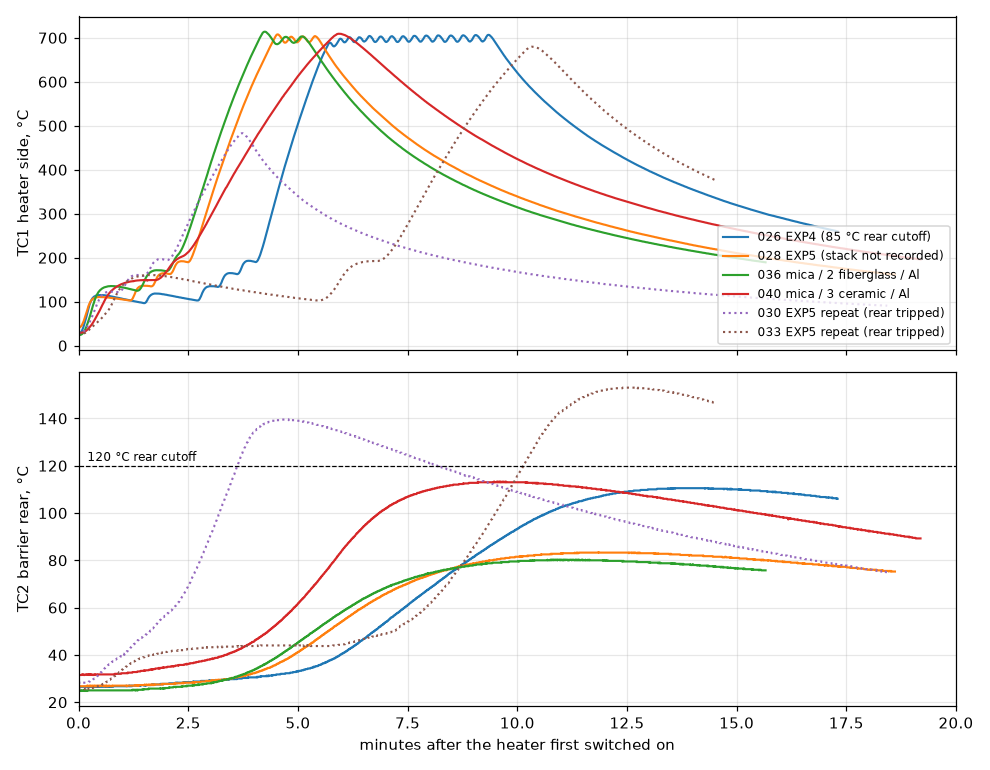
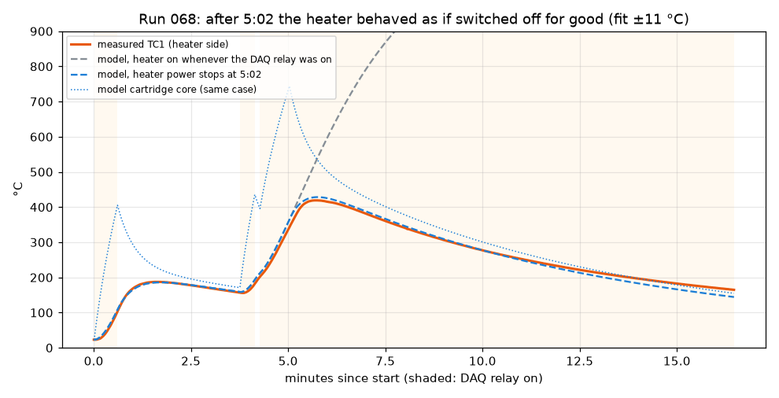
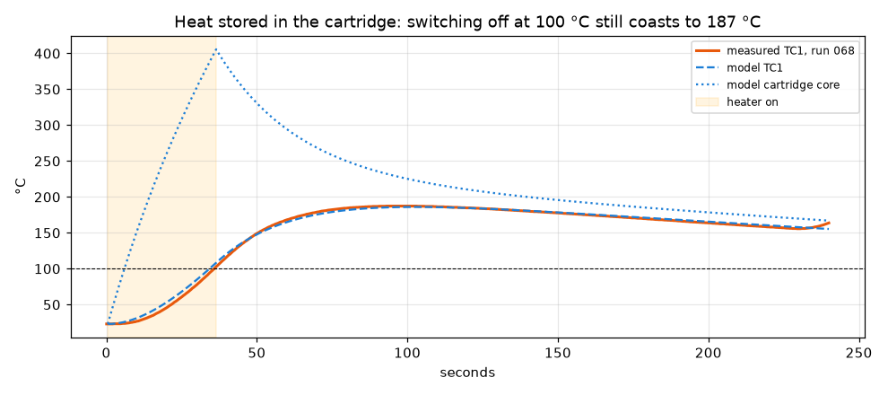
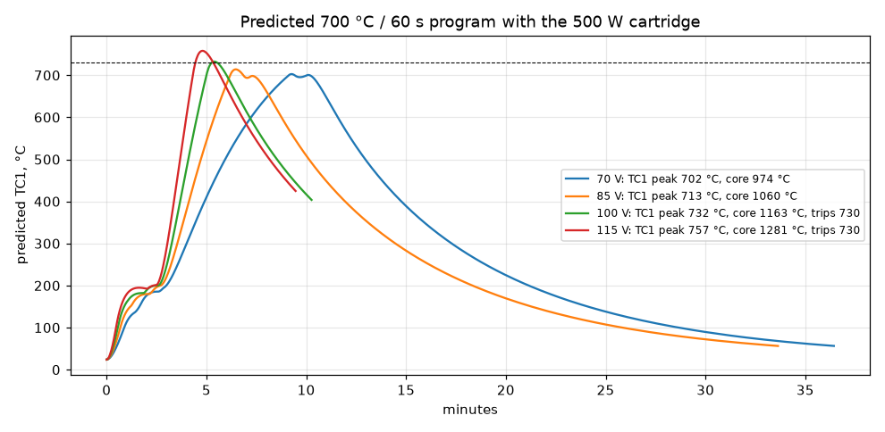

# What the runs show (runs 001–068)

Written 2026-11-20 from the raw data. Every number below comes from `runs/NNN/data.csv` and
`events.csv` through the same code the DAQ page uses (`python analysis/analyze.py` regenerates
the figures and `metrics.json`). "Operator" means something Colin said at the time; nothing
here relies on the earlier assistant-written logs' conclusions.

Channels: **TC1 = heater side** (amplifier 2, pins 28/30/32), **TC2 = barrier rear**
(amplifier 1, pins 22/24/26) in every heated run. The earlier software called these raw TC2
and raw TC1; `runs/catalog.json` records the mapping per run.

## Timeline

| Date | Runs | What happened |
|---|---|---|
| Oct 30 | 001–006 | DAQ commissioned. Run 006: first heat, 1 mica layer, cartridge leaned on the block, no sand. |
| Nov 2 | 007–015 | Relay control (EXP2) built, 30 V. Thermocouple faults and swapped probes; no usable test. |
| Nov 6 | 016–026 | **017** first end-to-end run (1 mica / 2 basalt / 1 Al). **023** held 300 °C for 20 min at ~70 V. **026** first 700 °C (EXP4, 100 V). |
| Nov 9 | 027–033 | **028** completed EXP5: 700 °C, 60 s hold. 030 and 033 tripped the 120 °C rear cutoff. |
| Nov 13 | 034–059 | Fine sand. **036** (2× fiberglass) and **040** (3× ceramic) completed 700 °C / 60 s. The 300 W cartridge died at the end of 040 (open circuit); 044–059 heated nothing. |
| Nov 16 | 060–068 | New 500 W cartridge with an internal grounded TC. On the MAX31855 the internal TC faulted at heat-on (064). Selec TC513 on the internal TC instead (**068**); it switched the heater off once and never back on. |

## Key runs

| Run | Barrier (rear side last) | Heater, V | TC1 peak | TC1 → 700 °C | Relay on | TC2 rise | TC2 peak, when | Fitted rear gain |
|---|---|---|---:|---:|---:|---:|---:|---:|
| 023 | mica / 2 basalt / Al | 300 W, ~70 V | 303 °C (held 299 ± 2.4 for 20 min) | — | 9:53 | 55.8 °C | 83.8 °C at end, still rising | 0.21 |
| 026 | not recorded | 300 W, 100 V | 707 °C | 6:10 | 3:54 | 84.0 °C | 110.5 °C, 5:06 after TC1 peak | 0.21 |
| 028 | not recorded | 300 W, 100 V | 708 °C | 4:28 | 2:55 | 56.8 °C | 83.5 °C, 7:19 after | 0.20 |
| 036 | mica / 2 fiberglass / Al | 300 W, 100 V | 714 °C | 4:08 | 2:56 | 55.5 °C | 80.3 °C, 7:24 after | 0.20 |
| 040 | mica / 3 ceramic / Al | 300 W, 100 V | 710 °C | 5:47 | 4:54 | 81.8 °C | 113.3 °C, 3:48 after | 0.20 |
| 030 | not recorded | 300 W, 100 V | 483 °C | — | 2:29 | 111.3 °C | 139.5 °C, tripped 120 | 0.43 (±10 °C) |
| 033 | not recorded | 300 W, 100 V | 680 °C | — | 4:44 | 127.5 °C | 153.0 °C, tripped 120 | 0.28 |
| 068 | not recorded | 500 W, 100 V + TC513 | 419 °C | — | (TC513 in charge) | 86.3 °C | 110.0 °C | 0.38 |

*TC1 → 700 °C* is time from the heater first switching on. *Relay on* is total time heat was
permitted. *Fitted rear gain* is from a two-stage lag model of heat moving from TC1 to TC2
(see below): how many °C TC2 would eventually rise per °C of TC1 rise if both were held
steady. Lower is a better barrier.

## What we know

1. **The rear peaks long after the heater side.** In every 700 °C run TC2 kept climbing for
   3¾–7½ minutes after TC1 peaked and the heater was off (fig 1). Any pass/fail criterion on the
   rear has to include the cool-down; a rear cutoff stops the heater but not the rear rise
   (026: tripped at 85 °C, peaked 110.5 °C four minutes later).
2. **One barrier comparison exists, and it does not separate the barriers.** 036 (2× fiberglass)
   and 040 (3× ceramic) ran the same program. 040's rear rose 82 °C vs 55.5 °C, but 040 also
   needed 4:54 of heating instead of 2:56 to reach 700 °C, so it put in about 1.7× the energy
   (fig 4). Normalised by the fitted model, both barriers transmit the same fraction (rear gain
   0.20). With one run each and a cartridge that was failing during 040, **the data cannot rank
   fiberglass vs ceramic**. 026, 028, 036 and 040 all fit 0.20–0.21: in this rig the rear
   response is dominated by the sand and the geometry, not by which insulation is in the stack.
3. **Something changed between 028 and 030/033.** Same program, same afternoon, but the rear
   rose two to three times faster and tripped 120 °C. The stack was not recorded for any of
   these. The likely suspects are a layer missing or shifted, or the rear TC touching the
   aluminum near the heater. Record the stack every run (the page now asks for it).
4. **The cartridge stores a lot of heat.** In run 068, full power was cut when TC1 hit 100 °C
   and TC1 still climbed to 187 °C (fig 3). At full power the inside of the cartridge runs
   hundreds of degrees hotter than the external TC. Any "full power until X" step overshoots X;
   the old EXP programs' "100 °C hold" was really "coast to ~185 °C".
5. **An external reading of 700 °C means the cartridge interior is far above 700 °C.** When the
   TC513 cut the heater in run 068 (its internal TC near 650 °C), the external TC read about
   343 °C. Holding the external TC at 700 °C therefore needs the interior well past the 760 °C
   rating. That is the most likely reason the 300 W cartridge failed at the end of run 040
   (after three 700 °C runs, in sand that sheds heat poorly), and it is a hard limit for future
   700 °C tests: either accept consuming cartridges, or test at a lower external temperature.
6. **Run 068's TC513 did not regulate.** After 200 °C the DAQ relay stayed on for 12 minutes
   but TC1 peaked at 419 °C and then cooled. Replaying the run through the thermal model, the
   data matches (within 11 °C for 11 minutes) a heater that lost power for good at 5:02 and
   never came back (fig 2). If the TC513 had held its internal TC at 650 °C, TC1 would have
   settled near 515 °C. Check the TC513's control mode, setpoint (not SP.H) and output wiring
   before the next TC513 run.
7. **Controlled holds work.** Run 023 held 299.0 ± 2.4 °C for 20 minutes (on/off relay control,
   ~70 V). The rear was still rising at 84 °C when it stopped, so 30 minutes at 300 °C would
   have taken the rear past 85 °C with that stack.
8. **The MAX31855 cannot read the new cartridge's internal TC.** It is a grounded junction; the
   readings fault as soon as the heater circuit is powered (run 064). A 47 kΩ resistor to
   ground did not help. Use the TC513 (or an isolated amplifier) for the internal TC.

## The thermal model

`che126/model.py` describes the rig as four lumped nodes: cartridge core → heater-side TC
(TC1) → barrier middle → rear TC (TC2), with losses to room. Power is
`P = heater_W × (variac_V / rated_V)²` while the relay is on.

* Heater nodes were fitted to run 068's first 4 minutes (3 °C RMS), then checked against the
  rest of the run with the TC513 cut-off: 11 °C RMS up to 425 °C. They are for the **500 W
  cartridge**; the old 300 W cartridge ran hotter for longer.
* Barrier nodes are the median of the fits to 026, 028, 036 and 040 (1–3 °C RMS each).
* It drives three things on the page: the *Predicted run* in the Program tab, the *Predictive*
  controller (heat only while the model says TC1 would stay below the setpoint if the heater
  switched off now), and the practice rig (`python daq.py --sim`).
* Not validated above 425 °C with the new cartridge, or for the core temperature (never
  measured on the DAQ). Treat predictions as a guide and compare with the grey dashed line on
  the Live charts during real runs.

## Lessons for running the rig

* Write the full stack (layers, order, thickness, sand, TC positions) into *Setup* at the start
  of every run. Five of the eight key runs have no recorded stack.
* Use **Hold** (or Ramp) to approach a temperature; reserve **Full power until** for getting
  off room temperature. The Predicted run shows the overshoot before you heat.
* Keep the rear cutoff, but judge the barrier by the rear peak including cool-down.
* The relay is wired COM–NC: **the heater is on whenever the Arduino is unpowered or
  resetting.** Switch the variac on only after the page shows the board connected, and off
  before unplugging USB.
* Run the same program at least twice per barrier before comparing barriers.

## Suggested next experiments

1. **Repeatability baseline.** Same stack (1 mica / 2 basalt / 1 Al), program *Hold 300 C for
   30 min*, two runs. Gives the run-to-run spread every barrier comparison needs.
2. **Barrier ranking at a temperature the cartridge survives.** Same program for each stack
   (mica + 2 basalt + Al; mica + 2 fiberglass + Al; mica + 3 ceramic + Al; Al only as the
   control), two runs each. Compare the rear peak including cool-down and the fitted rear gain
   (both in the Runs tab).
3. **TC513 check before trusting it.** Program *TC513 650 C, 90 s*. Watch the TC513 display:
   the heater-side TC should level off (the model says about 500 °C) instead of falling.
4. **Validate the model at higher temperature.** One *Hold 500 °C* run with the new cartridge;
   compare actual vs predicted (grey line). If they disagree, refit (ask an agent to rerun
   `analysis/analyze.py` and update `DEFAULT_MODEL` in `che126/model.py`).
5. **Only then 700 °C runs**, at 85–100 V, accepting that the cartridge may not survive many.
