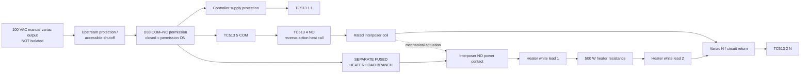

# EXP8: TC2 sequencing + Selec TC513 internal-temperature control

## Scope and agreed operation

EXP8 uses the existing Arduino/DAQ for the external and rear thermocouples and for
the D33 heat-permission contact. A **Selec TC513** directly reads the cartridge's
internal grounded K thermocouple and regulates its own heater-output circuit.
There is no internal thermocouple input to the DAQ in EXP8.

Use `start exp8`, `next`, and `stop exp8`. START reloads `experiment8.toml`; the
100 V variac setting and TC513's 650°C setpoint are manual hardware settings, not
software voltage/output commands.

1. **HEAT_100:** D33 permits heat continuously until raw external **TC2** reaches
   100°C.
2. **HOLD_100:** permission is latched OFF and does not reheat while waiting.
3. **First NEXT:** always acknowledged; from HEAT_100 or HOLD_100 it immediately
   enters RAMP_200, even before 100°C. There is no operator-command temperature,
   phase-freshness, or TC513-PV gate.
4. **RAMP_200:** TC2 on/off control follows the same 100→200°C, 90-second
   reference as EXP7. Measured **TC2 ≥200°C**, not expiry of 90 seconds, enters
   BOOST_FINAL. NEXT in this phase is an acknowledged no-op.
5. **BOOST_FINAL / `WAIT_TC513_CONFIRM`:** D33 permission stays continuously ON.
   The TC513 independently regulates the internal thermocouple at its manually
   entered 650°C setpoint. The DAQ does **not** measure or infer that PV.
6. **Second NEXT, explicitly confirmed by the user:** when the operator observes
   **TC513 PV =650°C**, press `next`. This enters HOLD_FINAL and starts a
   **90-elapsed-second** timer; its reason is `TC513_TIMED_HOLD`. Another NEXT is
   acknowledged as a no-op and never restarts or extends the timer.
7. At expiry, COMPLETE commands permission OFF and cooldown logging continues.

Those entry/ramp and boost/hold transitions are the only NEXT transitions. NEXT
is acknowledged in every other state too, including idle and terminal states.
TC1 remains rear protection at 120°C. TC2 fault/stale handling and its 730°C
high limit remain active; existing heartbeat and STOP protection remain.
`feedback_cutoff_C` is therefore an **external TC2** limit in EXP8, independent
of the manual TC513 setpoint. There is no TC3 requirement and no automatic DAQ
650°C measurement. EXP8 retains the three raw CSV columns for compatibility,
but the UI hides the unused TC3 trace.

EXP8 intentionally uses `external_channel = 2` and `feedback_channel = 2`;
this alias is EXP8-only. `rear_channel = 1`, `phase_feedback_channel = 2`
throughout, `target_C = 650` is manual-TC513 metadata, `preheat_target_C = 100`,
`ramp_target_C = 200`, `ramp_s = 90`, `hold_s = 90`, and
`variac_voltage_V = 100`. EXP7 remains a distinct TC2/TC3/TC1 profile.

## Identify the exact TC513 before wiring

Read the **rear model/order-code label, supply-voltage label, output label, and
terminal printing**. Do not infer them from the front bezel or from “TC513”
alone. The numbers below were checked against the **rendered terminal diagrams**
on Selec OP292-V04 page 1 and the current manufacturer TC513AX datasheet page 2,
not merely against flattened PDF text.

| Exact documented variant / function | Terminals |
|---|---|
| TC513A / TC513AX supply on the 85–270 VAC/DC manual variant | **1 L(+), 2 N(−)** |
| TC513A / TC513AX internal K thermocouple | **6 TC+, 7 TC−** |
| TC513A relay output (SPST) | **4 NO, 5 COM**; terminal 3 is not an AX NC contact |
| TC513AX relay output (SPDT) | **3 NC, 4 NO, 5 COM** |
| TC513AX SSR-drive output, when that output is selected | **10 SSR+, 12 SSR−** |

These are conditional mappings, not a universal TC513 pinout. **Relay and SSR
outputs use different terminals and only one control output is available at a
time.** Do not use the SSR terminals as a second relay contact, DAQ signal, or
independent alarm output. A BX, another suffix, or a different 24 V/order-code
variant can have a different map: follow that unit's own rear diagram/manual
instead. Never apply this A/AX table to an unidentified variant.

The OP292-V04/V05 instructions specify **85–270 VAC/DC**, with an optional
**24 VAC/DC** version; the current manufacturer product page/datasheet specifies
**90–270 VAC/DC** for the listed TC513AX models. Thus 100 VAC is within the
published mains-supply ranges, but the unit's own rating is decisive. **A 24 V
variant must not receive 100 V.** A fixed supply matching the nameplate is the
preferred alternative below; the requested common-OFF wiring instead supplies
the mains-rated controller from the switched variac output.

## EXP8 thermocouple and DAQ wiring

Make all changes with every power source disconnected and hot parts cool.

| Function | Connection |
|---|---|
| TC1 rear/barrier MAX31855 | CLK/DO/CS **22/24/26** |
| TC2 external/cartridge-side MAX31855 | CLK/DO/CS **28/30/32** |
| Former TC3/internal MAX31855 | **Unused/unplugged**; former map 34/36/38 is not an EXP8 feedback path |
| D33 relay-module signal | Existing 5 V active-HIGH module: S→D33, +→5 V, −→GND |
| 8440T32 internal K, yellow lead | TC513 **6 TC+** only |
| 8440T32 internal K, red lead | TC513 **7 TC−** only |
| 8440T32 two white heater leads | Fused heater-load branch only, never TC terminals |

The archived McMaster print for **8440T32** explicitly identifies a **grounded
K thermocouple**, yellow positive/red negative, a 500 W/120 V cartridge, maximum
sheath exposure **1400°F =760°C**, and maximum wire-lead exposure
**480°F =249°C**. The older 449°C lead figure belongs to the previous heater,
not this part. The sheath rating is not a promise that every mounting is safe at
that temperature.

Keep the internal thermocouple electrically and physically separate from both
the heater-power leads and every MAX31855/Arduino conductor. **Do not share it
with a MAX input and do not add the tried 47 kΩ negative-to-ground bias
resistor.** The Selec manual lists a K input but does not explicitly prove
compatibility with this grounded junction; this guide does not claim input
isolation, a leakage cure, or manufacturer confirmation of grounded-probe
support. Removing the known-unsupported grounded probe from the MAX31855 is not
evidence that the TC513 input is isolated.

Retain protective earth on the existing heater/fixture. A variac is a variable
voltage source, **not an isolation transformer**; controller `L/N` labels and
Arduino GND are not protective earth. Do not defeat PE to troubleshoot a sensor.

## Requested power topology: final OFF removes TC513 and heater power

The user explicitly requested the existing-hardware arrangement in which the
D33 permission contact is **before both the TC513 supply branch and the heater
load branch**. Consequently COMPLETE/OFF removes power from the controller as
well as the heater. This section documents that requested arrangement; the next
section is an alternative, not a silent substitution.

For a relay-output TC513A/AX using the manual-required interposing
relay/contactor, the functional connections are:



Use an interposer coil rated for the actual switched voltage and power contacts
suitable for the heater branch; do not assume a low-voltage or nominal 120 V coil
is suitable at the actual variac output. Follow the manual's load-connection and
noise-suppression diagrams for the selected interposer. The heater's separate
fused load branch must not be taken from TC513 supply terminals 1/2. **Powering
1/2 alone does not create a heater circuit:** the fused live load path must pass
through the controller output/interposer and the heater.

For the AX **SSR-output** selection, terminals 10/12 drive only a compatible SSR
input; the separate fused heater branch passes through that SSR's power contacts.
Do not connect the 500 W heater or a mechanical-relay coil directly to the 12 V
SSR-drive terminals. The same two-permission truth table applies.

| D33 series permission | TC513 control output | Controller supply | Heater load |
|---|---|---|---|
| Open | Any state | OFF in requested common-OFF topology | OFF |
| Closed | OFF | ON | OFF |
| Closed | ON | ON | ON only when the interposer/SSR load path is closed |

Opening the series contact removes the common feed; it is **not** an open-contact
bypass and does not force full power. The existing **COM–NC** D33 wiring can close
when the Arduino/relay coil loses power or resets, so reset/power loss can fail
permission ON. A serial OFF acknowledgement is not physical proof of power
removal.

### Existing-hardware direct-contact option (documented deviation)

If no DIY interposer is available, a mains-rated relay-output A/AX can be wired
with its **NO** contact (4–5) directly in the separately fused heater-live branch.
The older manual lists a 10 A resistive relay rating; the current AX datasheet
lists 10 A NO and 5 A NC. Neither fact changes Selec's explicit page-1
instruction: **“Although the relay output is rated at 10 amps it is always
necessary to use an interposing relay or contactor that will switch the load.”**
The direct-contact option therefore remains a **documented deviation from the
manufacturer's required load-connection practice**, not a manufacturer-approved
alternative; no claim of approval for this particular wiring is made. Never use TC513 NC for reverse-action heating; below setpoint the
reverse-action NO circuit is the heating call.

### Why common power cycling matters

In the requested topology, every TC2 OFF pulse can remove TC513 supply and every
ON pulse can reboot it. Expect display/controller startup delay and restarted
PID control operation. Auto-tune is optional; the operator chose to retain the
existing PID coefficients for this run, without claiming they were validated for
this cartridge. If auto-tune is used, keep its heating permission uninterrupted:
Selec states that power loss before completion restarts tuning at the next
power-on. BOOST_FINAL supplies continuous permission.

## Recommended alternative: fixed controller supply, heater-only permission

Where wiring changes are acceptable, power TC513 terminals 1/2 from a fixed supply
matching its exact rating and leave it on throughout TC2 control. Put the D33
series permission contact only in the fused heater-load branch. The TC513 output
and D33 permission are still both required for heater ON. This avoids controller
reboot/startup delay on each TC2 pulse; final OFF removes heater power but leaves
the TC513 display/controller powered. Optional shared-supply shutdown at the end
is possible, but fixed controller power during control is preferred. This is an
alternative to—not a replacement for—the explicitly requested common-OFF wiring
above.

## Front-panel setup and tuning

### Actual keys and menu labels

The three front keys are **■ (square/SV), ▼, and ▲**; there is no separate key
labeled SET. `R` is the control-output-ON indicator. During auto-tune the least
significant decimal point flashes rapidly and stops flashing rapidly on
completion. Menus time out after 30 seconds of inactivity. Locked SP/LV1/LV2
items cannot be changed until unlocked in the protection level.

| Action | Key operation |
|---|---|
| View setpoint (SV) | Press **■** |
| Change setpoint | Hold **■ + ▲** to increase or **■ + ▼** to decrease |
| Enter Level 1 | Hold **▼** for 3 seconds |
| Enter Level 2 | Hold **▲** for 3 seconds |
| Enter protection level | Hold **▲ + ▼** for 3 seconds |
| Previous/next parameter in a menu | Press **▼ / ▲** once |
| Decrease/increase a parameter | **■ + ▼ / ▲** |
| Exit configuration | Hold **▲**, **▼**, or **▲ + ▼** for 3 seconds |

Seven-segment labels below follow the rendered OP292-V04 page-3 menu. `Cnt`,
`ACt`, `tUn`, and the single-letter PID fields are menu displays, not invented
PID values.

| Menu | Display | EXP8 setting/action |
|---|---|---|
| Level 1 | `InP` | Select **K**, matching the connected sensor |
| Level 1 | `UnT` | Select **°C** |
| Level 1 | `S.P.L`, `S.P.H` | Set limits so SV=650 is permitted; do not treat SP.H as a safety trip |
| Level 1 | `FtC` | Input filter 0.2–10.0 s; retain or adjust from observed noise/response, not a guessed universal value |
| Level 1 | `ACt` | Select **rE / reverse** for heating: output ON below SV and OFF above SV |
| Level 1 | `Cnt` | Select **PId** for auto-tune PID, or **OnF** for the on/off alternative |
| Level 2 | `tUn` | For PID, select ON to start auto-tune |
| Level 2 | `P`, `I`, `d` | Auto-tuned proportional band, integral minutes, derivative seconds; no universal hand-entered coefficients |
| Level 2 | `CY.n`, `CY.t` | Cycle-time mode/value; auto-tune computes cycle time in PID mode |
| Level 2 | `HYS` | On/off hysteresis only (`Cnt=OnF`), 0.1–99.9° |
| Online | SV | Enter **650°C** with ■ and ■+▲/▼ |

`S.P.H` is only the allowed setpoint ceiling, not the operating setpoint.
Press ■ to view the actual SV and set **SV=650°C** separately. Normal operation
uses the process-temperature display; no tuning/menu screen needs to remain open.

For initial configuration, follow Selec's instruction to disconnect the output
connections on first power-up. Reconnect the selected output/load circuit only
with power off and after confirming the variant, supply, and terminal map.

### PID auto-tune with the available EXP8 commands

The lower TC2 phases can interrupt either controller power (common-OFF topology)
or heater-load permission (either topology), so neither lower phase provides the
uninterrupted process operation auto-tune needs. Use BOOST_FINAL itself:

1. Complete the selected wiring with power off. Use `start exp8`, then the
   **first** `next` to enter the TC2 ramp. At measured TC2 ≥200°C, EXP8 enters
   BOOST_FINAL and holds D33 permission continuously ON. In the requested
   common-OFF topology, let the TC513 boot. With uninterrupted BOOST_FINAL
   permission now active, confirm/set K, °C, reverse action, `Cnt=PId`, and
   SV=650°C as above, but do not enable tuning yet.
2. Only after those BOOST_FINAL checks, set `tUn=ON`.
   Keep the heater/load and sensor in their actual final thermal arrangement.
   **Do not press the second NEXT during tuning:** the operator-confirmed second
   NEXT would enter the 90-second final hold and end it before a multi-cycle
   tune can finish.
3. Selec says auto-tune computes **P, I, D, ARW%, and CY.t** from the process.
   Let it run through its actual heat/cool cycles without STOP, reset, TC2
   permission changes, or supply interruption.
4. Wait until the rapid decimal-point flashing stops. The manual says that if
   tuning has not completed after **3–4 cycles**, suspect failure and check
   wiring/parameters such as control action and input type. Three or four
   thermal cycles are **not 90 seconds** and can include substantial overshoot.
5. Record the resulting P/I/D/ARW/CY.t values, turn `tUn=OFF`, and use
   `stop exp8` to end the tuning run and command permission OFF. After the
   apparatus is ready, `start exp8` creates a fresh actual experiment; its second
   NEXT is reserved for the observed 650°C point in that run. Repeat auto-tune
   after a setpoint or process change. If power is interrupted before completion,
   Selec says tuning restarts at next power-on.

The fixed-controller-supply alternative avoids controller reboots, but its heater
load permission still cycles in the lower phases; it does not remove the need to
run the tune during uninterrupted BOOST_FINAL permission.

For a **mechanical relay/contactor**, use a cycle time appropriate to its
switching life and the slow thermal process; do not apply fast SSR-style PWM or
subsecond cycling merely because `CY.t` permits 0.1 s. The documented range is
0.1–99.9 s. Inspect the auto-tuned value and choose any slower mechanical-relay
setting from observed switching/thermal behavior rather than a generic number.
SSR drive is the different output mode for a compatible SSR, not a reason to
cycle mechanical contacts rapidly.

### On/off alternative

Set `Cnt=OnF` and retain `ACt=rE`. In reverse mode the manual turns the relay ON
up to the set temperature, OFF above it, and ON again slightly below SV. Choose
`HYS` from acceptable observed temperature swing and mechanical switching rate;
do not copy an unvalidated universal hysteresis or PID coefficient set. PID
`tUn`, P/I/D, ARW, and PID cycle-time tuning are not substitutes for selecting
this on/off mode.

A 650°C setpoint is not a guaranteed absolute ceiling: PID/on-off overshoot,
sensor/controller faults, and contact faults can exceed it, and this accepted
EXP8 build does not add an independent internal high-limit cutoff.

## Heater electrical estimate

For the documented **500 W, 120 V** heater, the nominal resistance estimate is

```text
R ≈ V²/P = 120²/500 = 28.8 Ω
```

At an ideal 100 V RMS with that same resistance:

```text
P ≈ 100²/28.8 = 347 W
I ≈ 100/28.8 = 3.47 A
```

These are nominal approximations, not measured hot resistance, actual variac
output, power, or contact/branch sizing approval. The McMaster print separately
lists 4.17 A at 120 V.

## Lessons carried forward from the failed internal-MAX attempt

- A **47 kΩ thermocouple-negative-to-ground resistor was tried and FAILED** to
  make the internal channel usable. EXP8 does not repeat that bias modification.
- The saved 8440T32 McMaster PDF confirms **Thermocouple Sensor Type: Grounded**.
  This resolves the probe-construction question; it does not prove that every
  controller input is compatible with a grounded junction.
- EXP7 **run064 on 2026-11-16, 10/27** samples recorded **TC3 NaN =37.0%**.
  The first TC3 NaN was at 18:29:32.363 UTC, about **0.711 s after** the first
  `heater_on=True` report at 18:29:31.652 UTC. TC1 and TC2 stayed finite with no
  fault flags for all 27 run064 samples; this is channel stability, not accuracy
  calibration.
- Run064 retained only the aggregate `TC3_fault` flag, **not the raw MAX31855
  fault-bit codes**. Grounding, open circuit, short, wiring, and noise therefore
  cannot be ranked from that recording; root cause remains **unproven**.
- The user explicitly chose the manual second-NEXT-at-650 procedure with no
  TC513/operator-command gates. EXP8 removes the former internal DAQ software
  high limit, leaves TC3 out of the control path, and retains the documented NC
  reset-can-fail-ON limitation.

## Software verification and hardware status

Integration verification passed the native controller checks and **33 Python host
checks**. The actual `.ino` and actual hub ran through an isolated PTY: TC3 NaN
was ignored, TC2 reached the 100°C latch and 200°C handoff, BOOST_FINAL waited
100 virtual seconds without starting the hold, the second NEXT started a
**90,000 ms** hold, duplicate NEXT did not reset it, and COMPLETE commanded OFF.
Browser UI and offline reports were exercised; Mega ADK compilation produced
22,894 bytes flash/1,380 bytes RAM and the Nix launcher built. There was **no
firmware upload, live DAQ restart, physical relay/heater action, or real TC513
PV/tuning validation** in that verification.

On the subsequent operator-requested deployment, EXP8 firmware was uploaded to
the Mega ADK on `/dev/ttyACM0`, and the live DAQ restarted as
`che126daq-exp8-live.service` with `--wait-for-start`. Real board telemetry was
fresh IDLE/commanded OFF with finite TC1/TC2 readings. An EXP8 NEXT command was
acknowledged as an IDLE no-op without arming heat. No heating START was sent.
The live idle display was corrected to select the EXP8 TC2/TC1 two-panel layout,
even when a plain recording still carries legacy metadata; archived views retain
their saved channel mappings.

## Archived manufacturer sources

- [Selec OP292-V04 operating instructions](../references/datasheets/Selec-TC513-Manual.pdf), especially p. 1 supply/load/TC513A/AX terminals and p. 2–3 keys, auto-tune, menus. Source: [Tecnoedu PDF](https://tecnoedu.com/Download/ManualSelecTC513.pdf).
- [Selec OP292-V05 operating instructions](../references/datasheets/Selec-TC513-TC203-TC303-Manual.pdf), same model family with explicit “one output at a time.” Source: [Enika PDF](https://www.enika.cz/data/files/produkty/komponenty/mereni-a-regulace/TC513_TC203_TC303_MAN.pdf).
- [Manufacturer TC513AX instruction manual](../references/datasheets/Selec-TC513AX-Instruction-Manual.pdf) and [current TC513AX datasheet](../references/datasheets/Selec-TC513AX-Datasheet.pdf), downloaded from Selec's [TC513AX product page](https://www.selec.com/product-details/temperature-controller-digital). Current product specifications differ from the older manual's lower supply bound, so the physical order-code/nameplate remains decisive.
- [McMaster 8440T32 exact product print](../references/datasheets/McMaster-8440T32-Internal-Thermocouple-Heater.pdf), pp. 1–2: 500 W/120 V, grounded K sensor, yellow/red polarity, 760°C sheath and 249°C wire-lead limits. Source: [McMaster 8440T32](https://www.mcmaster.com/8440T32/).
- [MAX31855/Arduino wiring and safe power order](wiring.md). EXP8 does not connect the grounded internal probe to the MAX31855.
