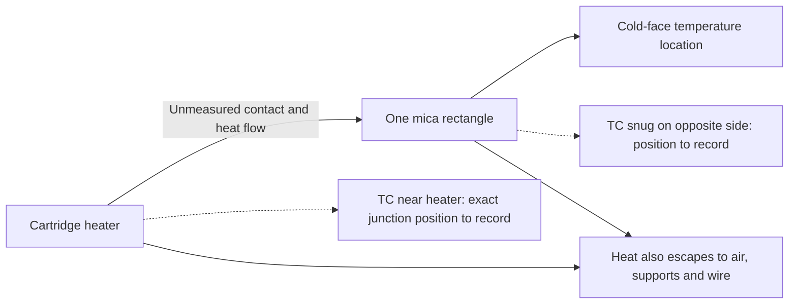

# Experiment log

## 2026-10-30 — Working setup and first checks

**Source:** Colin's setup rundown and clarifications in this session. This entry records what was reported, not a claim that the assistant inspected or operated the fixture. It takes precedence over conflicting older design drafts when describing the current plan.

### What we are trying to learn

Compare how different clamped insulating stacks change the two measured temperatures over time, and find out how much confidence these two thermocouples can support. The intended later test is about a 30-minute exposure with acceptable temperatures and useful repeatability. The acceptable temperature, power history, and repeatability threshold have **not** been selected.

This is a practical capstone proof of concept. The first checks should expose the big confounders, not pretend to certify a material or recreate a battery thermal-runaway event.

### Hardware and material status

- Heater: ordered McMaster **4877K305**, documented in the downloaded heater PDF. A variac is the current working assumption for supplying adjustable power; exact model, isolation arrangement, instruments, and independent protection have not been identified. No closed-loop control is being assumed.
- Fixture: a cinderblock and sand. The sand currently present is **semi-wet QUIKRETE**, according to Colin. The order sheet links QUIKRETE All-Purpose Sand, not a concrete mix; verify the bag label before treating that identification as inspected fact.
- Acquisition: Arduino Mega ADK and two MAX31855 amplifiers; Colin reports the amplifiers are now connected. Two thermocouples are available. Current probe SKU and electrical isolation are still to be checked.
- Samples: **2-inch-wide × 6-inch-tall rectangles**, cut so the layers can be clamped together.
- Mica and other non-aerogel materials are available; **aerogel has not arrived**.
- Mechanical check already reported: clamps at the top and a clip at the bottom held the assembly firmly. This is evidence of workable handling, not measured contact pressure or thermal-contact repeatability.

### Candidate later stacks — hot to cold

| Candidate | Layer order | Status |
|---|---|---|
| A | Mica → basalt fabric → aluminum | Planned comparison |
| B | Mica → basalt fabric → aerogel → aluminum | Planned; waiting for aerogel |
| C | Mica → aerogel → aluminum | Planned; waiting for aerogel |

Other variations are possible; none are locked in. Aluminum is intended as a backing/workholding layer that helps clamp soft materials against the mica hot-side face. Aluminum alloy, thickness, exposed area, and clamp details have not been confirmed. The older ChatGPT scenario used an aluminum thickness; that is **not** a measurement of the actual backer.

**Important distinction:** the earlier calculation supports negligible *added ideal through-thickness resistance* for its assumed thin aluminum sheet. It does not establish negligible effect on local temperatures, lateral heat spreading, heat loss, or clamping contact. The choice to use aluminum is a practical working decision whose influence can be checked experimentally.

### Intended later assembled experiment

- Cartridge heater held next to the barrier.
- Hot-side thermocouple placed slightly off-center and wedged in as well as practical without sacrificing heater/barrier contact. Exact junction position and which surface it senses must be photographed.
- Ordered battery on the other side, with the second thermocouple near that interface. Colin described the battery as largely cosmetic; its temperature, contact, and thermal mass would nevertheless change the measurement.
- Sand packed around the assembly to hold/support it during the later experiments.
- Repeat each selected configuration to judge consistency.

The battery is not an inert fixture component. An inert surrogate is recommended for initial thermal checks; any real-cell heating needs a separate reviewed plan. This recommendation has not been recorded as a user-adopted decision.

### Today's first mica-only check

**Reported assembly, not yet a completed heating result:**

1. Cartridge heater with one thermocouple held immediately beside it using wire.
2. One mica layer.
3. Second thermocouple snug against the other side of the mica, also held using wire.
4. For these early checks, the assembly is leaned against the cinderblock wall rather than deliberately packed into sand. Whether existing sand touches it, and where the block supports it, still needs a photo/note.
5. No basalt, aluminum backer, or aerogel was reported in this specific first-check stack. No battery was reported in this specific first-check stack.

The immediate aim is to check temperature acquisition, channels, fixture contact, and variac/power recording, and see whether the temperature differences are consistent with a plausible heat-transfer picture. A conductivity comparison with the McMaster mica value is a **conditional consistency check**, not an independent measurement of conductivity.

This is a heat-path sketch, not a scale drawing or a statement that the hot TC directly measures the mica surface. If it instead reads the sheath, contact resistance lies between the hot reading and the mica.

### Clarification: air versus sand is an experiment, not a nuisance to hide

Colin wants short exploratory tests, including air-supported versus sand-packed arrangements, to learn what the two probes can establish and how representative the eventual packed fixture is. That is part of the plan.

Compare these as **different boundary conditions** at matched recorded input and geometry. A trace closer to a calculation using catalog conductivity is not automatically more accurate: unmeasured contact area, heat losses, probe placement, and sand moisture can move a trace toward that calculation for unrelated reasons. Start with a reproducible dry-sand condition before adding deliberately controlled moisture; do not silently treat today's semi-wet sand as a known material property.

### What has and has not been demonstrated

- **Reported complete:** sample size chosen; practical top-clamp/bottom-clip holding check; amplifiers connected; first-check components physically arranged as described.
- **Historical only:** older water/reference-thermometer spot-check in the design document. It is not a new measurement from today or a full-range calibration.
- **Not yet demonstrated in this record:** a successful heated mica trace, electrical power measurement, steady state, repeatability, known cross-mica heat flow, catalog-conductivity agreement, or equivalence of air and sand fixtures.
- The assistant has not selected a variac setting, energized the heater, or approved the mains installation.

### Practical stop points before heating

Resolve these with the lab's responsible person rather than improvising around them:

- The heater product describes installation in a close-fitting drilled/reamed metal hole and requires separate temperature control. A cartridge leaned against a sheet/block is not that documented installation; maximum exposure temperature is not a guarantee against internal overheating in this geometry.
- Wet sand and mains-heater terminations are not an approved combination by default. Keep electrical connections dry and enclosed; verify the actual heater's moisture/insulation condition, sheath protective-earth continuity, fuse/GFCI and accessible disconnect. A two-prong cord order does not establish protective earthing. A variac is not assumed to be isolated or an over-temperature cutoff.
- If the probes match Adafruit #3245, the sensing junction is connected to the stainless tip. Check compatibility with the MAX31855 and an earthed metal sheath. Do not disconnect protective earth to cure a thermocouple fault.
- Keep the real battery out of initial fixture/debugging tests. A cell described as cosmetic still stores energy and can be damaged by heat.

Sources and product limits: [current-check-sources.md](current-check-sources.md). Suggested small experiments: [quick-checks.md](quick-checks.md). Executed calculations and conditional plots: [../models/mica-check/results.md](../models/mica-check/results.md).

### Photos / observations that would remove the most ambiguity

1. **Whole first-check assembly:** heater, both probe tips, mica edges, wire, block support and any sand contact, with a ruler in frame.
2. **Close-up of each probe junction/contact:** identify channel, distance from heater centerline, and whether it touches sheath, mica, wire, or more than one surface. Photograph before and after a repeat.
3. **Electrical arrangement, with power disconnected:** heater markings/lead end, variac model label, protective-earth arrangement and meters. No exposed energized work for a photo.
4. **Clamping and layer edge:** show top clamps/bottom clip, overlap, thickness measurement points and whether metal spans hot to cold.
5. **Sand condition:** bag label and a view showing fill height, packing, and heater/probe positions. Record sand mass and preparation/condition alongside the image.

These are suggested evidence to capture, not invented missing photographs or a requirement for elaborate documentation.

## 2026-11-06 — Test-day restart and previous-session outcome

- Colin reported that the previous session did not reach an experimental run because of too many thermocouple issues. Treat the saved troubleshooting/heat-gun acquisition as commissioning data, not a completed controlled cartridge/barrier hold. Further lessons were not supplied because copy/paste failed; no additional observations are inferred.
- Existing evidence: run 014 contains faults on both channels and serial disconnections; run 015 contains repeated TC2 faults and a serial disconnect, ending with application shutdown. These events do not establish whether the root cause was probe contact/grounding, wiring, amplifier, USB connection or another issue.
- Current saved `experiment.toml`: target 300°C, hysteresis 3°C, TC1 cutoff 320°C, enabled TC2 cutoff **85°C**, prediction lead 5s, minimum OFF time 5s, hold band ±5°C, hold duration 1800s. The 85°C value supersedes the earlier 140°C operating choice for the next START; saved settings are not proof of board-applied settings.
- Test-day inspection found the localhost DAQ endpoint unavailable, no matching DAQ/Arduino process, and no `/dev/ttyACM*` device. No serial port was opened, board reset/upload performed, settings changed or heating command issued.
- Immediate diagnostic priority: establish stable channel readings and identify whether faults follow a probe, amplifier/channel or fixture contact, with heater power disconnected and wiring changes made unpowered. Grounded-tip/MAX31855 incompatibility remains a possibility, not a confirmed diagnosis; do not remove protective earth to suppress faults.

## 2026-11-06 — Run 017 reversed probes; EXP3 preparation

- Operator reported that the two probes were accidentally reversed in run 017: physical/raw channel 1 measured the opposite barrier face and physical/raw channel 2 measured the heater. Added this correction through the running hub's `note` command; raw CSV columns and existing samples were not rewritten.
- The recorded `TC2_LIMIT` event at 17:36:27 UTC therefore acted on the heater probe under the applied 85°C cutoff, not the intended rear-side probe. This is not evidence of a successful 300°C hold or of the rear-side cutoff operating on its intended location.
- Split the live graph into independently scaled temperature panels: logical TC1/heater blue from raw TC2; logical TC2/rear orange from raw TC1. Labels preserve the raw-channel identity. Run-specific historical interpretation prevents this correction from silently swapping other old runs.
- Operator requested EXP3 with a 65V manually set preset and the existing temperature/timing settings. At nominal 48Ω this is 88.02W ON power, 4.694 times the 30V nominal power; no voltage-based temperature rescaling or physically validated retuning is claimed.
- Operator selected **prepare now, deploy after recording**. The active v3 firmware/host and recording are left running. Correcting the displayed labels does not change the current controller's input mapping; EXP3's board-local swap requires the later firmware upload and host restart.

## 2026-11-06 — Run 017 closeout and EXP3 deployment

- Operator described the completed test as the **first successful test**, with **1 mica layer, 2 basalt-fabric layers and 1 aluminum layer**. Recorded this assessment in run 017's notes. Hot-to-cold order, thicknesses, sand condition and actual voltage history were not established by this closeout.
- Finalized run 017 by the DAQ `stop` command: **2504 samples**, approximately **1250.91s** between first and last saved samples. Both raw channels had zero nonfinite temperature samples in this run. Corrected rear/raw TC1 peak was **29.25°C**; corrected heater/raw TC2 peak was **85.75°C**. The recorded controller trip was `TC2_LIMIT` under the 85°C setting, acting on the reversed heater probe. This is a successful trial by the operator's assessment, not a completed 300°C/30-minute hold.
- Uploaded the previously verified v4 firmware, restarted the DAQ with `--wait-for-start`, and reopened the browser terminal. Confirmed real-board v4 IDLE/commanded OFF with live readings and no recording allocated; run 018 remained available for the next explicit `start exp3`. No heating START was issued during deployment.
- Added the reported stack as comments in `experiment3.toml`, so the next run's exact config snapshot carries it. EXP3 remains target 300°C, heater cutoff 320°C, enabled rear cutoff **85°C**, swap enabled, 65V manual-preset metadata, and the existing timing/hold settings.
- Clarification after operator question: the initial UI showed the board's inactive boot default rear cutoff **140°C**, not a raised EXP3 cutoff. The actual control swap and 85°C cutoff apply together on `start exp3`. Relabeled boot values explicitly to distinguish them from selected experiment settings.

## 2026-11-06 — Run 019 display correction and STOP evidence

- Operator reported still seeing combined graphs and a rapidly rising trace labeled TC2, questioned the swap/85°C trip, and required `stop exp3` to cut heat. Accepted the display report; the exact old tab/version was not captured, so stale browser code is a possible cause, not established fact.
- Live events show run 018 allocated at 18:00:01.418Z, then finalized when EXP3 START allocated run 019 at 18:03:54.036Z. Board acknowledged `swap_inputs=true`, heater cutoff 320°C, rear cutoff 85°C and target 300°C. A STOP sent at 18:04:26.789Z was acknowledged at 18:04:26.840Z as STOPPED/`heater_on=false`.
- Inspection's additional `stop exp3` returned already inactive/no STOP sent. Fresh telemetry remained STOPPED/OFF and run 019 kept recording. No real START, upload or serial reconnect was issued during this investigation.
- Saved run 019 heater/raw TC2 peaked at 113.5°C; rear/raw TC1 was approximately 30°C during inspection. The 85°C rear threshold does not apply to the heater after the swap. Cooldown from the heater peak was visible, but relay-contact state/current were not independently measured.
- Replaced the shared subplot figure with two distinct graphs and opened the versioned page. Verified every retained plotted value against its physical CSV/API channel: blue TC1/heater ← raw TC2; orange TC2/rear ← raw TC1. Historical 016 retained unswapped mapping, 017 retained its reversal. Native STOP/cutoff regressions passed.
