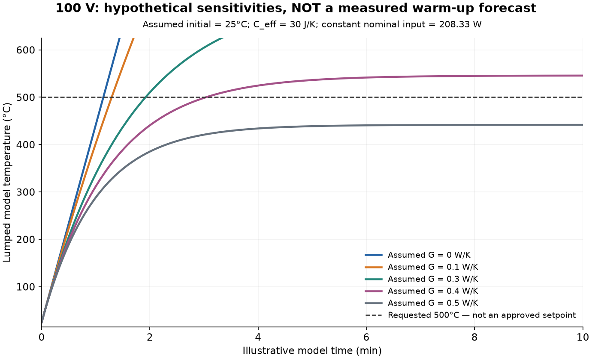

# 100 V → 500°C: calculation record

**No defensible apparatus time is available yet.** The table/figure below is a sensitivity illustration, not a probable range, measured trace, safe operating instruction or approved 500°C run.

## Nominal electrical input

[Heater rating](https://www.mcmaster.com/4877K305/): 300 W at 120 V. R_nom = V_rated²/P_rated = **48 Ω**. At **100 V RMS**, nominal **P = 208.333333 W**, **I = 2.083333 A**, assuming constant resistance. Actual input must be measured.

## Missing thermal information

A lumped illustration is `C_eff dT/dt = P − G(T − T_ambient)`. Here C_eff and G are unmeasured. With initial temperature equal to ambient and constant inputs, `T(t) = T0 + (P/G)(1 − exp(−Gt/C_eff))`. For G=0, `T(t)=T0+Pt/C_eff`. [Energy-balance source](https://apmonitor.com/pdc/index.php/Main/PhysicsBasedModels); [first-order response source](https://apmonitor.com/pdc/index.php/Main/FirstOrderSystems).

For an **assumed 25°C start**, the loss-free expression is `t = 2.280000 × C_eff` seconds when C_eff is entered in J/K. This is only a no-loss result for that assumed lumped capacity, NOT a known minimum for your unmeasured TC location or fixture.

For the same assumed ambient, linear **G = 0.438596 W/K** makes the equilibrium exactly 500°C, approached only asymptotically. Higher G never reaches the target in this model. This illustrates that a time can be finite or nonexistent; it does not identify the actual loss.

For temperature-dependent properties the corresponding energy-balance expression is `t = integral[C_eff(T)/(P(T) − Q_loss(T)) dT]`, provided net heating stays positive. Unknown radiation, conduction, moisture and sensor dynamics cannot be replaced by an invented constant G.

## Arbitrary scenarios — NOT estimates of actual parameters

All initial temperature, capacities, loss conductances and plotting choices are arbitrary analyst-selected sensitivities. They are NOT measured, fitted, sourced heater properties, confidence bounds, probable warm-up times, or operating recommendations. Assume one lumped temperature, constant capacity, rating-derived constant resistance, constant ambient, linear total heat loss and no sensor lag. Actual radiation, support conduction, mounting, sand moisture and heater internals can violate these assumptions.

| Assumed C_eff (J/K) | Assumed G (W/K) | Loss at target (W) | Model time to target (s) |
| --- | --- | --- | --- |
| 10 | 0 | 0.000 | 22.800 |
| 10 | 0.1 | 47.500 | 25.877 |
| 10 | 0.3 | 142.500 | 38.400 |
| 10 | 0.4 | 190.000 | 60.760 |
| 10 | 0.5 | 237.500 | Never |
| 30 | 0 | 0.000 | 68.400 |
| 30 | 0.1 | 47.500 | 77.631 |
| 30 | 0.3 | 142.500 | 115.201 |
| 30 | 0.4 | 190.000 | 182.281 |
| 30 | 0.5 | 237.500 | Never |
| 100 | 0 | 0.000 | 228.000 |
| 100 | 0.1 | 47.500 | 258.771 |
| 100 | 0.3 | 142.500 | 384.004 |
| 100 | 0.4 | 190.000 | 607.605 |
| 100 | 0.5 | 237.500 | Never |

## Reproduce / records

`python models/heater-timing/calculate.py` with numpy/matplotlib installed. NixOS: `nix-shell -p 'python3.withPackages (p: [p.numpy p.matplotlib])' --run 'python models/heater-timing/calculate.py'`. Edit `inputs.json`; `--inputs PATH --out DIRECTORY` is supported.

Saved: `inputs.json`, `calculate.py`, `results.json`, `sensitivity.csv`, `traces.csv`, `sensitivity.png`, `run.log`. JSON records executed code/input hashes and source URLs. No raw experiment data, fitted model or actual controller tuning parameters are fabricated.

Run plan and manual-versus-automatic control distinction: [heater-control-plan.md](../../docs/heater-control-plan.md).
