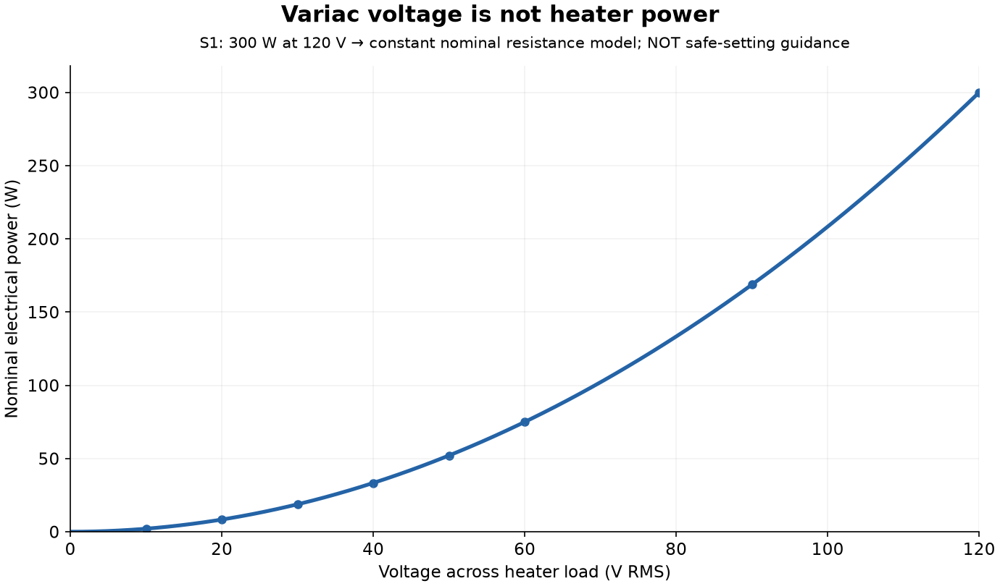
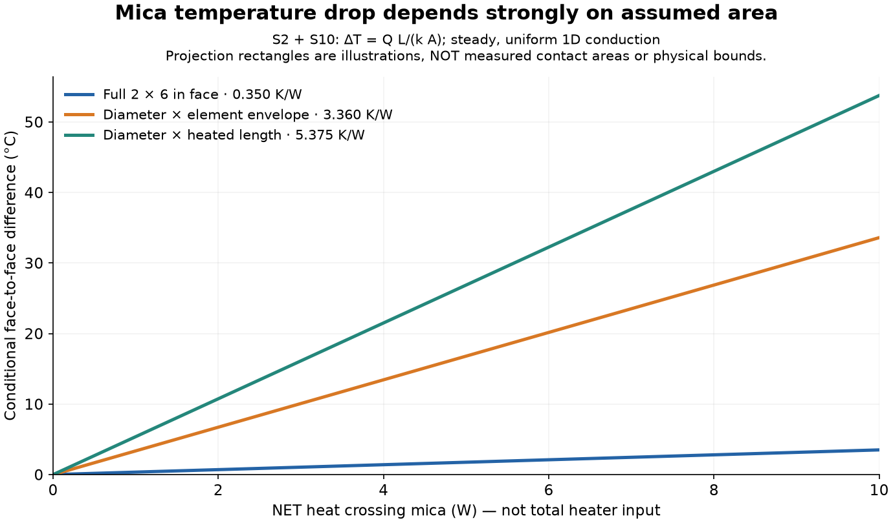
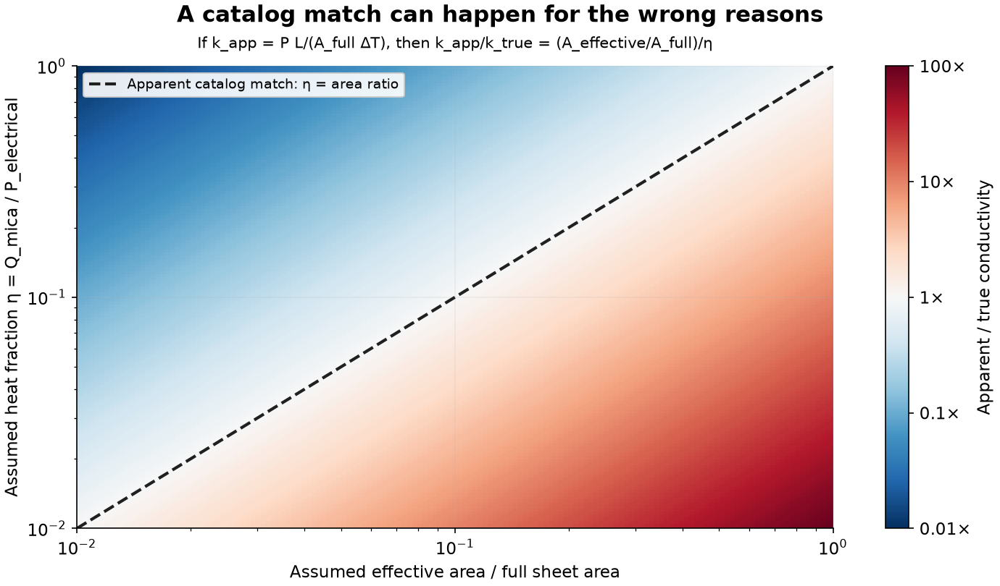

# Executed mica-check calculations

Conditional scenarios only. No measured heating data were supplied; no power setting is approved here.

## Reproduce / change assumptions

`python models/mica-check/calculate.py` regenerates this report, CSVs, JSON and plots. Edit `inputs.json`, or use `--inputs PATH --out DIRECTORY`. Sources: [source index](../../docs/current-check-sources.md). All geometry projections and heat fractions below are assumptions, not fits.

Dependencies are numpy and matplotlib. On NixOS: `nix-shell -p 'python3.withPackages (p: [p.numpy p.matplotlib])' --run 'python models/mica-check/calculate.py'`.

## Electrical input — S1

From the heater rating, R_nom = V_rated²/P_rated = **48 Ω**. Constant R is an approximation, not a resistance measurement. Actual current and power depend on the real heater and source. Table voltages are load RMS voltages, not dial positions.

| V RMS | Nominal A | Nominal W |
| --- | --- | --- |
| 10 | 0.2083 | 2.0833 |
| 20 | 0.4167 | 8.3333 |
| 30 | 0.6250 | 18.7500 |
| 40 | 0.8333 | 33.3333 |
| 50 | 1.0417 | 52.0833 |
| 60 | 1.2500 | 75.0000 |
| 90 | 1.8750 | 168.7500 |
| 120 | 2.5000 | 300.0000 |

## Mica benchmark — S2 + user geometry S10

L = **0.8128 mm**, k = **0.3 W/(m·K)**, full face A = **0.00774192 m²**. The 1D full-face resistance is **0.349956 K/W**. Thickness tolerance alone gives **0.314961–0.384952 K/W**; this is not a full uncertainty interval.

| Assumed area scenario | Area (m²) | R (K/W) |
| --- | --- | --- |
| Full 2 × 6 in face | 0.00774192 | 0.349956 |
| Diameter × element envelope | 0.00080645 | 3.359580 |
| Diameter × heated length | 0.00050403 | 5.375328 |

A cylinder touching a flat sheet does not make uniform contact across its diameter. Diameter × length is only a projection rectangle. Full face, envelope projection, and heated-length projection are NOT known bounds on the real plate/contact problem. Spreading/contact losses can invalidate each 1D approximation.

| Area scenario | Net crossing heat (W) | Conditional ΔT (°C) |
| --- | --- | --- |
| Full 2 × 6 in face | 1 | 0.3500 |
| Full 2 × 6 in face | 5 | 1.7498 |
| Full 2 × 6 in face | 10 | 3.4996 |
| Diameter × element envelope | 1 | 3.3596 |
| Diameter × element envelope | 5 | 16.7979 |
| Diameter × element envelope | 10 | 33.5958 |
| Diameter × heated length | 1 | 5.3753 |
| Diameter × heated length | 5 | 26.8766 |
| Diameter × heated length | 10 | 53.7533 |

## Example only: 30 V RMS → 18.7500 W nominal electrical input

η is an arbitrary illustration of the fraction crossing the mica. These rows are not a probable range, upper/lower experimental bound, recommended operating point or safe temperatures.

| Area scenario | Assumed η | Crossing W | Conditional ΔT (°C) |
| --- | --- | --- | --- |
| Full 2 × 6 in face | 0.1 | 1.8750 | 0.6562 |
| Diameter × element envelope | 0.1 | 1.8750 | 6.2992 |
| Diameter × heated length | 0.1 | 1.8750 | 10.0787 |
| Full 2 × 6 in face | 0.3 | 5.6250 | 1.9685 |
| Diameter × element envelope | 0.3 | 5.6250 | 18.8976 |
| Diameter × heated length | 0.3 | 5.6250 | 30.2362 |
| Full 2 × 6 in face | 1 | 18.7500 | 6.5617 |
| Diameter × element envelope | 1 | 18.7500 | 62.9921 |
| Diameter × heated length | 1 | 18.7500 | 100.7874 |

Neither surface temperature follows from ΔT alone. A sheath-mounted hot TC also includes unknown heater-to-mica contact effects. No absolute surface, sheath or element temperature is predicted.

## Why air versus sand cannot establish k by closeness alone

Let Q_mica = ηP and let the true effective area be A_eff. Under the ideal 1D relation, ΔT = ηP L/(k_true A_eff). If electrical P and full sheet area are used to infer conductivity, k_app/k_true = A_eff/(η A_full). Many wrong area/heat-fraction pairs therefore give a catalog-looking result. Contact drops and multidimensional paths add further ambiguity. This is an algebraic sensitivity illustration, not an inverse fit to this apparatus. [Plane-wall relation](https://web.mit.edu/16.unified/www/FALL/thermodynamics/notes/node118.html).

## Resolution versus partial error limits — S8

Output step: **0.25°C**. Adding the listed gain/offset and cold-junction terms conservatively gives **±4°C per channel**, or **±8°C for a difference of two channels** under the cited temperature conditions. This is a partial worst-case electronics budget, NOT a confidence interval or total probe accuracy. It excludes probe tolerance, mounting/contact offsets, thermocouple nonlinearity, spatial gradients and other effects. Correlated terms may cancel in a matched comparison, but that must not be assumed. Repeatability and a co-location/reference check can characterize observed mismatch; averaging does not remove systematic errors.

## What is reasonable to look for in the first check?

Look for saved, correctly labeled finite readings; stable reference/co-location behavior; the directly heated location responding when controlled input changes; a reproducible lag/difference at the other location; and continued logging through cooldown. A brief sign reversal during cooldown need not mean the channels are swapped. These are diagnostic patterns, not a numerical pass band. TCs can miss the hottest point, so their readings cannot guarantee heater safety.

The code intentionally does NOT produce time-to-temperature or a target variac setting. Conductivity alone gives neither heat capacity nor boundary losses. True contact geometry, initial state, heat-flow partition, moisture, support conduction and surface/contact temperatures are missing. A fitted curve could describe a run, but would not independently validate k or sensor accuracy.

## Saved evidence

`electrical.csv`, `geometry.csv`, `conditional.csv`, `results.json`, `power.png`, `area.png`, `ambiguity.png`. JSON records executed script/input hashes and source URLs. Original source PDFs are indexed in `../../docs/current-check-sources.md`. These artifacts are calculations, not raw acquired runs.
