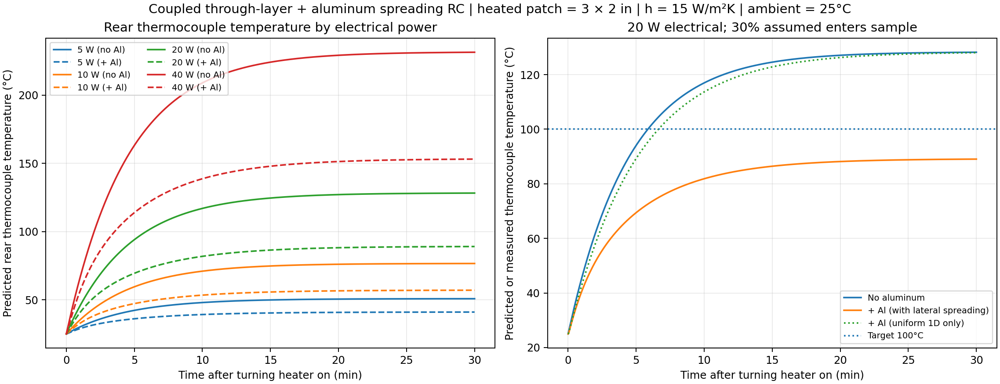
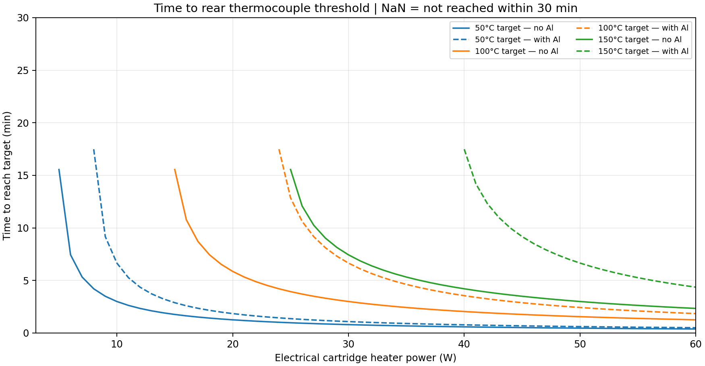
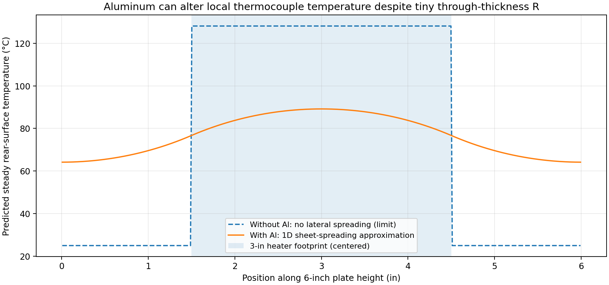

# Shared ChatGPT conversation: Calculate Thermal Resistance

Source: https://chatgpt.com/share/6ae4c9fc-e620-83e8-af32-5ab02745aa19

Captured 2026-10-30 from public page embedded conversation data; model claims are not independently validated.

## User

Okay. Imagine this expeirmentals etup: we have mica then this basalt fabric, laid flat in sheets. What I want you to do is calculate like the total thermal conductivity assumign resistors in a circuit and the area over the thermal conductivity thingy, this is 6 inches tall by 2 inches wide, and there is a cartridge heater on one side and a thermocouple on toher side just recording like heat over time and comparing it to the cartridge heater supposedly we know how much power we are giving it, yeah, dont w orry about that. what I need oyu to do is to do that calculation for the two layer setup, mica is first, touching the cartridge heater, and then the basalt layer, and then thermocouple on the other side. THEN, do teh same resistors in series area type approximation thing but imagine behidn the basalt fabric layer we have 0.225mm aluminum sheet, 6x2. how much woudl the aluminum change the total thermal conductivity? ideally an insignfiicant amount? uhhh, just assume the aluminum is whatever is the most common standard aluminum alloy found in general sheet metal applications and such.yeah. quickly run that math. preferably give me the python scripts you used to do the math. make graphs. its a 3 inch tall cartridge heater btw incase u need ot guage that. idk how many watts we gonna do. maybe make some kinda graph or series of graphs or sldiers that will change the results like time to reach certain temp depending on how much heat this cartridge heater is giving off. ideally, we would be able to test your nnumbers and approximations and see if the numbers we ge tcorrelate, thus validating our experimental setup, thermocouples, and if we can use this aluminum to help workhold without significantly altering performance over 2-3 tests, so wahtever experiment we run will be ran a few times to ensure consistency.

---

## User

Original custom instructions no longer available

---

## Assistant

# Thermal analysis: Mica + basalt fabric vs. mica + basalt + aluminum

**The aluminum is almost negligible as an additional *through-thickness thermal resistance*.** For your specified 6" × 2" stack, a 0.225 mm aluminum sheet increases the calculated conduction resistance by only **0.0232%**, assuming perfect contact between layers.

However, aluminum can have a considerably larger effect on the experiment's **heat-up time and spatial temperature distribution**. That distinction matters when you're using a thermocouple to validate your results.

<box gap={2}>
  <grid columns={3} gap={2}>
    <grid-item>
      <box background="surface-secondary" radius="lg" padding={3} gap={1}>
        <text color="secondary" size="2xs">Mica + basalt</text>
        <title size="lg" color="default" tabularNums>0.78696</title>
        <caption>K/W resistance</caption>
      </box>
    </grid-item>
    <grid-item>
      <box background="surface-secondary" radius="lg" padding={3} gap={1}>
        <text color="secondary" size="2xs">With aluminum</text>
        <title size="lg" color="default" tabularNums>0.78714</title>
        <caption>K/W resistance</caption>
      </box>
    </grid-item>
    <grid-item>
      <box background="surface-secondary" radius="lg" padding={3} gap={1}>
        <text color="secondary" size="2xs">Increase</text>
        <title size="lg" color="success" tabularNums>+0.0232%</title>
        <caption>Ideal conduction only</caption>
      </box>
    </grid-item>
  </grid>
</box>

## 1. Material properties and assumptions

I used the specifications in your two uploaded McMaster-Carr PDFs rather than substituting generic material values.

| Parameter | Mica | Basalt fabric | Aluminum |
|---|---:|---:|---:|
| Material | Phlogopite mica sheet | Basalt insulation strip | 3003-H14 alloy |
| Thickness | 0.8128 mm | 1.1906 mm | 0.225 mm |
| Conductivity, \(k\) | 0.300 W/(m·K) | 0.3519 W/(m·K) | 159 W/(m·K) |
| Plate dimensions | 6" × 2" | 6" × 2" | 6" × 2" |

The mica product lists 0.032" thickness and 0.3 W/(m·K) conductivity. The basalt product lists 3/64" thickness and 2.44 BTU·in/(hr·ft²·°F) conductivity, which converts to 0.3519 W/(m·K). The listed conductivity conditions are not identical: the mica's temperature-specific value is at 500°F, while basalt's is at 900°F. Consequently, this is a constant-property engineering approximation. <FileCite ref="turn0file0" line_range_start={13} line_range_end={45}/> <FileCite ref="turn0file1" line_range_start={13} line_range_end={24}/>

For the aluminum, I selected common general-purpose **3003-H14 sheet**, with thermal conductivity of approximately 159 W/(m·K). <Cite ref="turn183460search0"/>

## 2. Thermal-resistance calculation

Your electrical-resistor analogy is correct for steady-state, one-dimensional conduction.

<box border radius="lg" padding={3} gap={3}>
  <text weight="medium" size="sm">Configuration A — without aluminum</text>
  <svg viewBox="0 0 340 83" width="100%" xmlns="http://www.w3.org/2000/svg">
    <rect x="5" y="5" width="330" height="73" rx="7" fill="#888888" fillOpacity="0.07"/>
    <rect x="19" y="17" width="77" height="46" rx="3" fill="#C65C4A"/>
    <rect x="96" y="17" width="93" height="46" rx="2" fill="#C7A875"/>
    <rect x="189" y="17" width="107" height="46" rx="2" fill="#7C91A3"/>
    <path d="M296 40 H326 M320 34 L326 40 L320 46" fill="none" stroke="currentColor" strokeWidth="1.6"/>
    <g fontSize="11" textAnchor="middle" fill="#FFFFFF" fontWeight="600">
      <text x="57" y="36">Heater</text><text x="57" y="49" fontSize="9">hot side</text>
      <text x="142" y="36" fill="#30281D">Mica</text><text x="142" y="49" fill="#30281D" fontSize="9">0.813 mm</text>
      <text x="241" y="36">Basalt</text><text x="241" y="49" fontSize="9">1.191 mm</text>
    </g>
  </svg>
  <text weight="medium" size="sm">Configuration B — with aluminum</text>
  <svg viewBox="0 0 340 83" width="100%" xmlns="http://www.w3.org/2000/svg">
    <rect x="5" y="5" width="330" height="73" rx="7" fill="#888888" fillOpacity="0.07"/>
    <rect x="19" y="17" width="69" height="46" rx="3" fill="#C65C4A"/>
    <rect x="88" y="17" width="78" height="46" rx="2" fill="#C7A875"/>
    <rect x="166" y="17" width="83" height="46" rx="2" fill="#7C91A3"/>
    <rect x="249" y="17" width="47" height="46" rx="2" fill="#C1CCD8"/>
    <path d="M296 40 H326 M320 34 L326 40 L320 46" fill="none" stroke="currentColor" strokeWidth="1.6"/>
    <g fontSize="10.5" textAnchor="middle" fontWeight="600">
      <text x="53" y="43" fill="#FFFFFF">Heater</text>
      <text x="127" y="43" fill="#30281D">Mica</text>
      <text x="207" y="43" fill="#FFFFFF">Basalt</text>
      <text x="272" y="37" fill="#263747" fontSize="9">Al</text><text x="272" y="49" fill="#263747" fontSize="8">0.225</text>
    </g>
  </svg>
  <caption>Schematic only; widths are not proportional to thickness. The thermocouple measures the rear surface, immediately after basalt or aluminum.</caption>
</box>

The plate area is

\[
A=(6\times0.0254)(2\times0.0254)
=0.00774192\ \text{m}^2.
\]

For each layer, the conduction resistance is

\[
\boxed{R_i=\frac{L_i}{k_i A}}
\]

where \(L_i\) is thickness, \(k_i\) is thermal conductivity, and \(A\) is the area normal to heat flow.

### Configuration A: Mica + basalt

Mica:

\[
R_m=\frac{0.0008128}{0.3(0.00774192)}
=\boxed{0.349956\ \text{K/W}}
\]

Basalt:

\[
R_b=\frac{0.001190625}{0.351916(0.00774192)}
=\boxed{0.437006\ \text{K/W}}
\]

Adding the series resistances:

\[
\boxed{R_{\text{A}}=0.349956+0.437006
=0.786962\ \text{K/W}}
\]

### Configuration B: Mica + basalt + aluminum

Aluminum:

\[
R_{\rm Al}=
\frac{0.000225}{159(0.00774192)}
=\boxed{0.00018278\ \text{K/W}}
\]

Therefore:

\[
\begin{aligned}
R_{\text{B}}&=R_m+R_b+R_{\rm Al}\\
&=0.349956+0.437006+0.00018278\\
&=\boxed{0.787145\ \text{K/W}}
\end{aligned}
\]

The percentage increase is

\[
\frac{0.787145-0.786962}{0.786962}\times100
=\boxed{0.0232\%}
\]

That is a very small increase in the ideal thermal resistance.

### An important distinction: effective thermal conductivity

If you instead calculate the effective bulk conductivity of the entire stack,

\[
k_{\rm effective}=\frac{\sum L_i}{A R_{\rm total}},
\]

you obtain:

| Stack | Effective conductivity |
|---|---:|
| Mica + basalt | 0.32883 W/(m·K) |
| Mica + basalt + aluminum | 0.36567 W/(m·K) |

The apparent effective conductivity **increases by about 11.2%**. This is not a contradiction. The aluminum makes the stack thicker by 0.225 mm while adding practically no thermal resistance.

For your specific objective—determining whether adding aluminum changes the heat-transfer resistance—compare **K/W resistance**, not effective conductivity alone.

## 3. Temperature versus time: modeling your cartridge heater

The resistance calculations above describe steady-state heat conduction. To model the thermocouple's temperature over time, we also need thermal mass and heat losses.

For the following simulations, I used:

| Parameter | Assumed value |
|---|---|
| Cartridge heater electrical power | Variable, 5–60 W |
| Heat entering the sample | 30% of electrical power |
| Effective heated footprint | 3" × 2", centered |
| Total sheet dimensions | 6" × 2" |
| Initial/ambient temperature | 25°C |
| Rear heat-transfer coefficient | 15 W/(m²·K) |
| Contact between materials | Perfect |
| Mica/basalt specific heat | 840 J/(kg·K), assumed |

**The 30% heat-transfer fraction is an illustrative assumption, not a measured efficiency.** A real cartridge heater may have a much narrower contact patch than 2 inches, and the fixture may conduct heat away through other paths.

I calculated transient temperatures using a thermal RC network. It incorporates each material's heat capacity and, for aluminum, approximate lateral heat conduction along the 6-inch sheet.

### Graph 1 — Predicted thermocouple temperature vs. time



The solid curves show the system without aluminum. Dashed curves include aluminum spreading heat laterally across the sheet.

For the illustrative 20 W heater setting:

| Result | No aluminum | With aluminum |
|---|---:|---:|
| Rear temperature after 30 min | 128.2°C | 89.1°C |
| Time to 100°C | 5.86 min | Not reached |
| Aluminum contribution to bulk resistance | — | +0.0232% |

The aluminum can lower the *local* center thermocouple reading because it distributes the incoming heat over a larger surface area, which can then lose heat to the surroundings.

This is **not evidence that the aluminum is adding significant through-thickness insulation**. It is a different heat-transfer mechanism.

### Graph 2 — Electrical power vs. time to reach a temperature



For example, under the same assumptions:

| Heater power | No Al: time to 100°C | With Al: time to 100°C |
|---|---:|---:|
| 20 W | 5.86 min | Not reached |
| 30 W | 3.00 min | 6.65 min |
| 40 W | 2.04 min | 3.55 min |

These are conditional simulations, not guaranteed experimental outcomes.

## 4. Adjustable heating calculator

This interactive calculator uses a simplified first-order heating model and an analytical approximation for aluminum heat spreading. It is useful for quickly exploring scenarios; the downloadable Python model is more detailed.

{@body const [watt,setWatt] = DIL.useState(20)}
{@body const [coupling,setCoupling] = DIL.useState(0.30)}
{@body const [heatLoss,setHeatLoss] = DIL.useState(15)}
{@body const [targetT,setTargetT] = DIL.useState(100)}
{@body const scenario = DIL.useMemo(()=>{
  const ambient=25;
  const A=3*2*0.0254*0.0254;
  const q=watt*coupling;
  const bareSteady=ambient+q/(heatLoss*A);
  const lambda=Math.sqrt(159*0.000225/heatLoss);
  const a=6*0.0254/2;
  const b=3*0.0254/2;
  const spreadFactor=1-Math.sinh((a-b)/lambda)/Math.sinh(a/lambda);
  const alSteady=ambient+spreadFactor*(bareSteady-ambient);
  const rhoM=0.2*0.45359237/Math.pow(0.0254,3);
  const rhoB=1.75*0.45359237/Math.pow(12*0.0254,3);
  const cArea=rhoM*840*0.0008128+rhoB*840*(3/64*0.0254);
  const tauB=cArea/heatLoss+18;
  const tauA=Math.max(20,cArea/heatLoss-5);
  const data=Array.from({length:61},(_,i)=>{const minute=i/2;const t=minute*60;return {minute,bare:ambient+(bareSteady-ambient)*(1-Math.exp(-t/tauB)),aluminum:ambient+(alSteady-ambient)*(1-Math.exp(-t/tauA))};});
  const cross=(ss,tau)=>targetT<=ambient?0:targetT>=ss?null:-tau*Math.log(1-(targetT-ambient)/(ss-ambient))/60;
  const tb=cross(bareSteady,tauB),ta=cross(alSteady,tauA);
  return {bareSteady,alSteady,data,tb,ta,heat:q,spreading:spreadFactor};
},[watt,coupling,heatLoss,targetT])}
<box border radius="xl" padding={3} gap={3}>
  <grid columns={2} gap={3}>
    <grid-item>
      <box gap={1}>
        <text size="xs" color="secondary">Heater power: **{watt} W**</text>
        <slider min={5} max={60} step={5} value={watt} onChange={setWatt}/>
      </box>
    </grid-item>
    <grid-item>
      <box gap={1}>
        <text size="xs" color="secondary">Power entering sample: **{Math.round(coupling*100)}%**</text>
        <slider min={0.1} max={1} step={0.05} value={coupling} onChange={setCoupling}/>
      </box>
    </grid-item>
    <grid-item>
      <box gap={1}>
        <text size="xs" color="secondary">Effective heat-loss coefficient: **{heatLoss} W/(m²·K)**</text>
        <slider min={5} max={35} step={1} value={heatLoss} onChange={setHeatLoss}/>
      </box>
    </grid-item>
    <grid-item>
      <box gap={1}>
        <text size="xs" color="secondary">Target thermocouple temperature: **{targetT}°C**</text>
        <slider min={40} max={200} step={10} value={targetT} onChange={setTargetT}/>
      </box>
    </grid-item>
  </grid>
  <divider color="subtle"/>
  <grid columns={2} gap={3}>
    <grid-item>
      <text color="secondary" size="xs">No aluminum: target time</text>
      <title size="lg" color="default" tabularNums>{scenario.tb===null?"Not reached":scenario.tb.toFixed(1)+" min"}</title>
      <caption>Approx. steady temperature: {scenario.bareSteady.toFixed(1)}°C</caption>
    </grid-item>
    <grid-item>
      <text color="secondary" size="xs">With aluminum: target time</text>
      <title size="lg" color="default" tabularNums>{scenario.ta===null?"Not reached":scenario.ta.toFixed(1)+" min"}</title>
      <caption>Approx. steady temperature: {scenario.alSteady.toFixed(1)}°C</caption>
    </grid-item>
  </grid>
  <Chart content={{"chartType":"line","meta":{"footer":"Simplified transient and lateral spreading approximation; not a calibrated experimental prediction"},"xKey":"minute","xAxisScale":"linear","xAxisLabel":"Time (minutes)","series":[{"dataKey":"bare","label":"No aluminum","valueSuffix":"°C"},{"dataKey":"aluminum","label":"With aluminum","valueSuffix":"°C"}],"data":scenario.data}}/>
  <caption>Heater power delivered to modeled sample: {(scenario.heat).toFixed(1)} W. The heat-up estimates assume constant material properties and a uniform 3" × 2" heat-input region.</caption>
  <row justify="end">
    <button size="sm" color="secondary" variant="outline" onClick={()=>{setWatt(20);setCoupling(0.30);setHeatLoss(15);setTargetT(100);}}>
      <icon name="rotate-ccw" size="xs"/> Reset
    </button>
  </row>
</box>

## 5. Why the aluminum may significantly affect your measurement

Here is the crucial experimental complication.



In this idealized steady-state model, the heater supplies heat to the middle 3 inches, while the aluminum sheet extends across all 6 inches.

Without aluminum, the heat stays comparatively concentrated beneath the heater. With aluminum, heat can spread up and down the sheet.

This is why your thermocouple's **position** matters enormously. A thermocouple centered directly behind the cartridge may record a lower temperature with aluminum, while a thermocouple farther away may record a higher temperature.

Also, extra contact resistance can matter much more than the metal's own resistance. For example, an additional area-specific interface resistance of \(10^{-4}\ \text{m}^2\text{K/W}\) gives

\[
R_{\rm contact}
=\frac{10^{-4}}{0.00774192}
=0.01292\ \text{K/W}.
\]

That is over 70 times the aluminum's bulk resistance.

[View the interface contact sensitivity graph](../../models/thermal-stack/05_interface_contact_sensitivity.png)

## 6. Python scripts and experiment files

I created a runnable Python model with all five graphs, model predictions, and a template for your repeat measurements.

<box border radius="lg" padding={3} gap={3}>
  <row align="center" gap={3}>
    <icon name="file-archive" size="2xl" color="secondary"/>
    <box flex="1" gap={1}>
      **[Download complete thermal analysis package (.zip)](../../references/exports/mica_basalt_aluminum_thermal_model.zip)**
      <caption>Python source, five graphs, predicted temperatures, experiment CSV, instructions</caption>
    </box>
  </row>
  <divider color="subtle"/>
  <row align="center" gap={3}>
    <icon name="file-code-2" color="secondary" size="lg"/>
    <box flex="1" gap={1}>
      [Python source script](../../models/thermal-stack/thermal_stack_model.py)
      <caption>Reproducible calculations and graph generation</caption>
    </box>
  </row>
  <row align="center" gap={3}>
    <icon name="table" color="secondary" size="lg"/>
    <box flex="1" gap={1}>
      [Model predictions (.csv)](../../models/thermal-stack/thermal_predictions.csv)
      <caption>Time series for 5, 10, 20, 40 and 60 W</caption>
    </box>
  </row>
  <row align="center" gap={3}>
    <icon name="clipboard-list" color="secondary" size="lg"/>
    <box flex="1" gap={1}>
      [Three-repeat experiment data template (.csv)](../../models/thermal-stack/measurements_template.csv)
      <caption>Blank thermocouple readings for three trials in each configuration</caption>
    </box>
  </row>
</box>

Install the three required Python packages:

```bash
pip install numpy scipy matplotlib
```

Then run:

```bash
python thermal_stack_model.py
```

Or change the parameters:

```bash
python thermal_stack_model.py \
    --power 30 \
    --coupling 0.30 \
    --h 15 \
    --target 100
```

Once you've collected real measurements, fill the `TC_C` column in the template and run:

```bash
python thermal_stack_model.py \
    --power 20 \
    --measurements measurements_template.csv
```

The script overlays the experimental readings on the predictions and computes a root-mean-square temperature error for each run.

## 7. How I would validate your experiment

I would organize the tests as follows.

| Test | Configuration | Repeats | Main measurements |
|---|---|---|---|
| A | Heater → mica → basalt → TC | 3 | Time, temperature, power |
| B | Heater → mica → basalt → Al → TC | 3 | Same conditions |
| C | Same configurations, second heater power | 3 each | Sensitivity to power |

To evaluate repeatability, compare the measured temperature curves, their equilibrium temperatures, the time to reach attainable temperature thresholds, and the standard deviation between repetitions.

There are three requirements I would prioritize.

1. **Measure the hot-side temperature too.** One rear thermocouple and the heater's electrical power are insufficient to independently determine the stack's thermal conductivity. You need the actual heat flow through the stack and the temperatures across it, or a separately calibrated thermal model.

2. **Measure temperature at two positions on the rear surface.** Put one thermocouple directly behind the heater and another outside its 3-inch footprint. This is the easiest way to identify whether the aluminum is acting as a significant lateral heat spreader.

3. **Control the mechanical setup.** Use the same clamping pressure, contact area, thermocouple mounting method, initial temperature, and heater power for every run. Otherwise, changes in contact resistance may overwhelm the tiny bulk resistance added by aluminum.

One additional uncertainty deserves attention: the mica PDF's listed density of 0.2 lb/in³ converts to approximately 5,536 kg/m³, which is unusually high compared with typical natural mica densities. The heat-up calculations use this supplier value and assumed specific heats. Weighing a known-size piece of your actual sheet would substantially improve the time predictions.

## Final conclusion

For a steady-state, uniform one-dimensional conduction calculation, **0.225 mm of 3003 aluminum is an excellent candidate for a low-resistance workholding layer**: it adds just 0.0232% to the ideal thermal resistance.

For a thermocouple experiment with a localized cartridge heater, however, the aluminum is not thermally invisible. Its lateral heat spreading, added thermal mass, surface emissivity, and contact pressure may change the measured temperature substantially.

**I would use the aluminum if it makes the fixture mechanically more consistent, but I would not assume the rear thermocouple readings will be identical.** The two-position temperature test, repeated three times per configuration, will tell you whether the aluminum changes the actual temperature field enough to matter for your experimental objective.

---

If you want, I can:

- Generate a Python script to calculate and graph thermal resistances of layered materials
- Model transient temperature response using provided thermal parameters
- Create interactive sliders for heater power and heat transfer parameters
