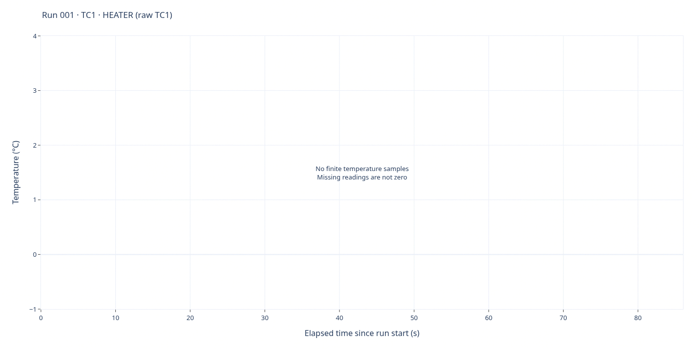

# Run 001 — Commissioning, no valid readings

2026-10-30 10:22 PDT · 1:24 long · setup

First day. Amplifiers connected, no thermocouple readings (NaN) or only a few. No heating.

## Comments

- 2026-10-30T17:24:07.404+00:00 — Hub commissioning only: both channels nan; probe attachment unverified; no heater controls used.

Files: [data.csv](data.csv) · [events.csv](events.csv) · [heater.png](heater.png) · [notes.md](notes.md) · [rear.png](rear.png)
