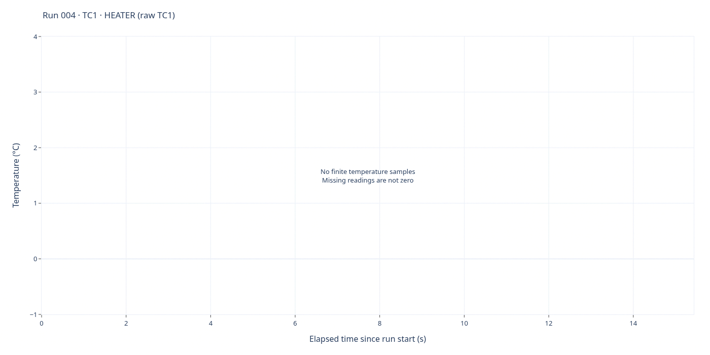

# Run 004 — Commissioning, no valid readings

2026-10-30 17:28 UTC · 0:15 long · setup

First day. Amplifiers connected, no thermocouple readings (NaN) or only a few. No heating.

Files: [data.csv](data.csv) · [events.csv](events.csv) · [heater.png](heater.png) · [notes.md](notes.md) · [rear.png](rear.png)
