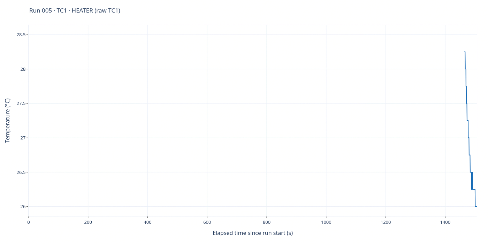
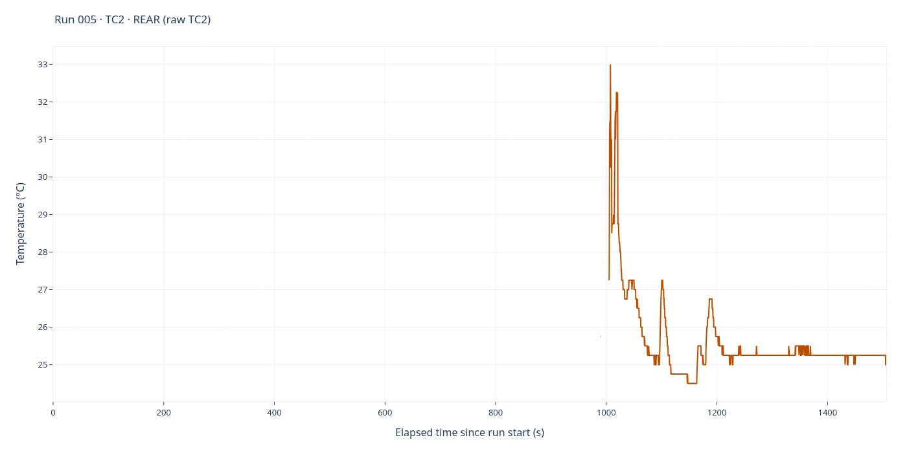

# Run 005 — Commissioning, no valid readings

2026-10-30 17:30 UTC · 25:06 long · setup

First day. Amplifiers connected, no thermocouple readings (NaN) or only a few. No heating.

| | |
|---|---|
| TC1 Heater side peak | 33.0 °C at 16:48 |
| TC2 Barrier rear peak | 28.5 °C at 24:23 |
| TC2 rise | 0.0 °C |

## Comments

- 2026-10-30T17:30:58.379+00:00 — Commissioning only: both channels nan; amplifier connection reported by user, probe attachment unverified. No heater controls or firmware upload.

Files: [data.csv](data.csv) · [events.csv](events.csv) · [heater.png](heater.png) · [notes.md](notes.md) · [rear.png](rear.png)
