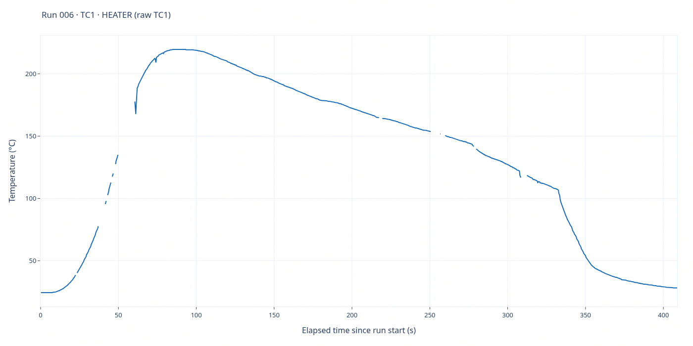
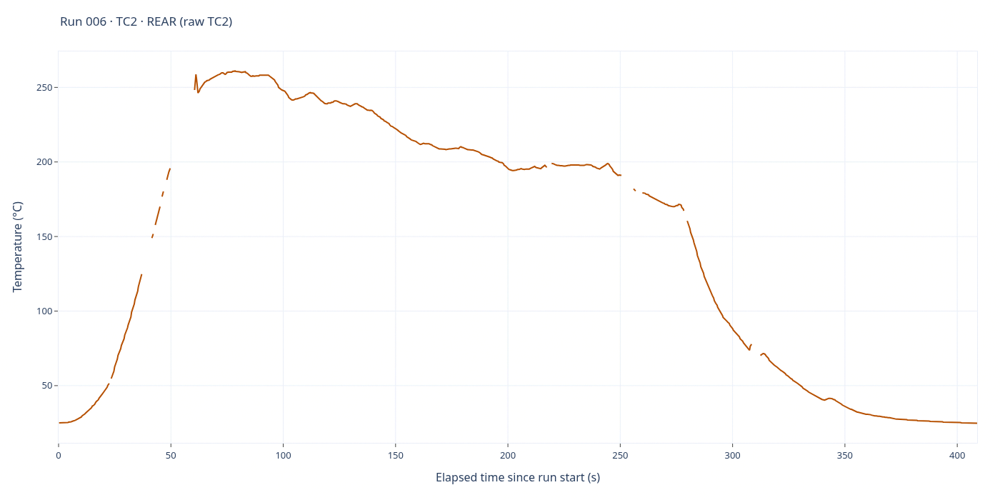

# Run 006 — First heat: mica only, leaned on block

2026-10-30 11:07 PDT · 6:49 long · partial

**Setup:** 1 mica sheet; heater-side TC wired beside the cartridge, rear TC wired to the far face; leaned against the cinder block (no sand). Variac voltage not recorded. McMaster 4877K305 cartridge, 300 W at 120 V (no internal TC).

Heater driven by hand from the variac (no relay control yet). Hotter TC peaked 261 °C at 1:18; the other 220 °C at 1:28, so one mica layer barely slowed the heat. Which raw channel was on the heater side is not recorded: assumed raw 2, which is hotter and leads, as in every later run. About 60 fault rows per channel.

| | |
|---|---|
| TC1 Heater side peak | 261.0 °C at 1:19 |
| TC2 Barrier rear peak | 219.8 °C at 1:29 |
| TC1 reached 100 °C after heat on | 0:33 |
| TC1 reached 200 °C after heat on | 1:00 |
| TC2 rise | 195.2 °C |
| Fitted rear gain | 0.82 (±13.0 °C) |

Files: [data.csv](data.csv) · [events.csv](events.csv) · [heater.png](heater.png) · [notes.md](notes.md) · [rear.png](rear.png)
