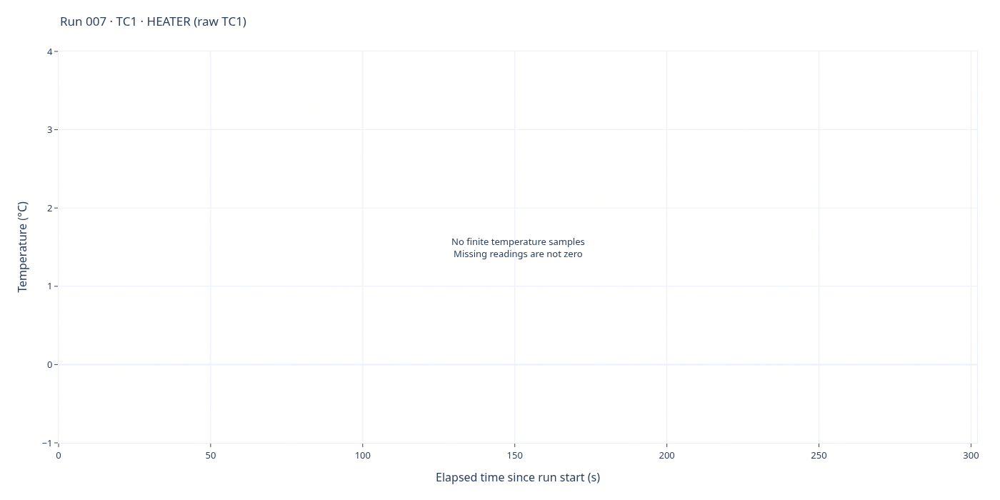

# Run 007 — Idle recording (no heating)

2026-11-02 10:34 PST · 5:00 long · idle

Logging only: the DAQ recorded while the rig sat idle, between starts, or while wiring. Kept for completeness.

Files: [data.csv](data.csv) · [events.csv](events.csv) · [heater.png](heater.png) · [notes.md](notes.md) · [rear.png](rear.png)
