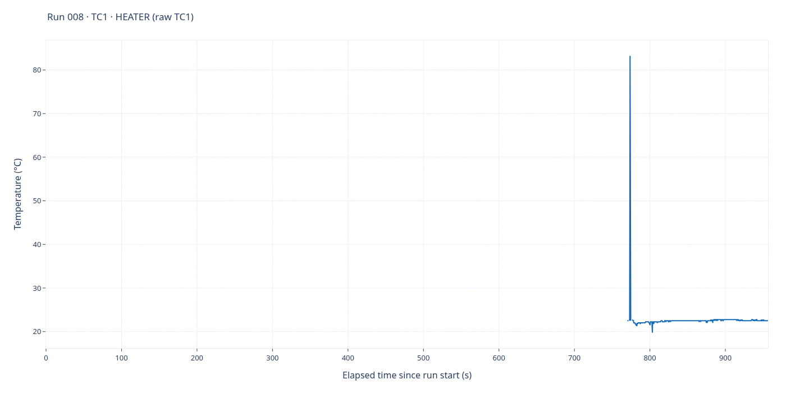
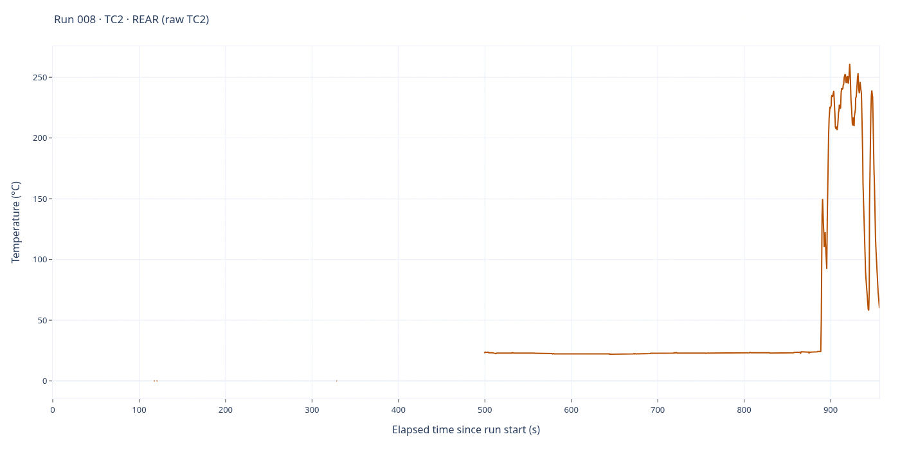

# Run 008 — Idle recording (no heating)

2026-11-02 10:39 PST · 15:55 long · idle

Logging only: the DAQ recorded while the rig sat idle, between starts, or while wiring. Kept for completeness. TC2 shows unexplained spikes (to 261 °C) and TC1 to 83 °C.

| | |
|---|---|
| TC1 Heater side peak | 261.0 °C at 15:22 |
| TC2 Barrier rear peak | 83.2 °C at 12:54 |
| TC1 reached 100 °C after heat on | 14:48 |
| TC1 reached 200 °C after heat on | 14:56 |
| TC2 rise | 60.8 °C |
| Fitted rear gain | 0.00 (±0.4 °C) |

Files: [data.csv](data.csv) · [events.csv](events.csv) · [heater.png](heater.png) · [notes.md](notes.md) · [rear.png](rear.png)
