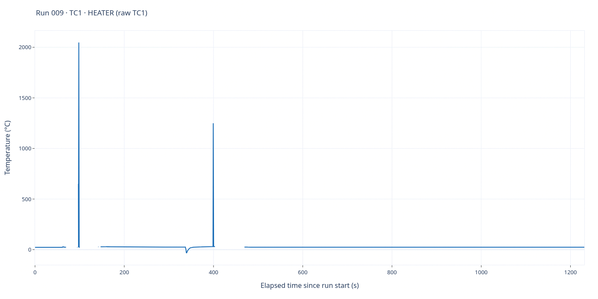
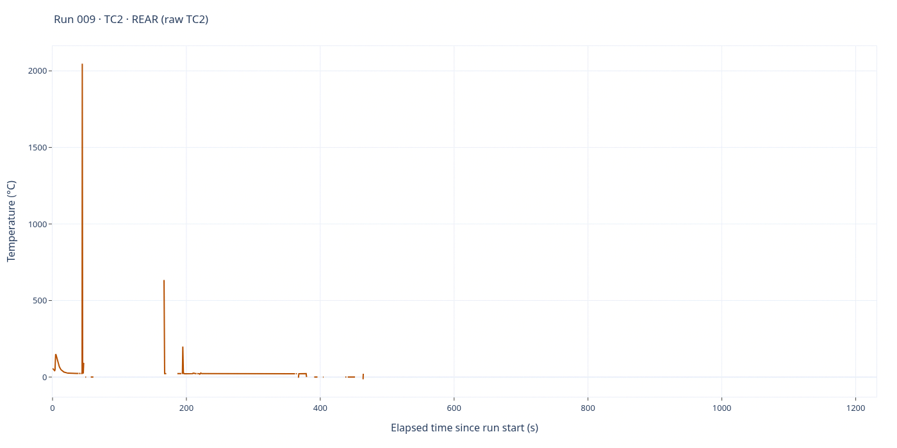

# Run 009 — First relay control attempt (EXP2, 30 V)

2026-11-02 18:55 UTC · 30 V · 20:31 long · setup

EXP2 started; within 4.5 s raw TC2 jumped past the 140 °C rear limit and tripped. Raw TC2 was on the heater side, i.e. the probes were already the other way round from the plan. Garbage frames (2047.75 °C) follow.

| | |
|---|---|
| TC1 Heater side peak | 1235.0 °C at 3:06 |
| TC2 Barrier rear peak | 1249.2 °C at 6:39 |
| TC1 reached 100 °C after heat on | 0:03 |
| TC1 reached 200 °C after heat on | 2:46 |
| TC1 reached 400 °C after heat on | 2:46 |
| TC1 reached 600 °C after heat on | 2:46 |
| TC1 reached 700 °C after heat on | 3:05 |
| TC2 rise | 1226.8 °C |
| Fitted rear gain | 0.13 (±6.3 °C) |
| Relay on | 0:04 |

Files: [data.csv](data.csv) · [events.csv](events.csv) · [heater.png](heater.png) · [notes.md](notes.md) · [rear.png](rear.png)
