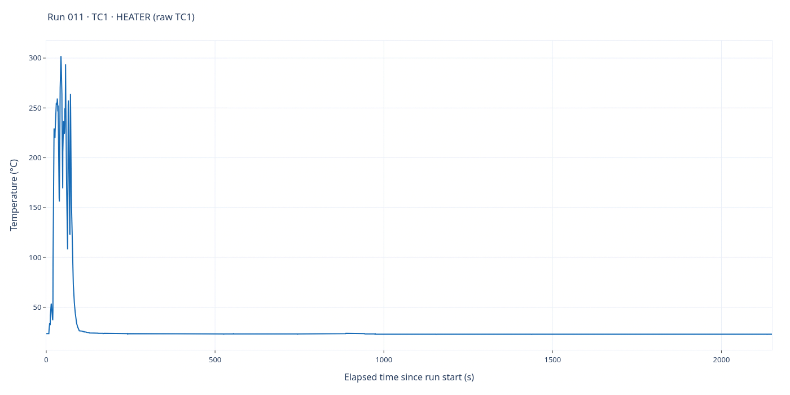
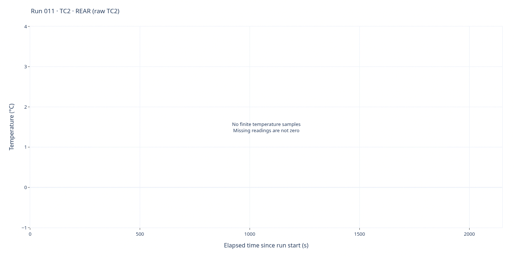

# Run 011 — Control check with one TC (heat gun)

2026-11-02 11:18 PST · 30 V · 35:50 long · setup

Single-thermocouple check of the EXP2 hold-at-300 °C logic while TC2 was unplugged; the operator had planned to test it with a heat gun. TC1 jumped 156 → 302 °C in 5 s, too fast for the cartridge. Not a barrier test.

| | |
|---|---|
| TC1 Heater side peak | 302.0 °C at 0:44 |
| TC1 reached 100 °C after heat on | 0:20 |
| TC1 reached 200 °C after heat on | 0:22 |
| Relay on | 1:16 |

Files: [data.csv](data.csv) · [events.csv](events.csv) · [heater.png](heater.png) · [notes.md](notes.md) · [rear.png](rear.png)
