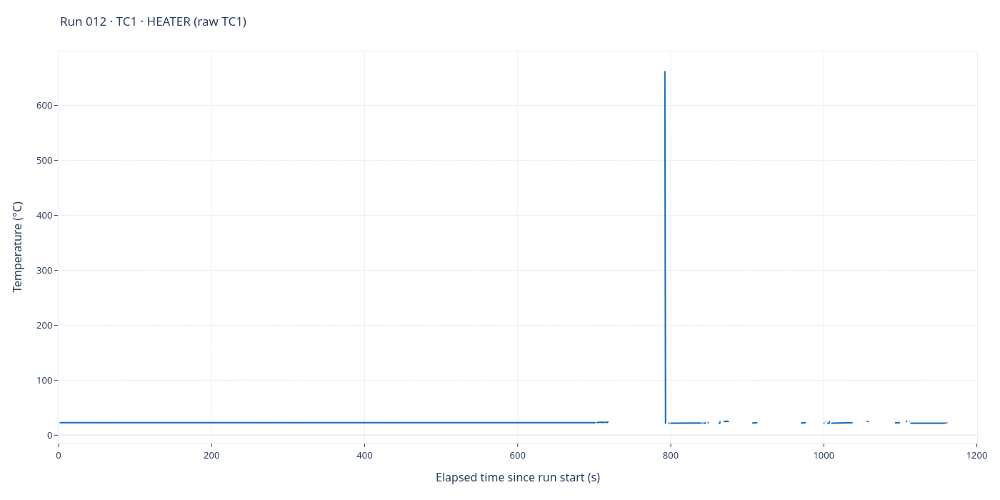
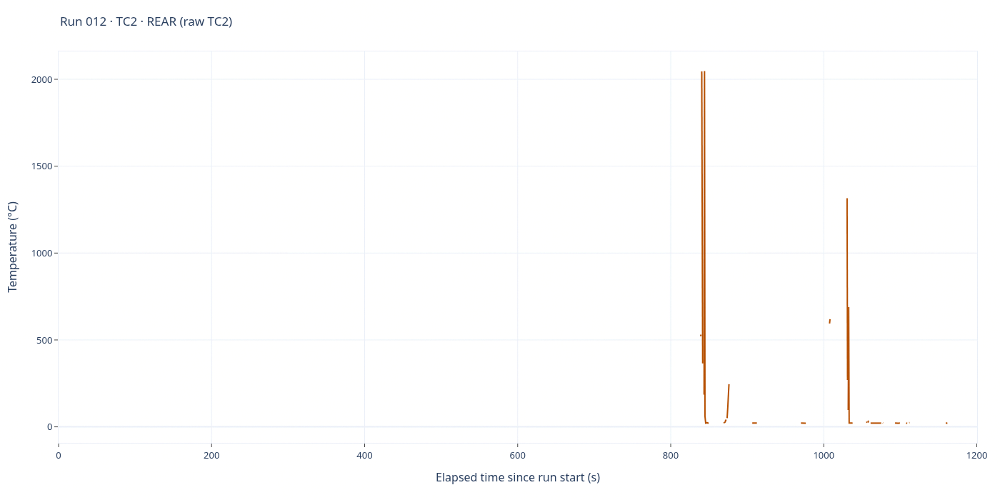

# Run 012 — Idle recording (no heating)

2026-11-02 11:54 PST · 19:59 long · idle

Logging only: the DAQ recorded while the rig sat idle, between starts, or while wiring. Kept for completeness.

| | |
|---|---|
| TC1 Heater side peak | 1315.8 °C at 17:10 |
| TC2 Barrier rear peak | 662.5 °C at 13:12 |
| TC1 reached 100 °C after heat on | 13:58 |
| TC1 reached 200 °C after heat on | 13:58 |
| TC1 reached 400 °C after heat on | 13:58 |
| TC1 reached 600 °C after heat on | 16:47 |
| TC1 reached 700 °C after heat on | 17:09 |
| TC2 rise | 639.5 °C |
| Fitted rear gain | 0.02 (±1.4 °C) |

Files: [data.csv](data.csv) · [events.csv](events.csv) · [heater.png](heater.png) · [notes.md](notes.md) · [rear.png](rear.png)
