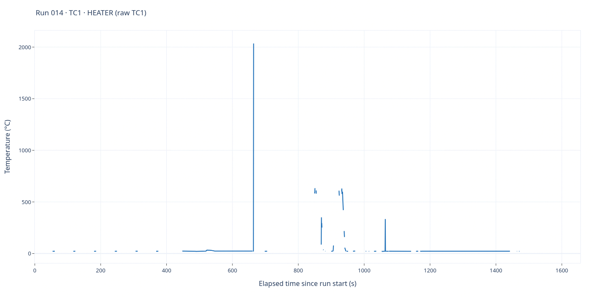
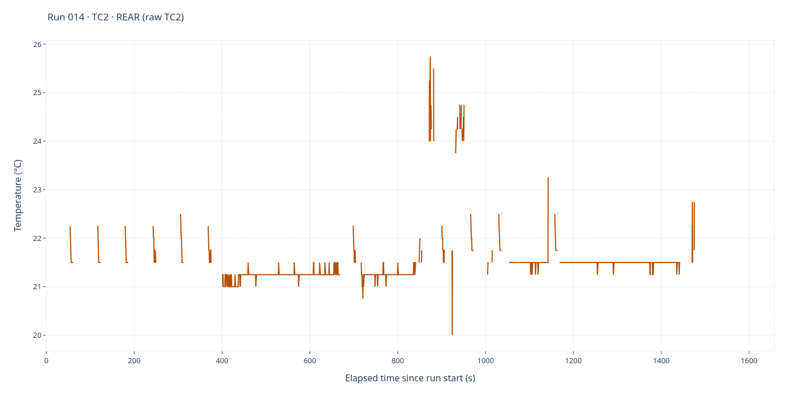

# Run 014 — Idle recording (no heating)

2026-11-02 12:14 PST · 27:30 long · idle

Logging only: the DAQ recorded while the rig sat idle, between starts, or while wiring. Kept for completeness.

| | |
|---|---|
| TC1 Heater side peak | 25.8 °C at 14:34 |
| TC2 Barrier rear peak | 1024.2 °C at 6:50 |
| TC2 rise | 1002.0 °C |

Files: [data.csv](data.csv) · [events.csv](events.csv) · [heater.png](heater.png) · [notes.md](notes.md) · [rear.png](rear.png)
