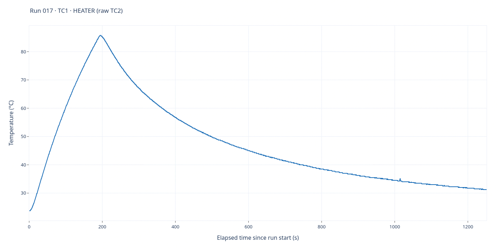
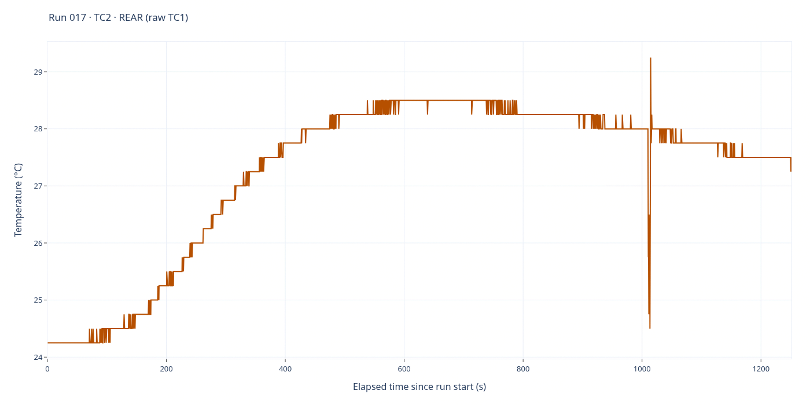

# Run 017 — Test 1: 1 mica / 2 basalt / 1 Al, rear cutoff 85 °C

2026-11-06 17:33 UTC · 20:51 long · test

**Setup:** 1 mica (85165K26, 0.032 in) / 2 basalt fabric (3/64 in) / 1 aluminum sheet. Semi-gravelly sand. McMaster 4877K305 cartridge, 300 W at 120 V (no internal TC). Variac voltage not recorded (30 V preset in config).

Operator: "first successful run". EXP2 hold-at-300 °C program, but the probes were swapped relative to the software, so the 85 °C rear cutoff watched the heater side and ended heating at 3:10 with the heater side at 85.75 °C. The rear rose only 5 °C. Useful as a working end-to-end check, not as barrier data.

| | |
|---|---|
| TC1 Heater side peak | 85.8 °C at 3:16 |
| TC2 Barrier rear peak | 29.2 °C at 16:54 |
| TC2 rise | 5.0 °C |
| Relay on | 3:09 |

## Comments

**Actual test 1 of 3:** the operator's first successful test, with the reported
1 mica / 2 basalt-fabric / 1 aluminum layer stack. This is run017, not the
subsequent planned run018. See [the three actual tests](../README.md#the-three-actual-tests).
The original reversed-probe and cutoff qualifications below remain applicable;
raw data, event logs and settings are unchanged.

- 2026-11-06T17:39:38.731+00:00 — Operator correction: probes were reversed during this run. Raw tc1_C is opposite-barrier temperature; raw tc2_C is heater temperature. Preserve raw CSV columns. The TC2_LIMIT event therefore acted on the heater probe, not the intended barrier probe. Operator requests 65 V RMS preset for EXP3; earlier automatic 30 V note is an assumption, not a measured voltage. Actual voltage history of this run is not established.

- 2026-11-06T17:53:55.929+00:00 — Operator assessment at closeout: first successful test. Reported assembly: one layer mica, two layers basalt fabric, one layer aluminum. Layer counts are operator-reported; hot-to-cold order, thicknesses, sand condition and actual voltage history were not supplied in this closeout. Probes were reversed: raw TC1=rear, raw TC2=heater; TC2_LIMIT was the 85 C cutoff acting on the heater probe. This successful-test assessment does not establish a completed 300 C/30 minute hold. Next planned experiment: EXP3 with corrected software input mapping and 65 V manual preset, intended run 018.

Files: [data.csv](data.csv) · [events.csv](events.csv) · [experiment-applied.json](experiment-applied.json) · [experiment.toml](experiment.toml) · [heater.png](heater.png) · [notes.md](notes.md) · [rear.png](rear.png)
