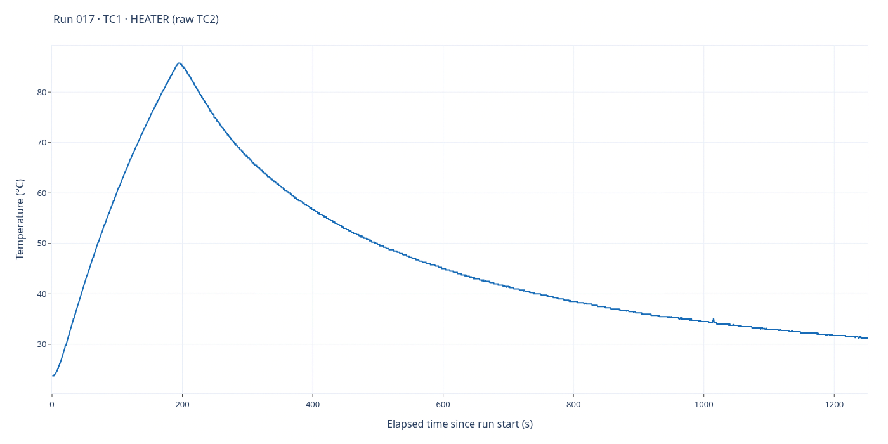
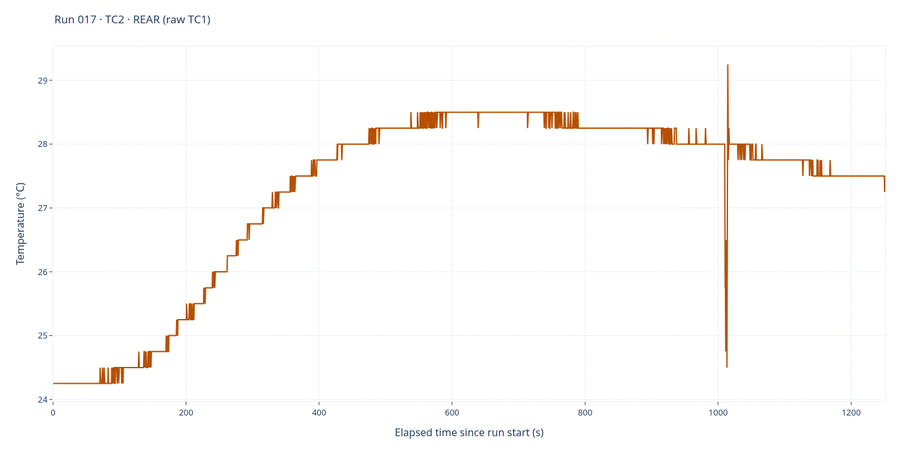

# Run 017 — Actual test 1 of 3

[All runs](../README.md) · [Three actual tests](../README.md#the-three-actual-tests) · [Raw CSV](data.csv) · [Event log](events.csv) · [Run notes](notes.md) · [Interactive report](report.html)

**2,504 saved sample rows.** Full elapsed-time range; no smoothing, downsampling or voltage scaling. Each graph has its own temperature axis.

## TC1 — heater

Saved-source interpretation: **TC1 · HEATER (raw TC2)**. 2,504 finite readings out of 2,504 saved rows.

## TC2 — rear

Saved-source interpretation: **TC2 · REAR (raw TC1)**. 2,504 finite readings out of 2,504 saved rows.

## Source and interactive viewing

The PNGs are1400×700 renders of the full-data Plotly traces in `report.html` and display directly on GitHub. Download/open the HTML locally for zoom, hover and export; GitHub does not execute its JavaScript. Regenerate HTML with `python host/report.py runs/017`; static PNGs are snapshots, not live views.

CSV SHA-256: `7f9ec68ea1b0e2080c27f32a56d7792eaaeba3b0d8d9f7986ddc636bb00ba6ed`.

Role labels follow saved/legacy mapping rules; consult the run notes for probe-placement corrections and validity limitations. Original CSV, event log, notes and settings are unchanged by rendering.
