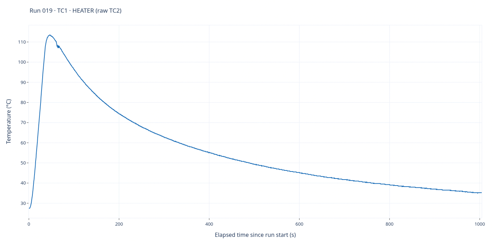
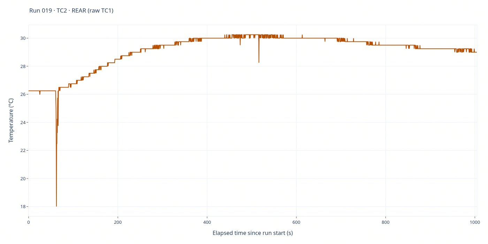

# Run 019 — EXP3 short start/stop

2026-11-06 10:03 PST · 65 V · 16:44 long · partial

**Setup:** 1 mica / 2 basalt / 1 Al, semi-gravelly sand. Variac preset 65 V.

Brief EXP3 starts used to check that stop cuts the heat. 019: heater on 32 s, heater side coasted to 113.5 °C after stop. 021: 5 s, no response in the data.

| | |
|---|---|
| TC1 Heater side peak | 113.5 °C at 0:47 |
| TC2 Barrier rear peak | 30.2 °C at 10:13 |
| TC1 reached 100 °C after heat on | 0:32 |
| TC2 rise | 4.0 °C |
| Relay on | 0:32 |

## Comments

- 2026-11-06T18:10:18.078+00:00 — Operator reports graphs still combined and rising heater trace labeled TC2, and requests assurance that stop exp3 cuts heat. At inspection controller reports swap_inputs=true, rear cutoff 85C, STOPPED/heater_on=false with STOP request 2 acknowledged at 18:04:26.840Z; raw TC2 is the heater and raw TC1 the rear. Physical power removal is not verified by serial telemetry. Correcting browser presentation without restarting acquisition.

Files: [data.csv](data.csv) · [events.csv](events.csv) · [experiment-applied.json](experiment-applied.json) · [experiment.toml](experiment.toml) · [heater.png](heater.png) · [notes.md](notes.md) · [rear.png](rear.png) · [run-metadata.json](run-metadata.json)
