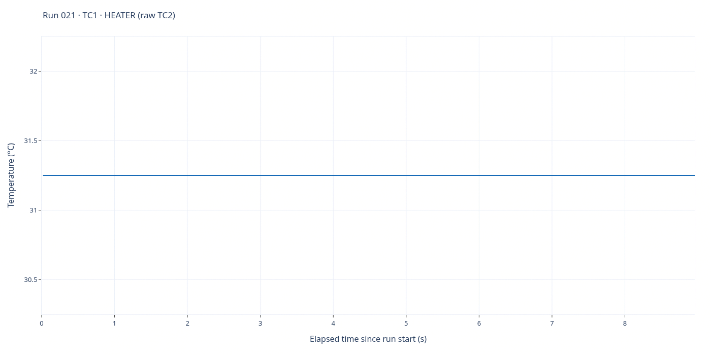
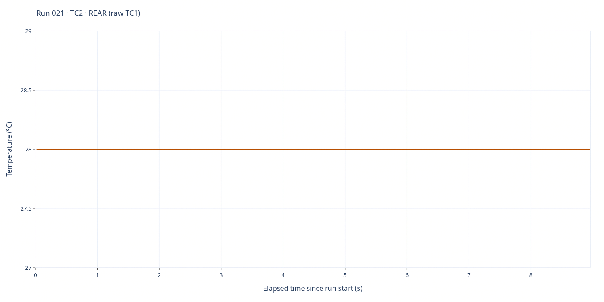

# Run 021 — EXP3 short start/stop

2026-11-06 18:26 UTC · 65 V · 0:09 long · partial

**Setup:** 1 mica / 2 basalt / 1 Al, semi-gravelly sand. Variac preset 65 V.

Brief EXP3 starts used to check that stop cuts the heat. 019: heater on 32 s, heater side coasted to 113.5 °C after stop. 021: 5 s, no response in the data.

| | |
|---|---|
| TC1 Heater side peak | 31.2 °C at 0:09 |
| TC2 Barrier rear peak | 28.0 °C at 0:09 |
| TC2 rise | 0.0 °C |
| Relay on | 0:05 |

Files: [data.csv](data.csv) · [events.csv](events.csv) · [experiment-applied.json](experiment-applied.json) · [experiment.toml](experiment.toml) · [heater.png](heater.png) · [notes.md](notes.md) · [rear.png](rear.png) · [run-metadata.json](run-metadata.json)
