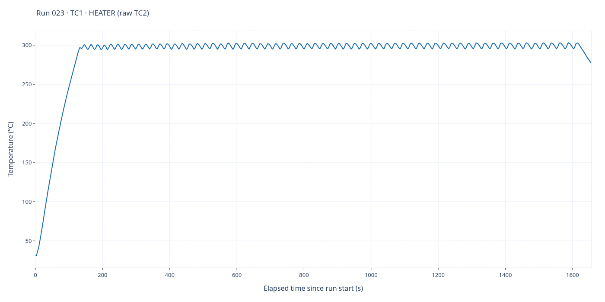
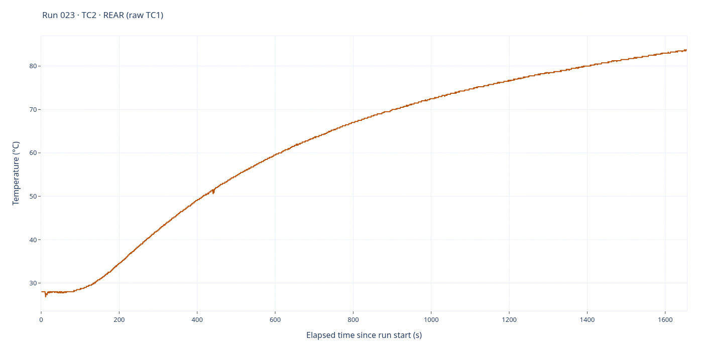

# Run 023 — Test 2: hold 300 °C, ~70 V, 1 mica / 2 basalt / 1 Al

2026-11-06 18:26 UTC · 70 V · 27:35 long · test

**Setup:** 1 mica / 2 basalt fabric / 1 aluminum. Semi-gravelly sand. McMaster 4877K305 cartridge, 300 W at 120 V (no internal TC) at about 70 V (operator; 65 V preset).

Operator: "great", "successful". EXP3 held the heater side at 300 °C (on/off with prediction): 299.0 ± 2.4 °C, range 294.5–303 °C, for about 20 minutes. Reached 100 °C at 0:32 and 200 °C at 1:14, then held for about 20 minutes (stopped at 1,218 s of a planned 1,800 s hold). The rear climbed steadily to 83.75 °C and had not levelled off when the run was stopped, so this barrier does not keep the rear under 85 °C for 30 min at 300 °C. Fitted rear gain 0.21 (±0.7 °C).

| | |
|---|---|
| TC1 Heater side peak | 303.0 °C at 26:54 |
| TC2 Barrier rear peak | 83.8 °C at 27:36 |
| TC1 reached 100 °C after heat on | 0:32 |
| TC1 reached 200 °C after heat on | 1:14 |
| TC2 rise | 55.8 °C |
| Fitted rear gain | 0.21 (±0.7 °C) |
| Relay on | 9:53 |

## Comments

**Actual test 2 of 3:** the operator-reported successful EXP3 run at approximately
70V, distinct from the earlier setup/restart recordings. The saved65V preset
remains unchanged. See [the three actual tests](../README.md#the-three-actual-tests).
This label does not alter the measured hold-duration qualifications below.

- 2026-11-06T18:55:35.421+00:00 — Run 023 / EXP3 operator closeout: operator described this run as great and SUCCESSFUL, operated at approximately 70 V. This is an operator-reported approximate operating voltage, not a logged electrical measurement; the original saved 65 V preset is retained as the requested configuration, not the actual-voltage claim. The voltage time history was not supplied. Saved setup comments carry the previously reported stack: 1 mica layer, 2 basalt-fabric layers, 1 aluminum layer; no new layer order, thickness or sand-condition observation was supplied. Corrected roles: logical TC1/heater = raw TC2; logical TC2/rear = raw TC1. Saved data: 3313 samples from 2026-11-06T18:26:33.875Z through 18:54:08.997Z, 1655.12 s between first/last samples; zero nonfinite readings on either channel. Heater peak 303.00 C, rear peak 83.75 C; last readings heater 277.00 C and rear 83.75 C. Applied target 300 C, heater cutoff 320 C, rear cutoff enabled at 85 C. STOP request 6 acknowledged at 18:53:37.360Z with STOPPED/heater_on=false; hold_s=1218 (20 min 18 s), not completion of the configured 1800 s hold. USB/serial disconnected at 18:54:09.273Z; no samples after 18:54:08.997Z at inspection. Host recording remains open. Current physical heater power after disconnect is unknown to software; the earlier OFF acknowledgement is not electrical-isolation proof. Logging this assessment does not change controller settings, raw data, original run metadata or run numbering.

- 2026-11-06T20:40:58.796+00:00 — Operator requested a fresh updated session. Finalizing run 023 after its earlier acknowledged STOP; serial is currently disconnected, so current physical heater state cannot be verified. Preserving all recorded data.

Files: [data.csv](data.csv) · [events.csv](events.csv) · [experiment-applied.json](experiment-applied.json) · [experiment.toml](experiment.toml) · [heater.png](heater.png) · [notes.md](notes.md) · [rear.png](rear.png) · [run-metadata.json](run-metadata.json)
