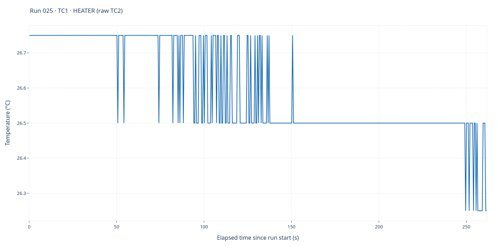
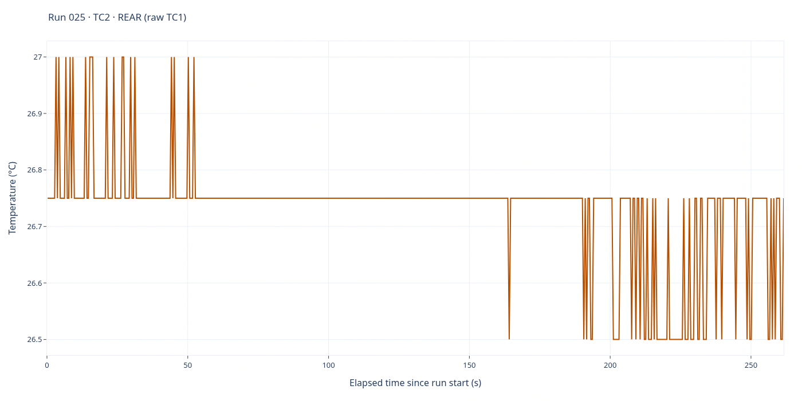

# Run 025 — Supporting recording

[All runs](../README.md) · [Three actual tests](../README.md#the-three-actual-tests) · [Raw CSV](data.csv) · [Event log](events.csv) · [Run notes](notes.md) · [Interactive report](report.html)

**524 saved sample rows.** Full elapsed-time range; no smoothing, downsampling or voltage scaling. Each graph has its own temperature axis.

## TC1 — heater

Saved-source interpretation: **TC1 · HEATER (raw TC2)**. 524 finite readings out of 524 saved rows.

## TC2 — rear

Saved-source interpretation: **TC2 · REAR (raw TC1)**. 524 finite readings out of 524 saved rows.

## Source and interactive viewing

The PNGs are1400×700 renders of the full-data Plotly traces in `report.html` and display directly on GitHub. Download/open the HTML locally for zoom, hover and export; GitHub does not execute its JavaScript. Regenerate HTML with `python host/report.py runs/025`; static PNGs are snapshots, not live views.

CSV SHA-256: `92fb171f636b74ba3f8aa1baf91802e21acbc799506b2fd110b0eee8160f8f86`.

Role labels follow saved/legacy mapping rules; consult the run notes for probe-placement corrections and validity limitations. Original CSV, event log, notes and settings are unchanged by rendering.
