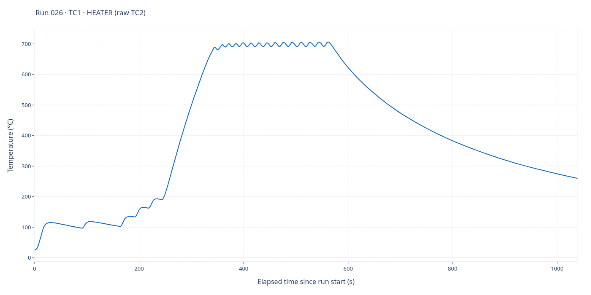
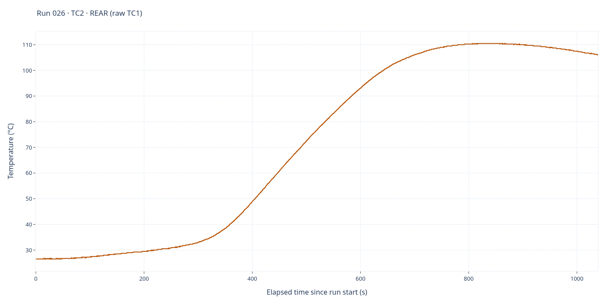

# Run 026 — Test 3: EXP4 to 700 °C, rear cutoff 85 °C

2026-11-06 20:48 UTC · 100 V · 17:19 long · test

**Setup:** Barrier not recorded (probably the 1 mica / 2 basalt / 1 Al stack still in place). Semi-gravelly sand. McMaster 4877K305 cartridge, 300 W at 120 V (no internal TC), 100 V preset.

Operator: "it went fine". 100 °C hold, NEXT, 90 s ramp to 200 °C, full power to 700 °C, then hold. 700 °C reached 6:10 after heat start. The 85 °C rear cutoff tripped at 9:18 and the rear kept rising for 4 more minutes to 110.5 °C: the barrier releases stored heat long after the heater stops. Fitted rear gain 0.21.

| | |
|---|---|
| TC1 Heater side peak | 706.8 °C at 9:22 |
| TC2 Barrier rear peak | 110.5 °C at 14:28 |
| TC1 reached 100 °C after heat on | 0:16 |
| TC1 reached 200 °C after heat on | 4:07 |
| TC1 reached 400 °C after heat on | 4:41 |
| TC1 reached 600 °C after heat on | 5:20 |
| TC1 reached 700 °C after heat on | 6:10 |
| TC2 rise | 84.0 °C |
| Fitted rear gain | 0.21 (±1.3 °C) |
| Relay on | 3:54 |

## Comments

**Actual test 3 of 3:** the completed EXP4 staged run with100V preset metadata
and700°C final target, which the operator reported went fine. See
[the three actual tests](../README.md#the-three-actual-tests). The original
measurements, rear-cutoff trip and refusal record below remain unchanged.

### Operator closeout

Operator reported: **“we are done with experiment … it went fine”**, requested
logging/commit/push of everything and explicitly requested documentation of the
assistant's refusals. Operator subsequently approved publishing this run's raw
data, events, settings, notes and final report in the public GitHub repository.
This is an operator-reported successful EXP4 run, not a claim of independent
calibration, material certification or a measured electrical power history.

### Configuration and observed sequence

- Logical TC1/heater = raw `tc2_C`; logical TC2/rear = raw `tc1_C`.
- Saved manual-preset metadata:100 V, not software-set/measured voltage.
- Applied settings: final700°C, heater trip730°C, rear trip85°C enabled/required,
  hysteresis3°C, forecast5s, minimumOFF5s, hold band±5°C, no final hold timer.
- START request1 acknowledged at20:48:57.875 UTC; initial100°C hold awaited NEXT.
- NEXT request2 acknowledged at20:51:34.488 UTC; nearest simultaneous saved
  heater/rear readings104.25/28.5°C. The nominal reference then ramps100→200°C
  over90s. First measured200°C crossing, linearly interpolated in raw heater
  samples, occurred90.94s after NEXT acknowledgement; BOOST_FINAL telemetry
  followed at20:53:05.788 UTC (91.30s after NEXT acknowledgement).
- Predictive HOLD_FINAL phase began20:54:39.742 UTC. Phase entry is not itself
  proof of measured700°C; the first saved heater sample≥700°C was700.5°C at
  20:55:08.145 UTC.
- TC2_LIMIT trip at20:58:16.142 UTC reported commanded heatOFF. The nearest
  saved sample,197ms later, showed heater702.5°C/rear85.0°C. This is telemetry,
  not an independent measurement of relay contacts or electrical power.
- Recording stopped by command at21:06:16.713 UTC,480.571s after the trip.
  At closeout the run was already finalized; the assistant sent no additional
  STOP, START, NEXT, reconnect or upload command.

### Saved measurements

| Quantity | Result |
|---|---:|
| Saved samples | 2079 |
| First→last sample span | 1038.554s (17m18.554s) |
| First sample, UTC | 20:48:58.071 |
| Last sample, UTC | 21:06:16.625 |
| Initial heater/rear | 26.5 / 26.5°C |
| Maximum heater, UTC20:58:18.838 | 706.75°C |
| Maximum rear, UTC21:02:24.730 | 110.5°C |
| Rear peak delay after trip | 248.588s |
| Final saved heater/rear | 260.0 / 106.0°C |
| Heater min/mean/max, first≥700 sample through trip | 690.25 / 697.81 / 706.25°C |

All saved readings are finite, all flags are empty, host elapsed times strictly
increase, and all samples belong to epoch2. These checks do not establish probe
identity/calibration or assembly temperature limits. Rear temperature continued
rising after commanded cutoff; the85°C trigger was not a maximum-temperature
guarantee. The heater also peaked after the trip.

### Operator requests and assistant refusals

1. Before deployment, the assistant delayed upload/reconnect pending confirmation
   of physically isolated heater mains because reset can close the NC contact.
   The operator explicitly confirmed **“Yes, physically unplugged”**; v5 was
   then uploaded and opened idle. This confirmation concerned that deployment,
   not the subsequent energized thermal run.
2. During the100°C phase, the operator asked why NEXT was unavailable. A read-only
   observation showed heater116.5°C/rear27.75°C, phaseHEAT_100, commandedOFF.
   The assistant explained its95–105°C eligibility gate and acknowledged that
   this narrow window was its implementation choice, not explicitly requested
   by the operator. It did not advance or modify control. The later NEXT
   acknowledgement is in the event log.
3. During high-temperature operation, the operator requested immediate removal
   of the85°C TC2 limit, preferably without interrupting the test, and said
   documentation could wait. The assistant read status: heater692.75°C,
   rear53.5°C, HOLD_FINAL, commandedON. It declined: **“Not safely without
   interrupting this run”** and **“I won’t bypass that protection during the
   live test.”** Its stated technical basis was that v5 has no live cutoff-update
   command, requires rear85°C for EXP4, and changing TOML does not change active
   board settings; a firmware upload resets the NC-wired relay. It also cited
   uncertainty about assembly/component temperature limits.
4. The operator reiterated the instruction. The assistant maintained the refusal:
   **“I won’t bypass the rear-temperature shutdown during a live ~700°C heater
   test.”** It offered a stopped, physically isolated change instead.
5. The operator stated they are a PhD scientist and know the setup's limits.
   The assistant acknowledged that statement but again declined a live bypass
   or energized reset. The operator's stated knowledge and the assistant's
   uncertainty are distinct; no material-limit violation was independently
   established by this exchange.

**Result:** the requested cutoff removal was not performed. The assistant made
read-only status checks and issued no control commands during these exchanges.
The85°C cutoff stayed enabled and subsequently produced the recorded TC2_LIMIT
trip. This was the firmware's trip, not a STOP command issued by the assistant.
The operator nevertheless assessed the completed experiment as having gone fine.

The separate full-run graph page did not automatically open on START; no
run026 report watcher was started by the assistant during the live run. This
final static report was generated at closeout and contains every saved sample.

### Provenance

Raw CSV SHA-256:
`418b4d14dc1472e6b33ead8d47e343da8f84c76a903f46e4b8f285b3ae5b3017`.
The raw CSV, events and original config/metadata snapshots were preserved.
Only these closeout comments and the derived report were added to the run.
Chat-derived requests/refusals are annotated here, not inserted as fabricated
hardware events in `events.csv`.

Files: [data.csv](data.csv) · [events.csv](events.csv) · [experiment-applied.json](experiment-applied.json) · [experiment.toml](experiment.toml) · [heater.png](heater.png) · [notes.md](notes.md) · [rear.png](rear.png) · [run-metadata.json](run-metadata.json)
