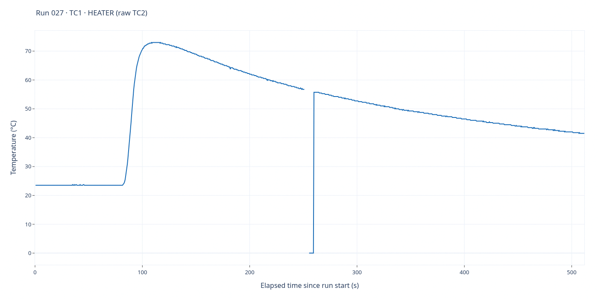
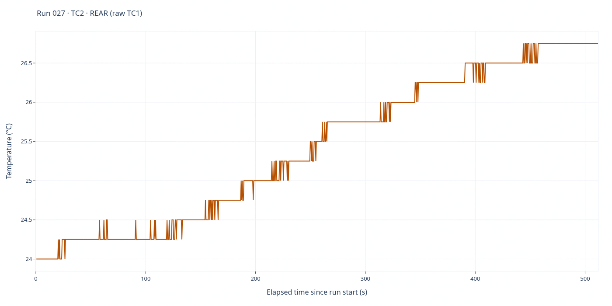

# Run 027 — Supporting recording before EXP5

[All runs](../README.md) · [Successful EXP5](../README.md#successful-exp5--run028) · [Raw CSV](data.csv) · [Event log](events.csv) · [Run notes](notes.md) · [Interactive report](report.html)

Supporting acquisition finalized when EXP5 started in [run028](../028/). No applied heater-control settings were saved for this recording; retained exp4 role/voltage metadata is not evidence of an EXP4 START.

**1,024 saved sample rows.** Full elapsed-time range; no smoothing, downsampling or voltage scaling. Each graph has its own temperature axis.

## TC1 — heater

Saved-source interpretation: **TC1 · HEATER (raw TC2)**. 1,016 finite readings out of 1,024 saved rows.

## TC2 — rear

Saved-source interpretation: **TC2 · REAR (raw TC1)**. 1,024 finite readings out of 1,024 saved rows.

## Source and interactive viewing

The PNGs are1400×700 renders of the full-data Plotly traces in `report.html` and display directly on GitHub. Download/open the HTML locally for zoom, hover and export; GitHub does not execute its JavaScript. Regenerate HTML with `python host/report.py runs/027`; static PNGs are snapshots, not live views.

CSV SHA-256: `3ef3fde8856738ce279e09a601f59c78336167e0ae1351af21a727b0972cf791`.

Role labels follow saved/legacy mapping rules; consult the run notes for probe-placement corrections and validity limitations. Original CSV, event log, settings and role metadata are unchanged by rendering. The dated publication closeout is appended below the original notes' Comments heading.
