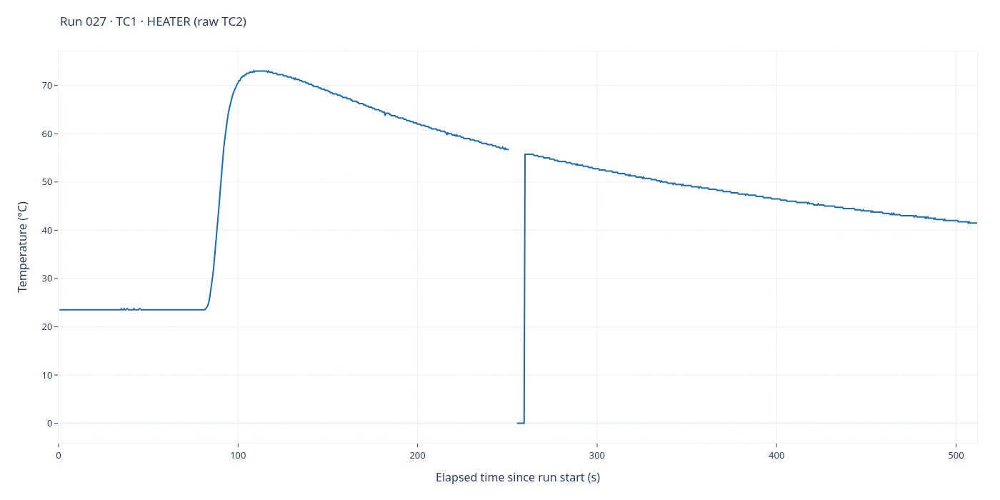
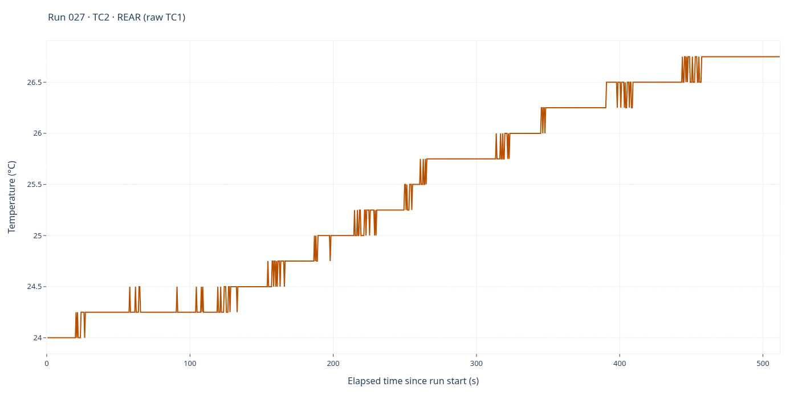

# Run 027 — Idle recording (no heating)

2026-11-09 18:19 UTC · 8:31 long · idle

Recorded before EXP5 started. The heater-side TC rose from 50 to 73 °C at about 1:30 without a START; cause not recorded.

| | |
|---|---|
| TC1 Heater side peak | 73.0 °C at 1:57 |
| TC2 Barrier rear peak | 26.8 °C at 8:32 |
| TC2 rise | 2.8 °C |

## Comments

Supporting acquisition immediately before EXP5:1024 saved samples, with no
EXP5 applied-settings snapshot. This intended exp027 recording was finalized at
18:27:43.477 UTC when EXP5 START allocated the actual experiment recording,
[run028](../028/notes.md). The event log contains one rawTC2 NaN fault at
18:23:22.763 UTC; no completed EXP5 sequence is attributed to this run.

Files: [data.csv](data.csv) · [events.csv](events.csv) · [heater.png](heater.png) · [notes.md](notes.md) · [rear.png](rear.png) · [run-metadata.json](run-metadata.json)
