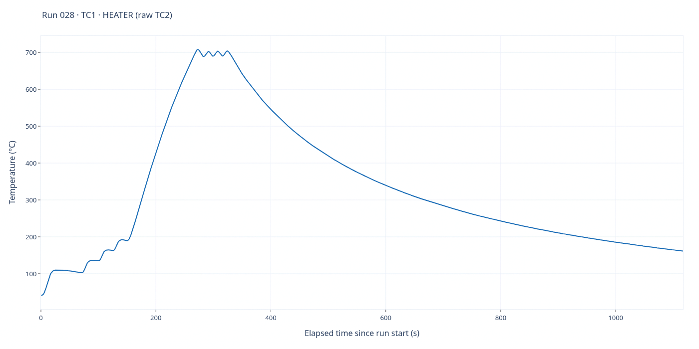
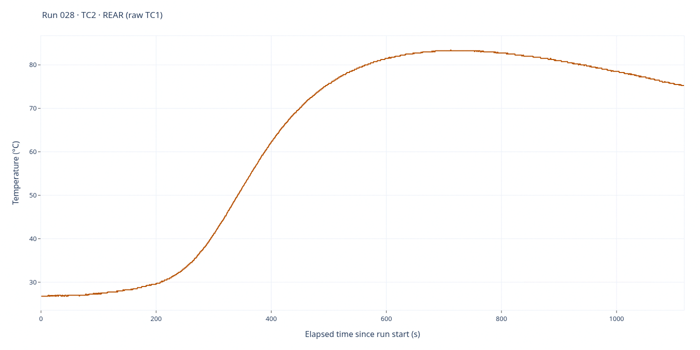

# Run 028 — EXP5 / actual test 4

[All runs](../README.md) · [Successful EXP5](../README.md#successful-exp5--run028) · [Raw CSV](data.csv) · [Event log](events.csv) · [Run notes](notes.md) · [Interactive report](report.html)

**Operator reported EXP5 went well.** The completed EXP5 recording is run028, not the originally intended run027. [Measured closeout and settings](notes.md).

**2,236 saved sample rows.** Full elapsed-time range; no smoothing, downsampling or voltage scaling. Each graph has its own temperature axis.

## TC1 — heater

Saved-source interpretation: **TC1 · HEATER (raw TC2)**. 2,236 finite readings out of 2,236 saved rows.

## TC2 — rear

Saved-source interpretation: **TC2 · REAR (raw TC1)**. 2,236 finite readings out of 2,236 saved rows.

## Source and interactive viewing

The PNGs are1400×700 renders of the full-data Plotly traces in `report.html` and display directly on GitHub. Download/open the HTML locally for zoom, hover and export; GitHub does not execute its JavaScript. Regenerate HTML with `python host/report.py runs/028`; static PNGs are snapshots, not live views.

CSV SHA-256: `8f7a63baf593cc73feadc9a090869e04fb875e6f8594731f179ee188f97d23e7`.

Role labels follow saved/legacy mapping rules; consult the run notes for probe-placement corrections and validity limitations. Original CSV, event log, settings and role metadata are unchanged by rendering. The dated publication closeout is appended below the original notes' Comments heading.
