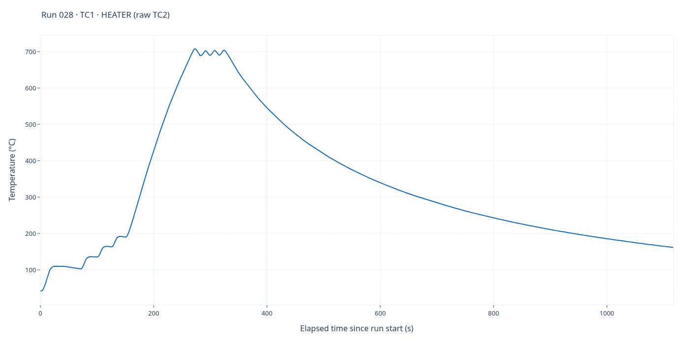
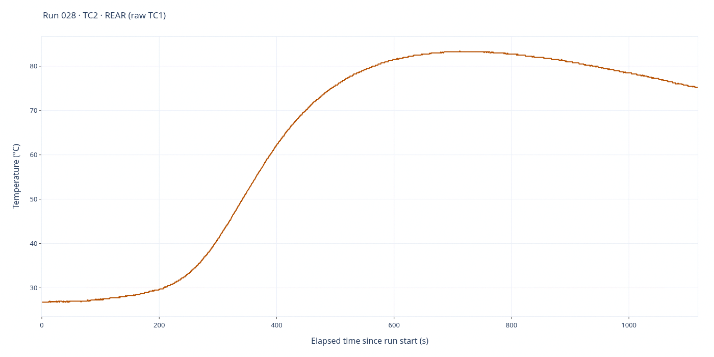

# Run 028 — Test 4: EXP5 700 °C, 60 s hold (completed)

2026-11-09 18:27 UTC · 100 V · 18:37 long · test

**Setup:** Barrier not recorded (same session as 030/033). Semi-gravelly sand. McMaster 4877K305 cartridge, 300 W at 120 V (no internal TC), 100 V preset.

Operator: "it went well". The cleanest full profile: 100 °C hold, NEXT, ramp to 200 °C, full power to 700 °C (reached 4:28 after heat start), 60 s hold, heat off. Rear peaked 83.5 °C 7 minutes after the heater-side peak. Fitted rear gain 0.20. Reference run for the old 300 W cartridge at 100 V.

| | |
|---|---|
| TC1 Heater side peak | 707.8 °C at 4:33 |
| TC2 Barrier rear peak | 83.5 °C at 11:52 |
| TC1 reached 100 °C after heat on | 0:17 |
| TC1 reached 200 °C after heat on | 2:35 |
| TC1 reached 400 °C after heat on | 3:14 |
| TC1 reached 600 °C after heat on | 3:59 |
| TC1 reached 700 °C after heat on | 4:28 |
| TC2 rise | 56.8 °C |
| Fitted rear gain | 0.20 (±1.3 °C) |
| Relay on | 2:55 |

## Comments

**Actual test 4; successful EXP5:** the operator reported that the completed
experiment **“went well.”** This records that assessment separately from probe
calibration, component certification or electrical-power verification. The
intended exp027 recording was finalized when EXP5 START allocated the actual
recording, **run028**.

### Configuration and observed sequence

- Logical heater/cartridge = raw `tc2_C`; logical rear/barrier = raw `tc1_C`.
  The CSV columns remain in raw physical-channel order.
- Board-applied settings: final target700°C, heater cutoff730°C, rear cutoff
  120°C enabled/required, hysteresis3°C, prediction lead5s, minimum OFF5s,
  hold band±5°C and60s elapsed final hold. Saved100V is manual-preset metadata,
  not a measured or software-controlled voltage.
- START request1 was acknowledged at18:27:43.595 UTC; NEXT request2 at
  18:28:47.603 UTC. BOOST_FINAL began at18:30:19.395 UTC.
- The first saved heater sample≥700°C was **700.25°C at18:32:12.535 UTC**.
  HOLD_FINAL began1ms later at18:32:12.536 UTC with the reported hold counter0.
- COMPLETE/HOLD_COMPLETE was reported at18:33:12.807 UTC with commanded heat
  OFF and hold counter60. HOLD_FINAL→COMPLETE was **60.271s**. Commanded OFF is
  controller telemetry, not independent proof of relay contacts or power removal.
- No `TC1_LIMIT`, `TC2_LIMIT`, `TRIPPED` or sensor-fault trip appears in the
  saved events. Recording continued through cooldown until stopped by command
  at18:46:21.060 UTC,788.253s after COMPLETE.

### Saved measurements

| Quantity | Result |
|---|---:|
| Saved samples | 2236 |
| First→last sample span | 1116.729s (18m36.729s) |
| First sample, UTC | 18:27:43.898 |
| Last sample, UTC | 18:46:20.627 |
| Initial heater/rear | 41.0 / 26.75°C |
| Maximum heater, UTC18:32:16.033 | 707.75°C |
| Maximum rear, UTC18:39:35.319 | 83.5°C |
| COMPLETE→last saved sample cooldown | 787.820s (13m7.820s) |
| Final saved heater/rear | 161.5 / 75.25°C |

All saved temperature readings are finite, all flags are empty and all samples
belong to epoch2. These checks do not establish probe identity/calibration or
physical power state. The raw CSV, events and original configuration/metadata
snapshots are unchanged; only this closeout was appended.

Files: [data.csv](data.csv) · [events.csv](events.csv) · [experiment-applied.json](experiment-applied.json) · [experiment.toml](experiment.toml) · [heater.png](heater.png) · [notes.md](notes.md) · [rear.png](rear.png) · [run-metadata.json](run-metadata.json)
