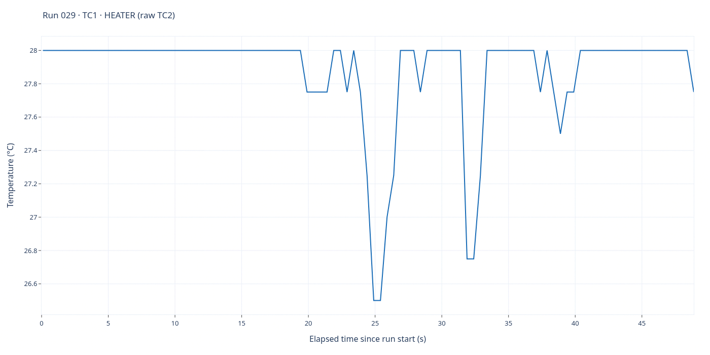
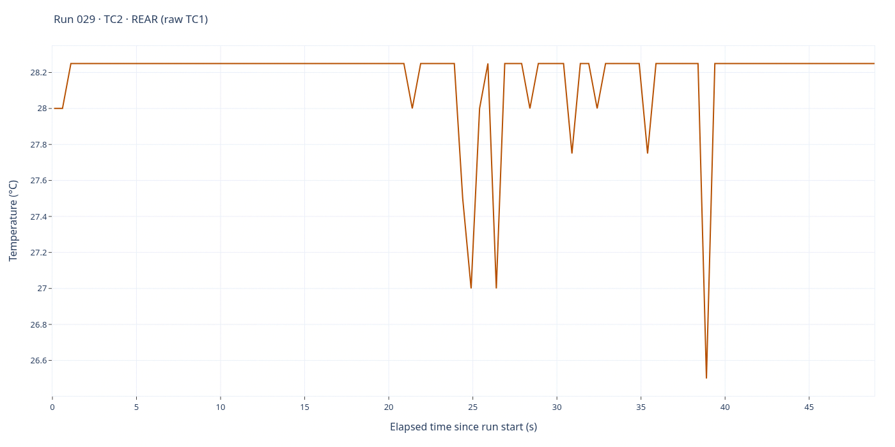

# Run 029 — Idle recording (no heating)

2026-11-09 12:02 PST · 0:49 long · idle

Logging only: the DAQ recorded while the rig sat idle, between starts, or while wiring. Kept for completeness.

| | |
|---|---|
| TC1 Heater side peak | 28.0 °C at 0:48 |
| TC2 Barrier rear peak | 28.2 °C at 0:49 |
| TC2 rise | 0.2 °C |

## Comments

**2026-11-09 closeout — supporting acquisition, not an EXP5 heating test.**
Logical heater/cartridge = raw `tc2_C`; logical rear/barrier = raw `tc1_C`.
The CSV columns remain in raw physical-channel order. Retained `exp5`,
`swap_inputs=true` and 100V metadata describe the session mapping/manual preset,
not applied heating settings or a measured voltage. This run has no applied
experiment snapshot and no EXP5 START in its own event log.

The recording was finalized before Experiment 5 at **20:03:04.147 UTC**; run030
then received the EXP5 START. Saved events include serial reconnect/startup and
an IDLE report, but no heating-program transition for run029.

| Quantity | Result |
|---|---:|
| Saved samples | 96 |
| First→last sample span | 48.787s |
| First / last sample UTC | 20:02:15.130 / 20:03:03.917 |
| Initial heater/rear | 28.0 / 28.0°C |
| Maximum heater/rear | 28.0 / 28.25°C |
| Final saved heater/rear | 27.75 / 28.25°C |

All saved temperatures are finite and flags are empty. Epochs3 and4 reflect the
recorded startup/reset; they do not establish probe calibration or physical
power state. Raw CSV, events and metadata are unchanged; only this closeout was
appended.

Files: [data.csv](data.csv) · [events.csv](events.csv) · [heater.png](heater.png) · [notes.md](notes.md) · [rear.png](rear.png) · [run-metadata.json](run-metadata.json)
