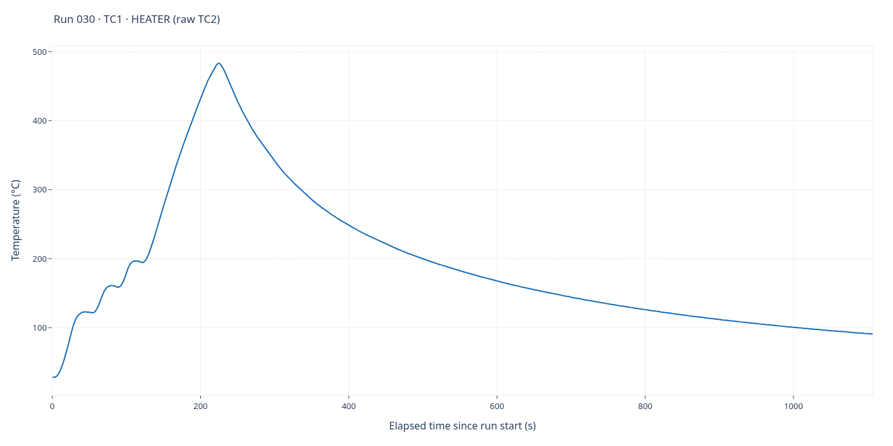
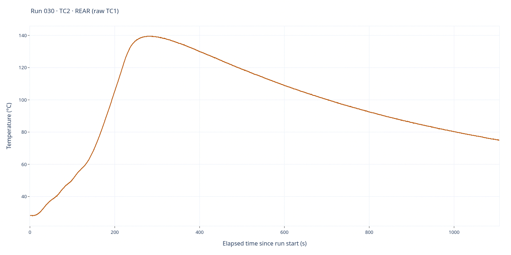

# Run 030 — EXP5 rear-limit trip and cooldown

[All runs](../README.md) · [Raw CSV](data.csv) · [Event log](events.csv) · [Run notes](notes.md) · [Run metadata](run-metadata.json) · [Selected settings](experiment.toml) · [Applied settings](experiment-applied.json) · [Interactive report](report.html)

EXP5 START and normal NEXT are acknowledged in the saved events; the board later tripped `TC2_LIMIT` during BOOST_FINAL. No700°C final hold/completion is recorded.

**2,215 saved sample rows.** Full elapsed-time range; no smoothing, downsampling or voltage scaling. Each graph has its own temperature axis. See [run notes](notes.md) for the dated closeout.

## TC1 — heater

Saved-source interpretation: **TC1 · HEATER (raw TC2)**. 2,215 finite readings out of 2,215 saved rows.

## TC2 — rear

Saved-source interpretation: **TC2 · REAR (raw TC1)**. 2,215 finite readings out of 2,215 saved rows.

## Source and interactive viewing

The PNGs are1400×700 renders of the full-data Plotly traces in `report.html` and display directly on GitHub. Download/open the HTML locally for zoom, hover and export; GitHub does not execute its JavaScript. Regenerate HTML with `python host/report.py runs/030`; static PNGs are snapshots, not live views.

CSV SHA-256: `c08cd376ab4fd3209a42570b62df5f0eb4980d1e5f9604013291908a61fa4785`.

Role labels follow saved/legacy mapping rules; consult the run notes for probe-placement corrections and validity limitations. Original CSV, event log, settings and role metadata are unchanged by rendering. The dated publication closeout is appended below the original notes' Comments heading.
