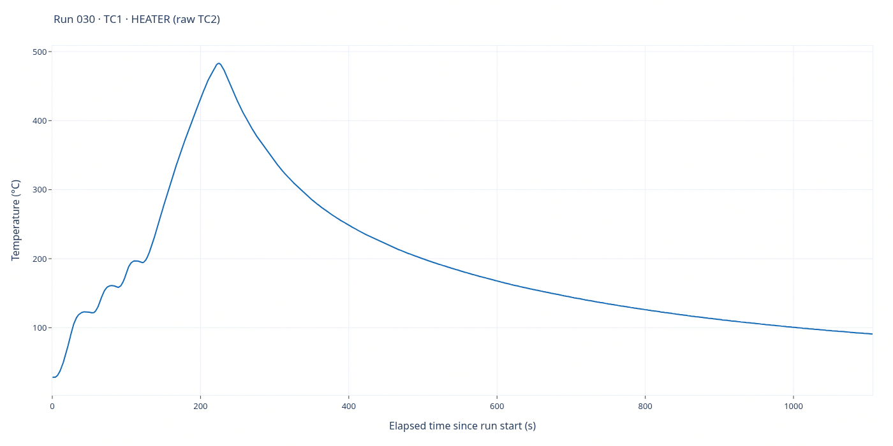
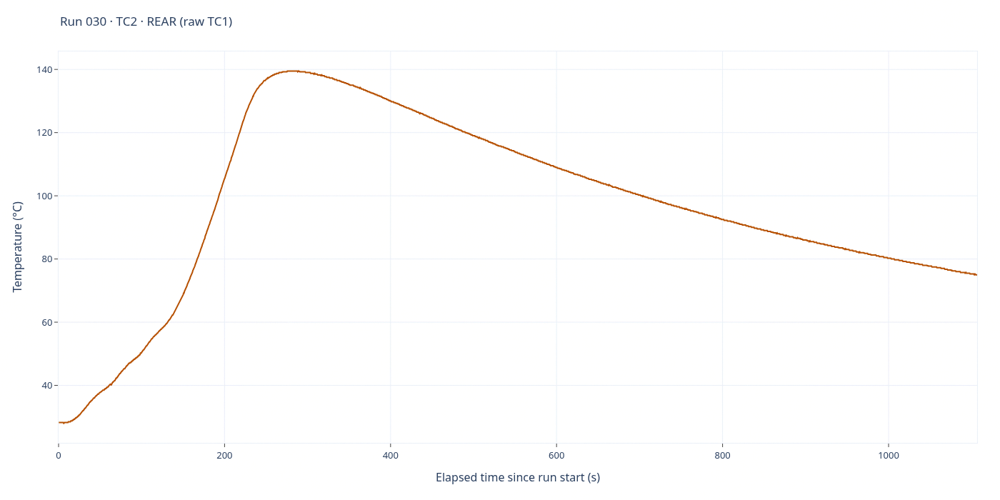

# Run 030 — EXP5 repeat: rear cutoff 120 °C tripped

2026-11-09 20:03 UTC · 100 V · 18:26 long · partial

**Setup:** Barrier not recorded. Semi-gravelly sand. McMaster 4877K305 cartridge, 300 W at 120 V (no internal TC), 100 V preset.

Same program as 028, run straight after. The rear rose much faster (fitted rear gain 0.43 vs 0.20) and tripped the 120 °C cutoff at 3:38 with the heater side only at 483 °C. Something in the stack or the rear TC's contact changed between 028 and 030; not recorded.

| | |
|---|---|
| TC1 Heater side peak | 483.0 °C at 3:45 |
| TC2 Barrier rear peak | 139.5 °C at 4:50 |
| TC1 reached 100 °C after heat on | 0:27 |
| TC1 reached 200 °C after heat on | 2:06 |
| TC1 reached 400 °C after heat on | 3:08 |
| TC2 rise | 111.2 °C |
| Fitted rear gain | 0.42 (±10.1 °C) |
| Relay on | 2:29 |

## Comments

**2026-11-09 closeout — EXP5 rear-cutoff trip; no completed 700°C/60s hold.**
Logical heater/cartridge = raw `tc2_C`; logical rear/barrier = raw `tc1_C`.
The CSV columns remain in raw physical-channel order. Board-applied settings
were final target700°C, heater cutoff730°C, rear cutoff120°C enabled/required,
hysteresis3°C, prediction lead5s, minimum OFF5s, hold band±5°C and60s elapsed
final hold. Saved100V is manual-preset metadata, not a measured or
software-controlled voltage.

EXP5 START request3 was acknowledged at20:03:04.220 UTC; NEXT request4 at
20:03:32.317 UTC; BOOST_FINAL was reported at20:05:11.654 UTC. At
**20:06:42.606 UTC**, the controller reported **TRIPPED / BOOST_FINAL /
TC2_LIMIT / heater_on=false**. This was the logical rear (raw TC1) cutoff, not
an assistant-issued STOP; commanded OFF is telemetry, not independent proof of
power removal. Recording continued until stopped by command at20:21:31.018 UTC.

| Quantity | Result |
|---|---:|
| Saved samples | 2215 |
| First→last sample span | 1106.446s (18m26.446s) |
| First / last sample UTC | 20:03:04.417 / 20:21:30.863 |
| Initial heater/rear | 28.0 / 28.25°C |
| Maximum heater, UTC20:06:48.300 | 483.0°C |
| Maximum rear, UTC20:07:39.775 | 139.5°C |
| Trip→last saved sample | 888.257s (14m48.257s) |
| Final saved heater/rear | 90.75 / 75.0°C |

No saved heater sample reached700°C, and the events contain neither HOLD_FINAL
nor COMPLETE. This run is therefore not recorded as a successful final-target
test. All saved temperatures are finite, flags are empty and all samples belong
to epoch4. Raw CSV, events and original configuration/metadata snapshots are
unchanged; only this closeout was appended.

Files: [data.csv](data.csv) · [events.csv](events.csv) · [experiment-applied.json](experiment-applied.json) · [experiment.toml](experiment.toml) · [heater.png](heater.png) · [notes.md](notes.md) · [rear.png](rear.png) · [run-metadata.json](run-metadata.json)
