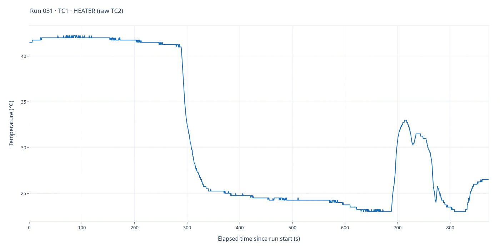
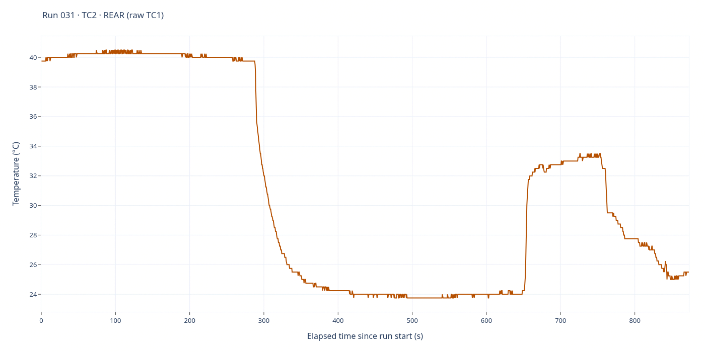

# Run 031 — Supporting acquisition

[All runs](../README.md) · [Raw CSV](data.csv) · [Event log](events.csv) · [Run notes](notes.md) · [Run metadata](run-metadata.json) · [Interactive report](report.html)

Supporting acquisition with retained EXP5 role/voltage metadata. No EXP5 START or applied-settings snapshot is recorded in this folder; metadata alone does not establish active heating.

**1,747 saved sample rows.** Full elapsed-time range; no smoothing, downsampling or voltage scaling. Each graph has its own temperature axis. See [run notes](notes.md) for the dated closeout.

## TC1 — heater

Saved-source interpretation: **TC1 · HEATER (raw TC2)**. 1,747 finite readings out of 1,747 saved rows.

## TC2 — rear

Saved-source interpretation: **TC2 · REAR (raw TC1)**. 1,747 finite readings out of 1,747 saved rows.

## Source and interactive viewing

The PNGs are1400×700 renders of the full-data Plotly traces in `report.html` and display directly on GitHub. Download/open the HTML locally for zoom, hover and export; GitHub does not execute its JavaScript. Regenerate HTML with `python host/report.py runs/031`; static PNGs are snapshots, not live views.

CSV SHA-256: `5c2a743b72c529dfd8e92c640f7465007b4dd3ff464bee7d3c93ae82e4a70d78`.

Role labels follow saved/legacy mapping rules; consult the run notes for probe-placement corrections and validity limitations. Original CSV, event log, settings and role metadata are unchanged by rendering. The dated publication closeout is appended below the original notes' Comments heading.
