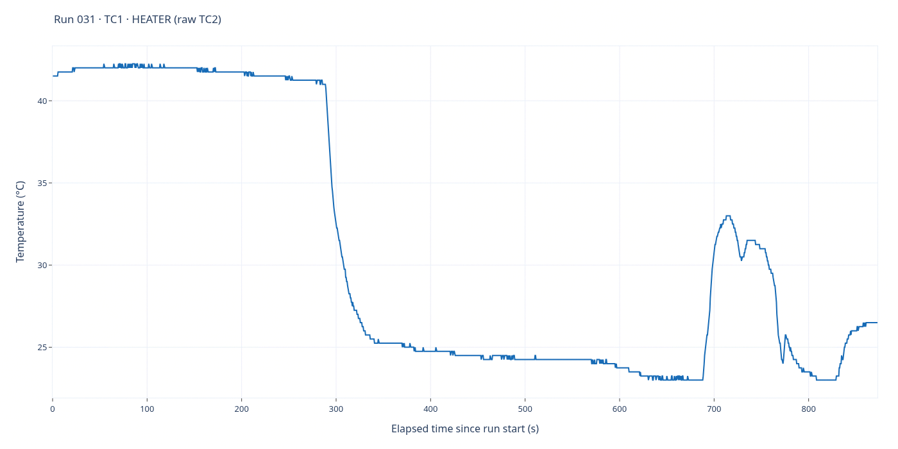
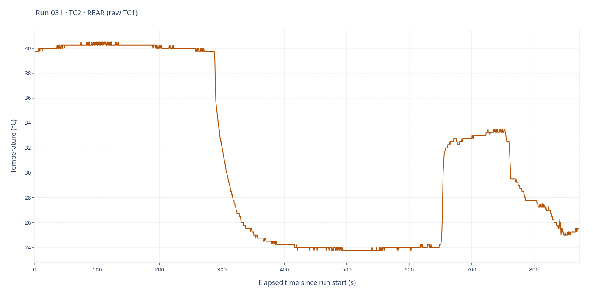

# Run 031 — Idle recording (no heating)

2026-11-09 12:33 PST · 14:33 long · idle

Logging only: the DAQ recorded while the rig sat idle, between starts, or while wiring. Kept for completeness.

| | |
|---|---|
| TC1 Heater side peak | 42.2 °C at 1:58 |
| TC2 Barrier rear peak | 40.5 °C at 2:14 |
| TC2 rise | 0.8 °C |

## Comments

**2026-11-09 closeout — supporting acquisition, not an EXP5 heating test.**
Logical heater/cartridge = raw `tc2_C`; logical rear/barrier = raw `tc1_C`.
The CSV columns remain in raw physical-channel order. Retained `exp5`,
`swap_inputs=true` and 100V metadata describe the session mapping/manual preset,
not applied heating settings or a measured voltage. This run has no applied
experiment snapshot and no EXP5 START in its own event log; its events contain
only recording creation and **Restarted by command** at20:47:42.593 UTC.

| Quantity | Result |
|---|---:|
| Saved samples | 1747 |
| First→last sample span | 872.558s (14m32.558s) |
| First / last sample UTC | 20:33:09.806 / 20:47:42.364 |
| Initial heater/rear | 41.5 / 39.75°C |
| Maximum heater, UTC20:34:03.779 | 42.25°C |
| Maximum rear, UTC20:34:23.771 | 40.5°C |
| Final saved heater/rear | 26.5 / 25.5°C |

The measurements show cooldown/ambient-range acquisition, not execution or
completion of the EXP5 heating sequence. All saved temperatures are finite,
flags are empty and all samples belong to epoch5. Raw CSV, events and metadata
are unchanged; only this closeout was appended.

Files: [data.csv](data.csv) · [events.csv](events.csv) · [heater.png](heater.png) · [notes.md](notes.md) · [rear.png](rear.png) · [run-metadata.json](run-metadata.json)
