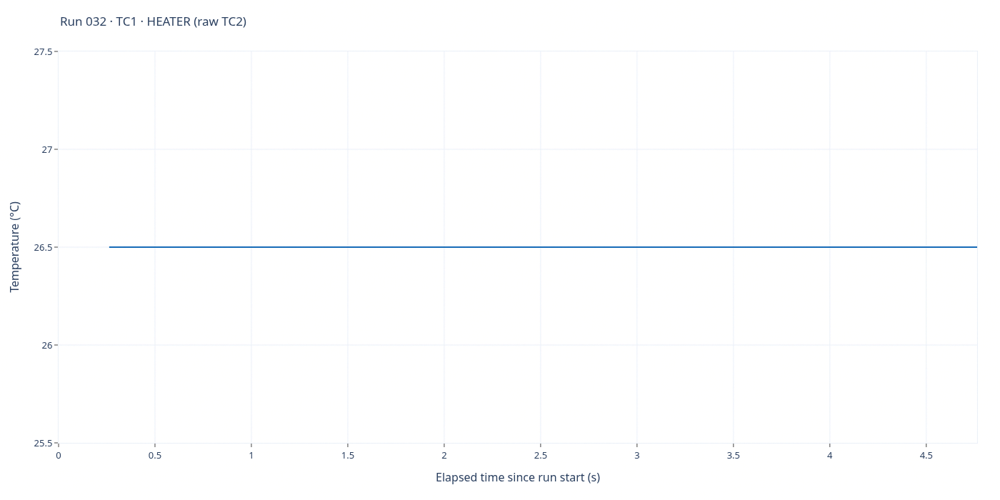
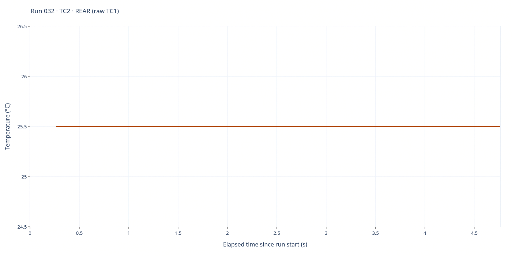

# Run 032 — Idle recording (no heating)

2026-11-09 20:47 UTC · 0:04 long · idle

Logging only: the DAQ recorded while the rig sat idle, between starts, or while wiring. Kept for completeness.

| | |
|---|---|
| TC1 Heater side peak | 26.5 °C at 0:05 |
| TC2 Barrier rear peak | 25.5 °C at 0:05 |
| TC2 rise | 0.0 °C |

## Comments

**2026-11-09 closeout — short transition acquisition, not an EXP5 heating test.**
Logical heater/cartridge = raw `tc2_C`; logical rear/barrier = raw `tc1_C`.
The CSV columns remain in raw physical-channel order. Retained `exp5`,
`swap_inputs=true` and 100V metadata describe the session mapping/manual preset,
not applied heating settings or a measured voltage. This run has no applied
experiment snapshot and no EXP5 START in its own event log.

The recording was finalized before Experiment 5 at **20:47:47.604 UTC**; run033
then received the EXP5 START. Run032 contains only the short interval between
the run031 restart and that new controlled recording.

| Quantity | Result |
|---|---:|
| Saved samples | 10 |
| First→last sample span | 4.501s |
| First / last sample UTC | 20:47:42.864 / 20:47:47.365 |
| Initial heater/rear | 26.5 / 25.5°C |
| Maximum heater/rear | 26.5 / 25.5°C |
| Final saved heater/rear | 26.5 / 25.5°C |

All saved temperatures are finite, flags are empty and all samples belong to
epoch5. Raw CSV, events and metadata are unchanged; only this closeout was
appended.

Files: [data.csv](data.csv) · [events.csv](events.csv) · [heater.png](heater.png) · [notes.md](notes.md) · [rear.png](rear.png) · [run-metadata.json](run-metadata.json)
