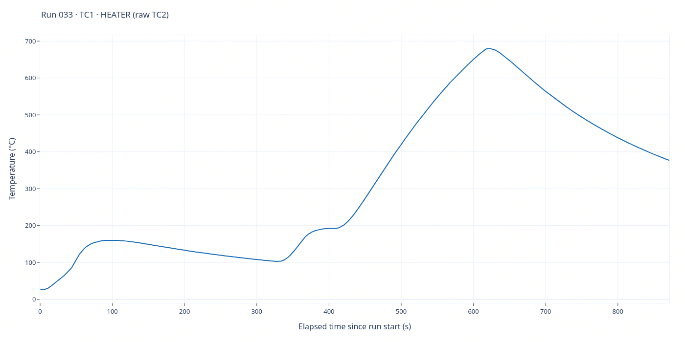
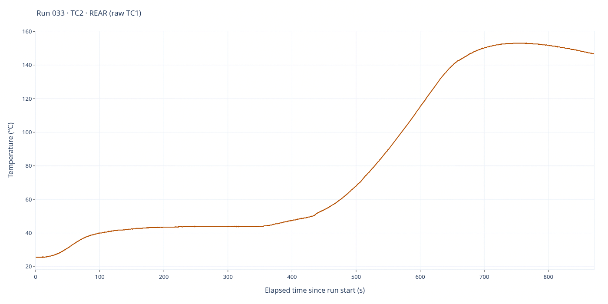

# Run 033 — EXP5 repeat: rear cutoff 120 °C tripped

2026-11-09 12:47 PST · 100 V · 14:31 long · partial

**Setup:** Barrier not recorded. Semi-gravelly sand. McMaster 4877K305 cartridge, 300 W at 120 V (no internal TC), 100 V preset.

Third EXP5 that afternoon. NEXT was refused for minutes by the old software's 95-105 °C window while the heater side sat at 156 °C (the operator's complaint). After the ramp, the rear tripped 120 °C at 10:10 with the heater side at 680 °C; rear peaked 153 °C. Fitted rear gain 0.28.

| | |
|---|---|
| TC1 Heater side peak | 679.8 °C at 10:23 |
| TC2 Barrier rear peak | 153.0 °C at 12:46 |
| TC1 reached 100 °C after heat on | 0:47 |
| TC1 reached 200 °C after heat on | 6:59 |
| TC1 reached 400 °C after heat on | 8:12 |
| TC1 reached 600 °C after heat on | 9:33 |
| TC2 rise | 127.5 °C |
| Fitted rear gain | 0.28 (±3.3 °C) |
| Relay on | 4:44 |

## Comments

**2026-11-09 closeout — EXP5 rear-cutoff trip; no completed 700°C/60s hold.**
Logical heater/cartridge = raw `tc2_C`; logical rear/barrier = raw `tc1_C`.
The CSV columns remain in raw physical-channel order. Board-applied settings
were final target700°C, heater cutoff730°C, rear cutoff120°C enabled/required,
hysteresis3°C, prediction lead5s, minimum OFF5s, hold band±5°C and60s elapsed
final hold. Saved100V is manual-preset metadata, not a measured or
software-controlled voltage.

EXP5 START request5 was acknowledged at20:47:47.668 UTC. After a later valid
HOLD_100 report, the saved events record normal NEXT request6 acknowledged at
**20:53:03.506 UTC**. BOOST_FINAL was reported at20:54:47.949 UTC. At
**20:57:57.344 UTC**, the controller reported **TRIPPED / BOOST_FINAL /
TC2_LIMIT / heater_on=false**. This was the logical rear (raw TC1) cutoff, not
an assistant-issued STOP; commanded OFF is telemetry, not independent proof of
power removal. Recording continued until stopped by command at21:02:19.078 UTC.

| Quantity | Result |
|---|---:|
| Saved samples | 1744 |
| First→last sample span | 871.041s (14m31.041s) |
| First / last sample UTC | 20:47:47.865 / 21:02:18.906 |
| Initial heater/rear | 26.5 / 25.5°C |
| Maximum heater, UTC20:58:08.035 | 679.75°C |
| Maximum rear, UTC21:00:12.471 | 153.0°C |
| Trip→last saved sample | 261.562s (4m21.562s) |
| Final saved heater/rear | 376.5 / 146.5°C |

No saved heater sample reached700°C, and the events contain neither HOLD_FINAL
nor COMPLETE. This run is therefore not recorded as a successful final-target
test. All saved temperatures are finite, flags are empty and all samples belong
to epoch5. Raw CSV, events and original configuration/metadata snapshots are
unchanged; only this closeout was appended.

Files: [data.csv](data.csv) · [events.csv](events.csv) · [experiment-applied.json](experiment-applied.json) · [experiment.toml](experiment.toml) · [heater.png](heater.png) · [notes.md](notes.md) · [rear.png](rear.png) · [run-metadata.json](run-metadata.json)
