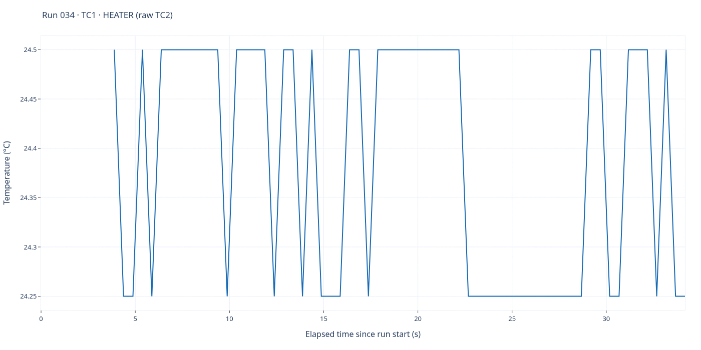
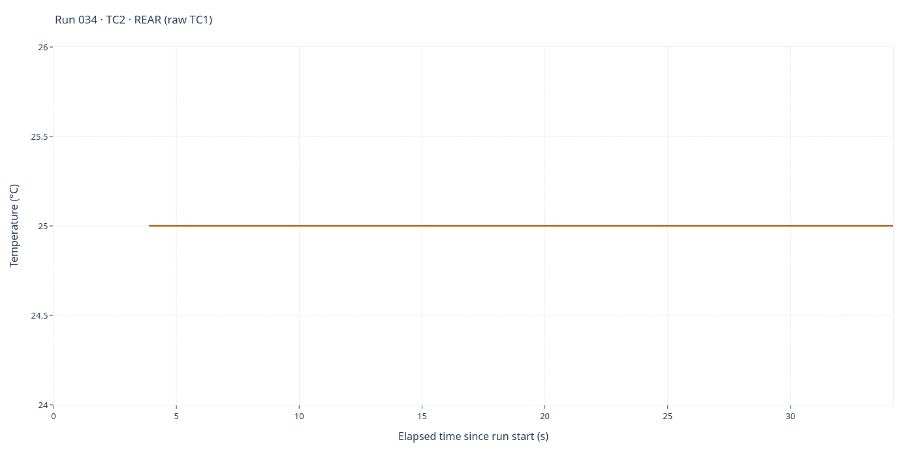

# Run 034 — pre-EXP6 supporting recording

[All runs](../README.md) · [Raw CSV](data.csv) · [Event log](events.csv) · [Run notes](notes.md) · [Run metadata](run-metadata.json) · [Interactive report](report.html)

Room-temperature idle acquisition before EXP6 START (board IDLE, no heating); retained as supporting history. Includes a serial reconnect/board reset.

**59 saved sample rows.** Full elapsed-time range; no smoothing, downsampling or voltage scaling. Each graph has its own temperature axis.

## TC1 — heater

Saved-source interpretation: **TC1 · HEATER (raw TC2)**. 59 finite readings out of 59 saved rows.

## TC2 — rear

Saved-source interpretation: **TC2 · REAR (raw TC1)**. 59 finite readings out of 59 saved rows.

