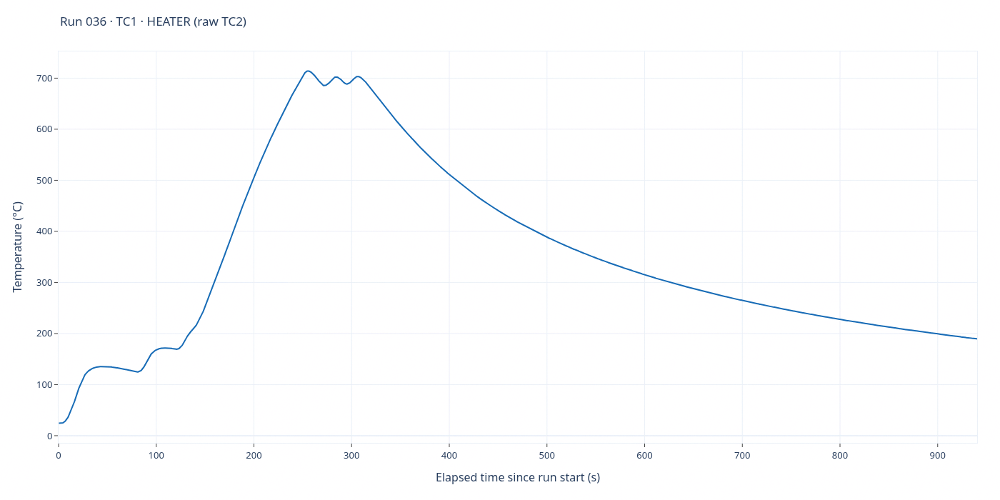
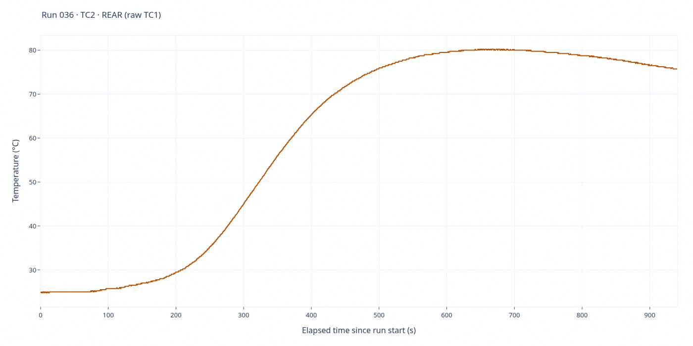

# Run 036 — Test 5: 1 mica / 2 fiberglass / 1 Al, 700 °C 60 s

2026-11-13 10:01 PST · 100 V · 15:40 long · test

**Setup:** 1 mica (0.032 in) / 2 fiberglass heat-barrier strip (McMaster 4234N12, 0.045 in) / 1 aluminum. Fine, less rocky sand (from run 034). McMaster 4877K305 cartridge, 300 W at 120 V (no internal TC), 100 V preset.

EXP6 (EXP5 with NEXT allowed any time). Completed the 60 s hold at 700 °C. Heater on 176 s in total. Rear rose 55.5 °C and peaked 7.4 minutes after the heater-side peak, during cooldown. Fitted rear gain 0.20 (±1.1 °C). Compare with run 040.

| | |
|---|---|
| TC1 Heater side peak | 714.0 °C at 4:16 |
| TC2 Barrier rear peak | 80.2 °C at 11:40 |
| TC1 reached 100 °C after heat on | 0:22 |
| TC1 reached 200 °C after heat on | 2:13 |
| TC1 reached 400 °C after heat on | 2:58 |
| TC1 reached 600 °C after heat on | 3:41 |
| TC1 reached 700 °C after heat on | 4:08 |
| TC2 rise | 55.5 °C |
| Fitted rear gain | 0.20 (±1.1 °C) |
| Relay on | 2:56 |

## Comments

- 2026-11-13 correction (operator): the barrier in this run was 2 layers of the fiberglass heat barrier strip, not the ceramic fiber pipe insulation. The barrier line above, run-metadata.json and experiment.toml were corrected after the run; data.csv and events.csv are unchanged.
- Result: EXP6 completed. NEXT sent from HEAT_100 at 18:02:44 UTC; heater first measured >=700 C at 18:06:02 (249.2 s), peaked 714.0 C, 60 s hold completed at 18:07:02 (HOLD_COMPLETE, heat OFF). Rear peaked 80.25 C at 18:12:34 during cooldown (642.0 s); the 120 C rear cutoff was never reached. 1882 samples, no sensor faults.

- Sand: fine, less rocky sand used from run034 onward (2026-11-13); earlier runs used a semi-gravelly sand.

Files: [data.csv](data.csv) · [events.csv](events.csv) · [experiment-applied.json](experiment-applied.json) · [experiment.toml](experiment.toml) · [heater.png](heater.png) · [notes.md](notes.md) · [rear.png](rear.png) · [run-metadata.json](run-metadata.json)
