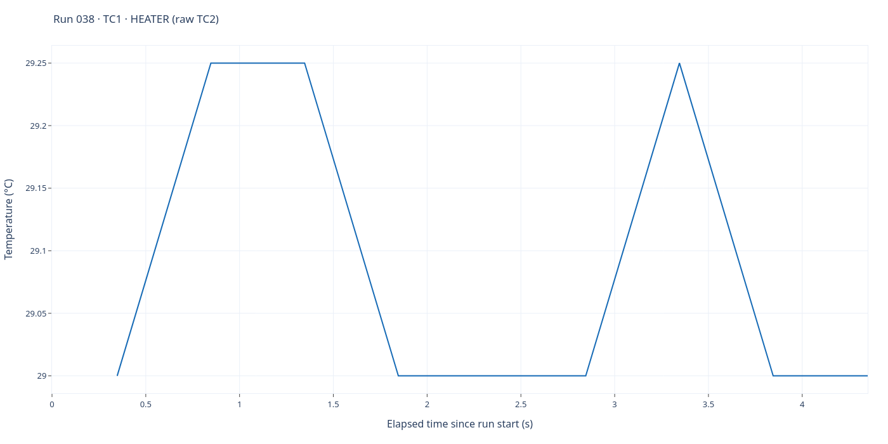
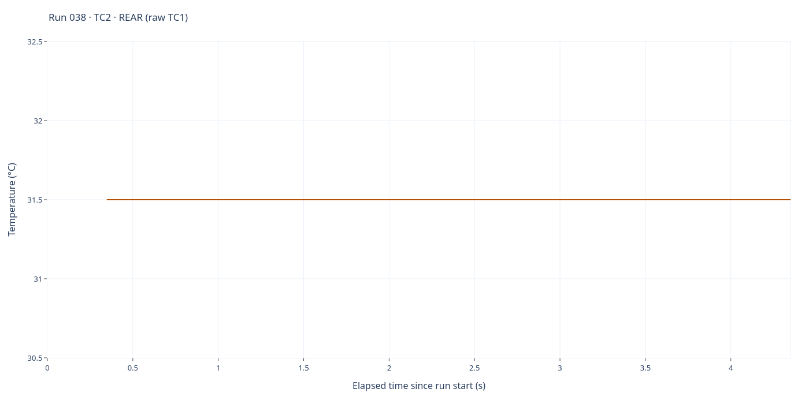

# Run 038 — EXP6 start aborted after 4 s

2026-11-13 10:45 PST · 100 V · 0:04 long · partial

**Setup:** 1 mica / 3 ceramic fiber / 1 Al.

Started and stopped after 4 s; not a test.

| | |
|---|---|
| TC1 Heater side peak | 29.2 °C at 0:03 |
| TC2 Barrier rear peak | 31.5 °C at 0:04 |
| TC2 rise | 0.0 °C |
| Relay on | 0:04 |

## Comments

- Aborted EXP6 START: START at 18:45:57 UTC, heater commanded ON at 18:45:58, operator STOP acknowledged at 18:46:02 (heat OFF). 9 samples; not a test.

- Sand: fine, less rocky sand used from run034 onward (2026-11-13); earlier runs used a semi-gravelly sand.

Files: [data.csv](data.csv) · [events.csv](events.csv) · [experiment-applied.json](experiment-applied.json) · [experiment.toml](experiment.toml) · [heater.png](heater.png) · [notes.md](notes.md) · [rear.png](rear.png) · [run-metadata.json](run-metadata.json)
