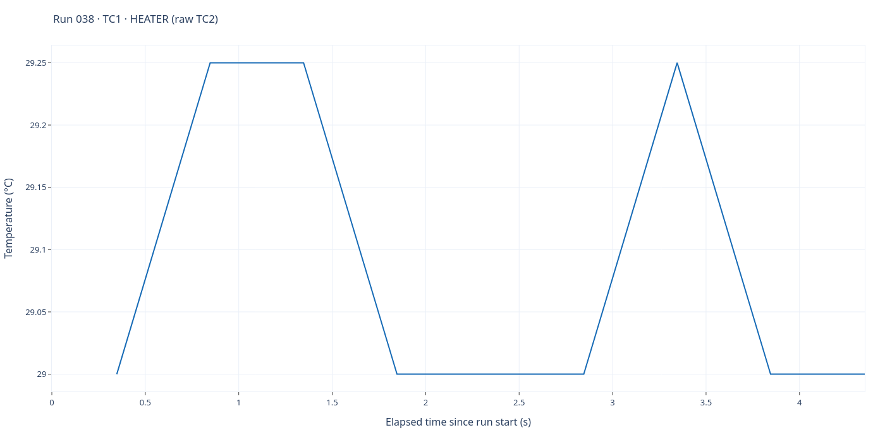
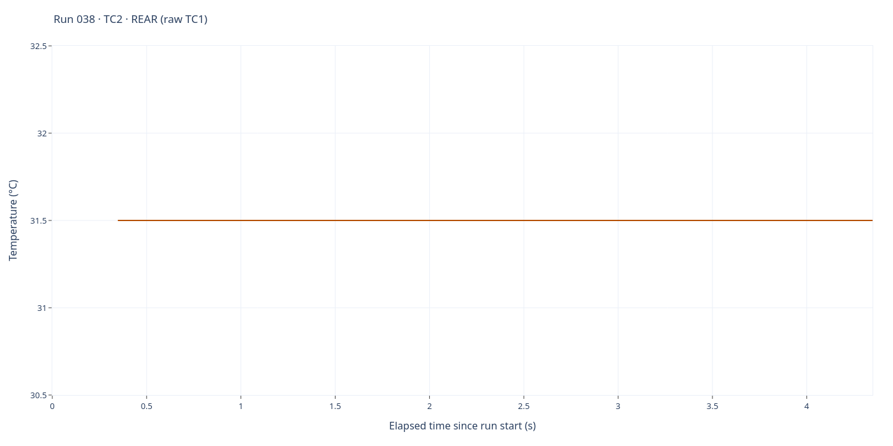

# Run 038 — aborted EXP6 START

[All runs](../README.md) · [Raw CSV](data.csv) · [Event log](events.csv) · [Run notes](notes.md) · [Run metadata](run-metadata.json) · [Selected settings](experiment.toml) · [Applied settings](experiment-applied.json) · [Interactive report](report.html)

EXP6 START at 18:45:57 UTC, stopped by the operator 4 s later (heat OFF). Not a test.

**9 saved sample rows.** Full elapsed-time range; no smoothing, downsampling or voltage scaling. Each graph has its own temperature axis.

## TC1 — heater

Saved-source interpretation: **TC1 · HEATER (raw TC2)**. 9 finite readings out of 9 saved rows.

## TC2 — rear

Saved-source interpretation: **TC2 · REAR (raw TC1)**. 9 finite readings out of 9 saved rows.

