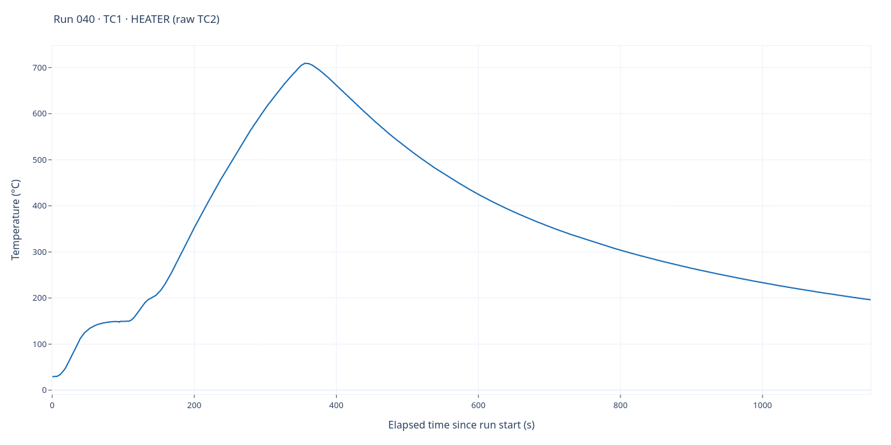
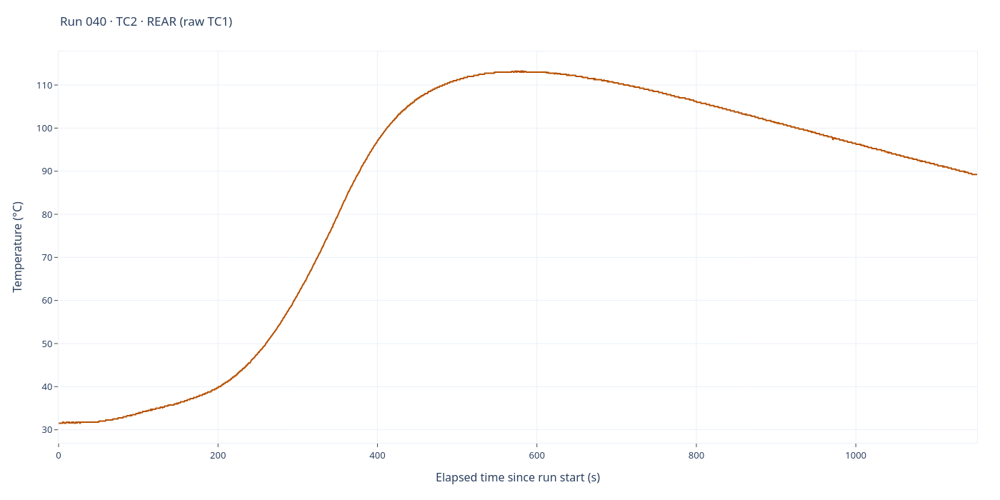

# Run 040 — Test 6: 1 mica / 3 ceramic fiber / 1 Al; cartridge died

2026-11-13 18:46 UTC · 100 V · 19:12 long · test

**Setup:** 1 mica (0.032 in) / 3 ceramic fiber pipe insulation (alumina, McMaster 87575K35, 1/32 in) / 1 aluminum. Fine sand. McMaster 4877K305 cartridge, 300 W at 120 V (no internal TC), 100 V preset.

Same program as 036, different barrier. Reached 700 °C 1.7 min later than 036 and needed 294 s of heating (036: 176 s), so more energy went in; the rear rose 82 °C (036: 55.5 °C). Fitted rear gain is the same as 036 (0.20), so most of the difference is the extra heat input, not the barrier. A re-heat during the hold at 18:52:48 produced no rise: the cartridge had failed (measured open circuit afterwards). Likely cause: the inside of the cartridge ran far hotter than the external TC's ~700 °C (the thermal model puts the core hundreds of degrees above the surface during fast heating), past its 760 °C rating, in sand that sheds heat poorly.

| | |
|---|---|
| TC1 Heater side peak | 709.5 °C at 5:58 |
| TC2 Barrier rear peak | 113.2 °C at 9:46 |
| TC1 reached 100 °C after heat on | 0:35 |
| TC1 reached 200 °C after heat on | 2:18 |
| TC1 reached 400 °C after heat on | 3:36 |
| TC1 reached 600 °C after heat on | 4:54 |
| TC1 reached 700 °C after heat on | 5:47 |
| TC2 rise | 81.8 °C |
| Fitted rear gain | 0.20 (±3.0 °C) |
| Relay on | 4:54 |

## Comments

- Result: EXP6 completed (actual test 6). Barrier 1 mica / 3 layers ceramic fiber pipe insulation / 1 aluminum. NEXT from HEAT_100 at 18:47:28 UTC; BOOST_FINAL 18:48:53; heater first measured >=700 C at 18:52:21 (347.7 s), peaked 709.5 C; 60 s hold complete at 18:53:21 (HOLD_COMPLETE, heat OFF). Rear peaked 113.25 C at 18:56:02 (568.5 s), during cooldown; the 120 C rear cutoff was not reached. Cooldown recorded to STOP at 19:05:46. 2306 samples, no sensor faults.

- Sand: fine, less rocky sand used from run034 onward (2026-11-13); earlier runs used a semi-gravelly sand.

- Cartridge failed during this run: the heater was commanded back ON at 18:52:48 UTC (reading 695.75 C) and stayed ON 33 s until HOLD_COMPLETE, but the reading kept falling at -1.41 C/s, the same rate as after heat OFF (-1.46 C/s). In run036 the same re-heat gave +0.5 C/s. The cartridge last delivered heat at the end of the full-power boost, around the 709.5 C peak at 18:52:29-18:52:48.

Files: [data.csv](data.csv) · [events.csv](events.csv) · [experiment-applied.json](experiment-applied.json) · [experiment.toml](experiment.toml) · [heater.png](heater.png) · [notes.md](notes.md) · [rear.png](rear.png) · [run-metadata.json](run-metadata.json)
