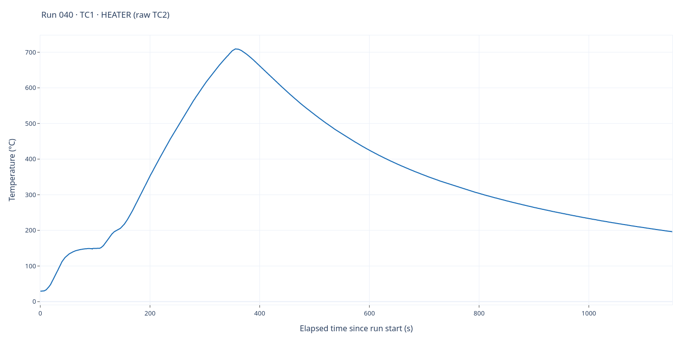
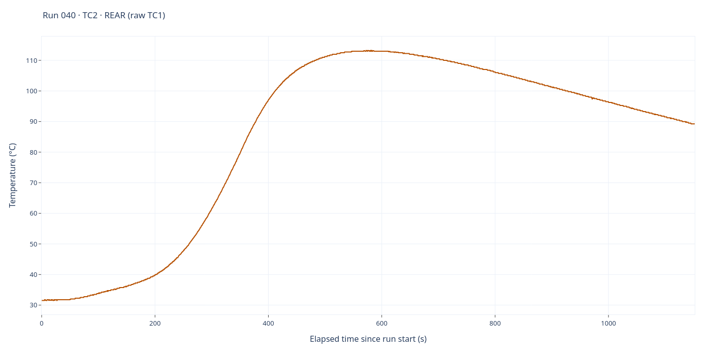

# Run 040 — EXP6 / actual test 6

[All runs](../README.md) · [Raw CSV](data.csv) · [Event log](events.csv) · [Run notes](notes.md) · [Run metadata](run-metadata.json) · [Selected settings](experiment.toml) · [Applied settings](experiment-applied.json) · [Interactive report](report.html)

**Barrier: 1 layer mica / 3 layers ceramic fiber pipe insulation (McMaster 87575K35) / 1 thin aluminum sheet.**

EXP6 completed: NEXT from HEAT_100 at 18:47:28 UTC, heater first measured ≥700°C at 18:52:21 (347.7 s), peak 709.5°C, 60-second hold complete at 18:53:21 and heat OFF. Rear peaked at **113.25°C** at 568.5 s, during cooldown; the 120°C rear cutoff was not reached. No sensor faults.

**2,306 saved sample rows.** Full elapsed-time range; no smoothing, downsampling or voltage scaling. Each graph has its own temperature axis.

## TC1 — heater

Saved-source interpretation: **TC1 · HEATER (raw TC2)**. 2,306 finite readings out of 2,306 saved rows.

## TC2 — rear

Saved-source interpretation: **TC2 · REAR (raw TC1)**. 2,306 finite readings out of 2,306 saved rows.

