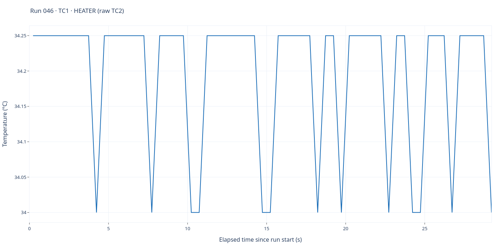
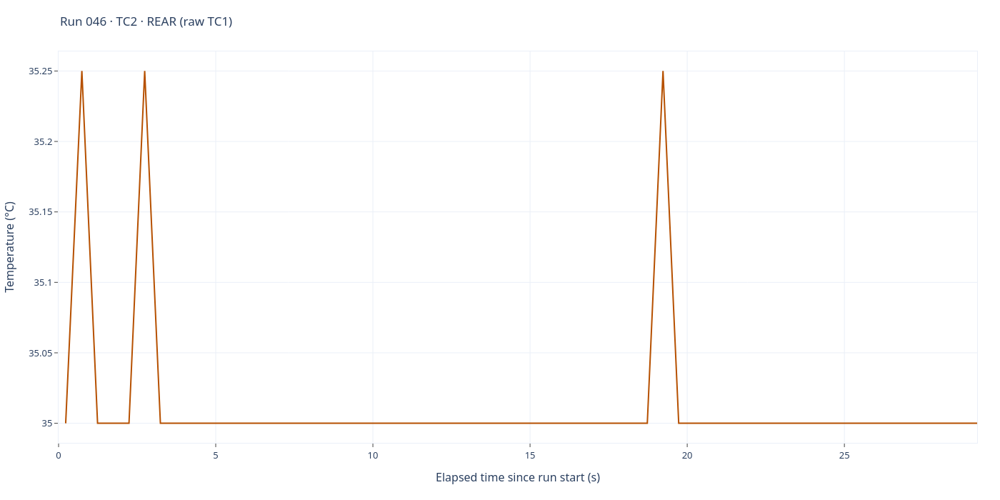

# Run 046 — control attempt, dead cartridge

[All runs](../README.md) · [Raw CSV](data.csv) · [Event log](events.csv) · [Run notes](notes.md) · [Run metadata](run-metadata.json) · [Selected settings](experiment.toml) · [Applied settings](experiment-applied.json) · [Interactive report](report.html)

Control attempt, EXP6 START; heater commanded ON ~29 s with no rise; operator STOP. Dead cartridge.

Cartridge failure: after run040 the cartridge produced no heat. The heater was commanded ON and the heater reading did not rise; the operator measured about 108 V at the cartridge with no heating.

**59 saved sample rows.** Full elapsed-time range; no smoothing, downsampling or voltage scaling. Each graph has its own temperature axis.

## TC1 — heater

Saved-source interpretation: **TC1 · HEATER (raw TC2)**.

## TC2 — rear

Saved-source interpretation: **TC2 · REAR (raw TC1)**.

