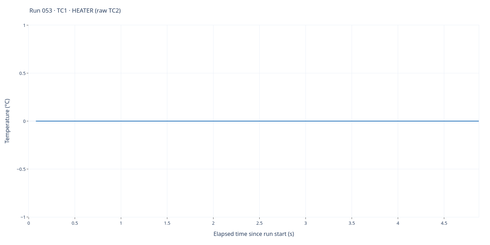
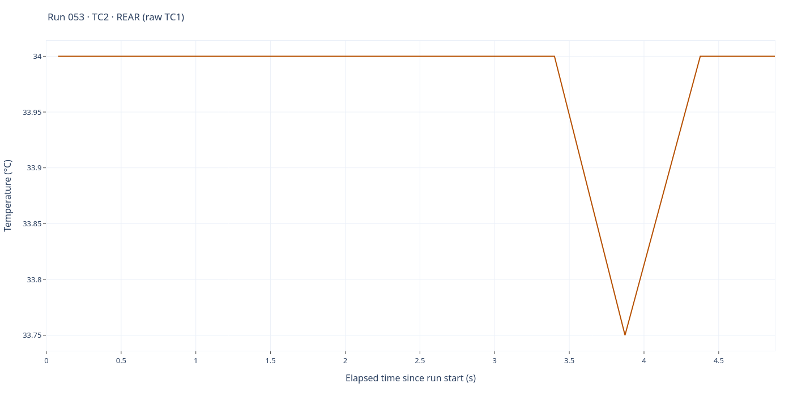

# Run 053 — Idle recording (no heating)

2026-11-13 19:38 UTC · 0:05 long · idle

Logging only: the DAQ recorded while the rig sat idle, between starts, or while wiring. Kept for completeness.

| | |
|---|---|
| TC2 Barrier rear peak | 34.0 °C at 0:05 |

## Comments

- Idle/reconnect recording between control attempts; no heating.
- Sand: fine, less rocky sand used from run034 onward (2026-11-13); earlier runs used a semi-gravelly sand.

Files: [data.csv](data.csv) · [events.csv](events.csv) · [heater.png](heater.png) · [notes.md](notes.md) · [rear.png](rear.png) · [run-metadata.json](run-metadata.json)
