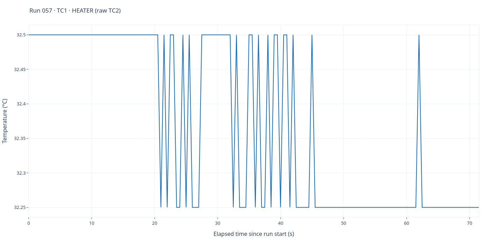
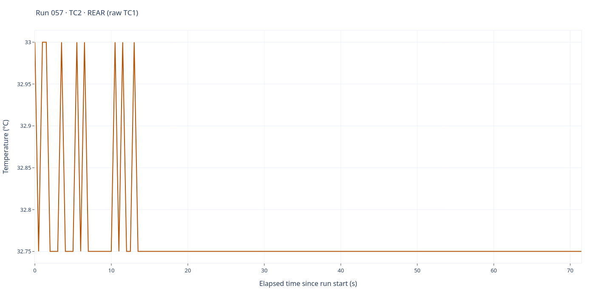

# Run 057 — Dead cartridge: heat commanded, no rise

2026-11-13 11:41 PST · 100 V · 1:12 long · failure

**Setup:** Control stack: 1 aluminum sheet only.

After run 040's cartridge failure: about 4.5 minutes of heat in total across these runs and no temperature rise. 108 V measured at the cartridge, open circuit across it. Several also show the heater-side TC reading 0.00 (wiring fault).

| | |
|---|---|
| TC1 Heater side peak | 32.5 °C at 1:02 |
| TC2 Barrier rear peak | 33.0 °C at 0:13 |
| TC2 rise | 0.0 °C |
| Relay on | 1:10 |

## Comments

- Control attempt, EXP6 START; heater commanded ON ~71 s with no rise; operator STOP. Dead cartridge.
- Cartridge failure: after run040 the cartridge produced no heat. The heater was commanded ON and the heater reading did not rise; the operator measured about 108 V at the cartridge with no heating.
- Sand: fine, less rocky sand used from run034 onward (2026-11-13); earlier runs used a semi-gravelly sand.

Files: [data.csv](data.csv) · [events.csv](events.csv) · [experiment-applied.json](experiment-applied.json) · [experiment.toml](experiment.toml) · [heater.png](heater.png) · [notes.md](notes.md) · [rear.png](rear.png) · [run-metadata.json](run-metadata.json)
